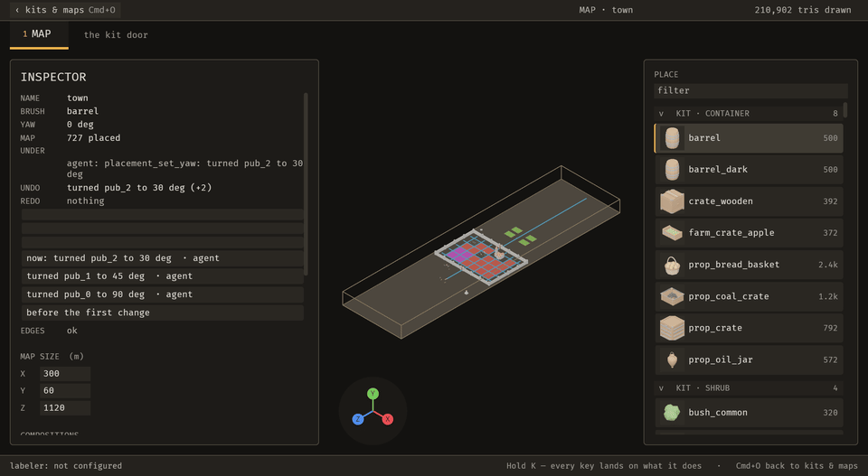
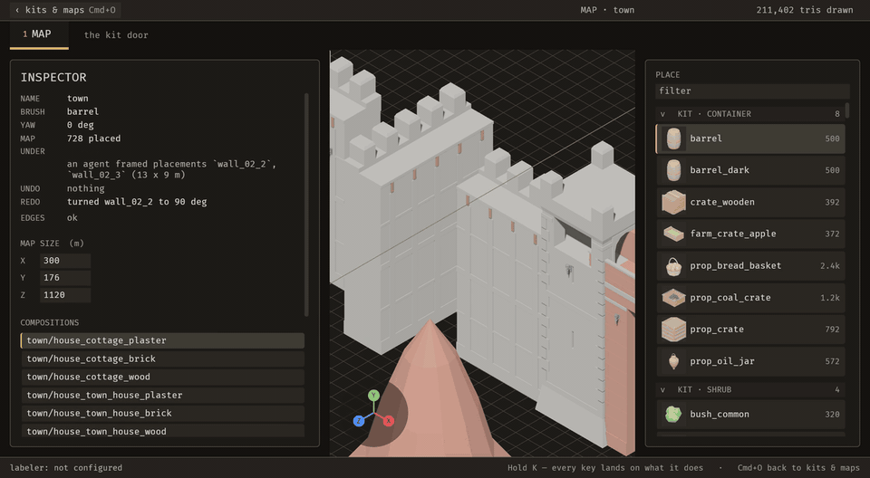
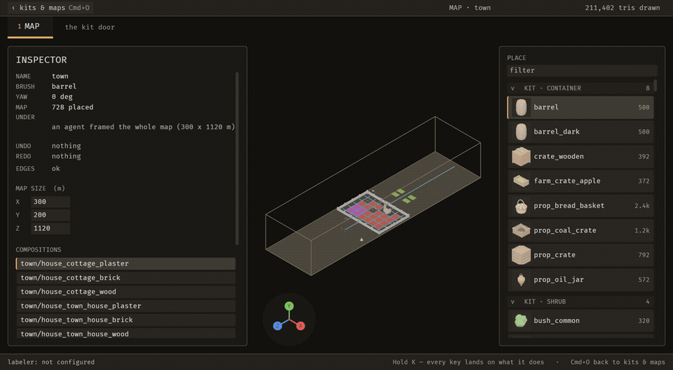
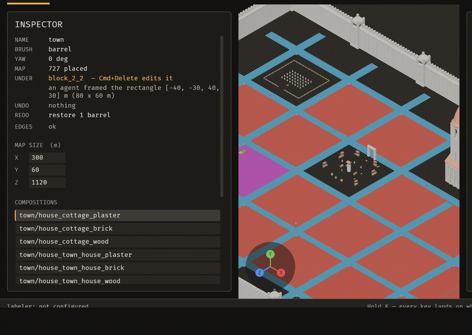
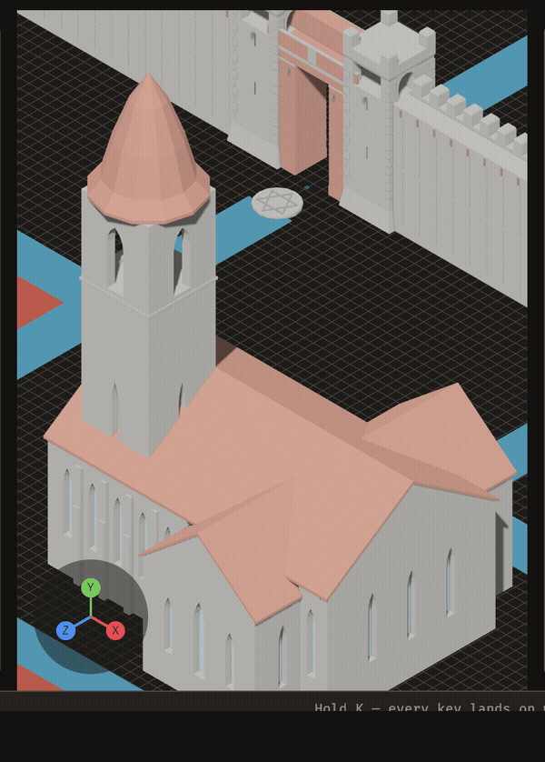
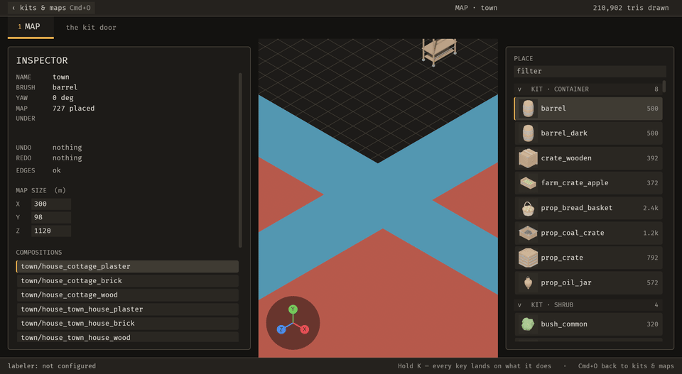
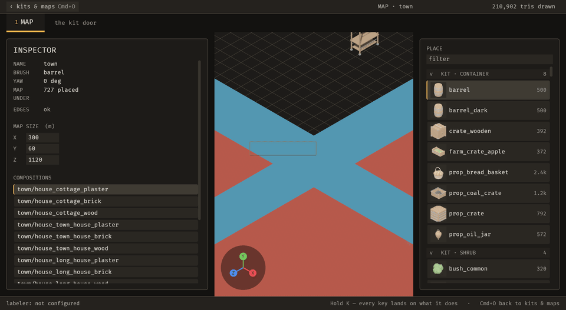

# Changelog

What each change added, newest first. A visible change has a clip: click the still to play it. `python3 tools/changelog/changelog.py page --open` plays them all in one page.

## 2026-10-29

- **115-s5** `8316c61` Rows laid by hand turn into a run: placements_to_run, or Cmd-drag in run mode *No clip: an operation; proved by rows_become_a_run_through_an_operation*
- **115-live-diff** `3b51545` The live reload names an edited run once by its id, not each of its rows (#115) *No clip: an API; proved by crates/bevy_emerge_core/tests/live_diff_names_runs.rs*
- **98-panel-season-climate** `0ffc53a` Environment panel: season and climate preset buttons, each one undo step (#98, slice 5) *No clip: visible, not yet recorded: no clip pass on this machine yet; proved by tests/environment_applies.rs the_panels_season_and_climate_buttons_are_one_undo_step_each*
- **98-launch** `e7866f0` Family settings already in the project at launch apply at once, so the environment preview is dressed without an edit *No clip: a launch-time bug fix; proved by tests/family_settings_at_launch.rs*
- **one-test-binary** `16fa7bb` The editor's integration tests build as one binary: the push gate's mapper build and run went from 815 s to 132 s *No clip: test infrastructure; proved by every_test_file_is_a_module_here and the timings in 16fa7bb*
- **n93-review** `pending` Review a done note: Keep it, or Undo this note reverts all its pieces as one step (#93 slice 2) *No clip: visible, not yet recorded: bmb has no clip run this pass*
- **93-s1** `6228546` Notes review rules: keep a done note, or undo its work unless a later change depends on it (#93 slice 1) *No clip: an engine-free API; proved by crates/bevy_emerge_core/tests/note_review.rs*
- **fix-118-black-viewport** `HEAD` With bevy_elements on, the editor viewport no longer goes black once the camera is dressed (#118): the HDR world and the interface are composed over each other *No clip: a bug fix to the camera output chain; proved by tests/a_dressed_camera_leaves_the_world_on_the_surface.rs and a live capture of the scratch town project*
- **E-051** `d59670d` Kit clicks no longer copy the whole project: a project's library, masks and kit layers are shared, and copied only when written *No clip: a performance refactor nobody can see; proved by crates/bevy_emerge_mapper/tests/project_clone_shares.rs*
- **92-fence** `ba9dfba` An agent holding a note is fenced: apply with its name refuses changes outside the area plus one cell, and removing a person's piece until it has asked and been answered (#92) *No clip: visible only in an agent's refusal; clip owed with the issue's end-to-end clip; proved by crates/bevy_emerge_mapper/tests/note_fence.rs*
- **#116** data_set, the Data panel and project.data_files read data.ron from the emerge directory, so a game under assets/emerge can change its tuning files *No clip: a path fix in three readers; proved by data_set_is_an_operation (7 tests)*
- **98-preview** `a32f56d` The editor viewport previews a map's sky, fog and clouds with bevy_elements (#98) *No clip: visible, not yet recorded: needs the noon/dusk/rain street on a display*
- **98-clock-scrub** `6e2fd82` Environment: the clock scrubber holds the preview at an hour of day with no file write and no undo step (#98, slice 2) *No clip: visible once the Environment panel lands, not yet recorded: no panel or preview yet; proved by tests/environment_applies.rs scrubbing_the_clock_moves_the_preview_clock_and_writes_nothing*
- **92b** `f295a70` Notes: an agent asks a question on a note, the person answers, and the agent resolves it with summary, assumptions, operations and two captures *No clip: visible, not yet recorded: no display on big*
- **notes-fence-core** `f97e646` Notes: the engine-free fence (area plus margin, ask-first thresholds), questions and answers, and the resolve record *No clip: core API, not yet wired to operations; proved by crates/bevy_emerge_core/tests/note_fence.rs*
- **113-mount-front** `8a90ab8` Decision-model labelling also proposes a piece's mount and front (#113 slice 2) *No clip: an API, labelling internals; proved by tests/decision_labels_mount_front.rs*
- **notes-claims** `e866c66` An agent claims a sent note over MCP: note_claim, note_renew, note_release leases, and emerge_state's notes bundle (text, area plus margin, pieces, palette, camera, earlier notes) *No clip: visible, not yet recorded: no display on big (the Claim, Renew and Release buttons on a note row); proved by bevy_emerge_core/tests/note_leases.rs and bevy_emerge_mapper/tests/note_claims.rs*
- **e98-environment-data** `c1a546b` A map's climate, date, clock and forced weather are saved in bevy_elements' own types and applied to the preview *No clip: an API and data layer, the Environment panel is the next slice; proved by environment_applies*
- **d5-decision-labels** `8308239` Labelling can ask a decision model one yes/no question per vocabulary token (EMERGE_LABEL_PATH=decide), with the chat path kept until measured *No clip: an editor setting, no new surface; proved by decide_labels::tests*
- **notes-panel** `cff4207` A Notes panel lists every note newest first, filters by status, sends all drafts, and a row frames its note *No clip: visible, not yet recorded: laptop pass did not record; proved by notes_listing and notes_panel_lists_every_note*
- **115-run-ops** `9a88580` Runs are edited through operations: run_add, run_set (move an end, change pitch, corners, gaps) and run_remove, each undone by id; Shift-drag in run mode lays a run the map holds, dragging a run's end moves it, a removal click takes it off whole (#115 slice 3) *No clip: visible, not yet recorded: Shift-drag run tool not filmed this pass; proved by tests/runs_are_edited_through_operations.rs*
- **E-066** `cce6e36` Undo takes away a map that map_create made, and redo puts its file back *No clip: an undo behaviour with no new screen; proved by a_made_map_can_be_taken_away_by_undo*
- **86-data-panel** `pending` The Data panel lists every registered data file's leaves; clicking one opens the field with its file and path typed (#86) *No clip: visible, not yet recorded: panel not captured on a display this pass*
- **data-set** `a046add` data_set: an agent or a person sets one leaf of a game's tuning file, logged and undoable *No clip: visible, not yet recorded: no display session this pass; the operation is proved by data_set_is_an_operation*
- **115-rows-to-run** `c20aa71` Rows that are one line convert to a run: Map::placements_to_run (#115 slice 2) *No clip: an API; proved by maps_hold_runs::rows_a_run_laid_convert_back_to_the_run and a_row_off_the_pitch_does_not_convert*
- **111-check-view** `cfdaeda` Check view: a button in the journal runs the project's checks on what is on screen, findings and a clear answer land in the journal (#111) *No clip: visible, not yet recorded: no display on big*
- **runs-in-maps** `4cc8a12` A map can hold a run (a fence as one line, not its rows); rows are laid on load as <id>/<n> *No clip: an API / data change; proved by crates/bevy_emerge_core/tests/maps_hold_runs.rs*
- **d3b-after-edit** `01aae83` An agent's applied operation now owes the project's after-edit checks once; a person's own edit owes none (#111 slice 3) *No clip: an internal trigger; proved by tests/an_agents_edit_owes_checks_a_persons_does_not.rs*
- **decide-d3b** emerge_decide over MCP: a named check or ad-hoc typed questions, a probability for every answer (#111 slice 2) *No clip: an MCP tool; proved by crates/bevy_emerge_mcp/tests/decide.rs with a recorded stand-in*
- **D3a** `e2d2699` Checks as project data: checks.ron with five built-in checks (floating, clipping, out of area, blank frame, toast), findings 'floating 0.93 > 0.70' *No clip: an API and data format, no editor surface yet; proved by bevy_emerge_decide/tests/checks.rs*
- **D2** `2abe1eb` bevy_emerge_decide: typed yes/no, choice and score questions to a decision model, recorded-fixture replay, and threshold calibration *No clip: an engine-free API crate; proved by crates/bevy_emerge_decide/tests/decide.rs*
- **D1** `0373600` clef-flash serves typed decisions (probability per option) on the LAN: recipe and first recorded fixture *No clip: serving recipe and a fixture; proved by a recorded /v1/systemone request and response (0.187 s warm)*
- **notes-history-send** `67a0f31` Notes keep an append-only history and Send sends all drafts in one undo step (#90, part) *No clip: visible, not yet recorded: no display on this pass; proved by notes_history_and_send*
- **n89-pieces** `9b6dc87` Note tool: Shift-click pieces to leave a note on them *No clip: visible, not yet recorded: no display on this laptop pass; proved by tests/a_note_on_picked_pieces_is_saved.rs*

## 2026-10-28

- **96-hot-reload** `0c63869` A family crate's settings file edited on disk is reloaded in the editor within a second; an invalid edit keeps the last good settings (#96) *No clip: an API and a status line; proved by core tests/family_watch.rs and mapper tests/family_settings_reload.rs*
- **B-030** `b823a2f` Undoing a change made before a map rename now says which rename to undo first, not 'Open <old name>' *No clip: an error message; proved by tests/an_undo_across_a_rename_names_the_rename.rs*
- **96-family-set** `8929fe4` family_set: change one field of a family crate's settings from a FAMILY SETTINGS field or an agent's apply, undoable (#96) *No clip: visible, not yet recorded: loop pass ran past budget compiling; proved by crates/bevy_emerge_mapper/tests/family_set_is_an_operation.rs*
- **f0-family-feature** `dc7cbbe` bevy_elements is an optional cargo feature pinned by git rev; a family.ron crate the build lacks is a status problem (#96) *No clip: an API and a cargo feature; proved by crates/bevy_emerge_mapper/tests/family_host.rs*
- **family-set-field** `5158321` family::set_field: write one field of a crate's settings RON, comments kept, old value returned for undo (#96) *No clip: an API; proved by crates/bevy_emerge_core/tests/family.rs*
- **F0-family-ron** `pending` family.ron: a project names the family crates it uses, and one it lists but the build lacks is a problem message (#96, data slice) *No clip: data and API; proved by crates/bevy_emerge_core/tests/family.rs*
- **#89-ops** Notes 1/7 (operations and Note tool): note_add, note_edit and note_remove are registered operations with undo; Shift+N arms a Note tool that drags a rectangle and opens a note box *No clip: visible, not yet recorded: no display on this pass; proved by tests/notes_are_operations.rs*
- **N1-core** `d614f62` Core notes can record an area: cells, world bounds, pieces, margin, camera, draft status (#89, data half) *No clip: an API; proved by crates/bevy_emerge_core/tests/note_areas.rs*
- **E-004** `ae13f82` Two agents writing one project's operation log can no longer claim the same sequence number or operation id *No clip: an operation-log internals fix; proved by two_writers_never_share_a_sequence_number*
- **S4.1** `383a00f` Notes for agents: the note data and its file beside the map *No clip: not visible: data and its file; proved by `crates/bevy_emerge_core/tests/notes.rs`*
- **S3.8** `ff89008` `bevy_emerge::live`: a running game reloads and respawns what changed *No clip: visible only in a running game, not in the editor; proved by `crates/bevy_emerge/tests/live_reload.rs`*
- **E-011** `edf7109` `emerge_state` carries the editor's frame clock *No clip: not visible: an MCP state field; proved by the tests in its commit*
- **S3.6** `9a493f9` `data_files`: a registry of game data files and type-keeping leaf edits *No clip: not visible: a core API; proved by the tests in its commit*
- **S3.5** `63c37f6` The game's verdict on a reload reaches the editor *No clip: not visible: an MCP state field; proved by the tests in its commit*
- **S3.4** `ac95eac` `--live` writes every change through to disk *No clip: not visible in the editor alone: a game that watches its project shows it; proved by the tests in its commit*
- **S3.3** `e95e0e6` `bevy_emerge_core::live`: FileWatch and diff_maps *No clip: not visible: a core API; proved by the tests in its commit*
- **S3.2** `3b254d7` A map is written one placement a line *No clip: not visible: the map file's format; proved by the tests in its commit*
- **S3.1** `868800b` The parity tables are product code (E-086) *No clip: not visible: a refactor; proved by the tests in its commit*
- **E-086** `868800b` The UI entry-point tables are product code, so a new operation needs no protected-file edit *No clip: not visible: a refactor; proved by the tests in its commit*

## 2026-10-27

- **Behaviour change (`089705f`, #82): a guest `on` a host lands on the host's lid.** `stack::surface_lift` now takes away the `align.y_offset` that `datum` already added, so the lid stands `extent.height` above the host's *base*. Hosts with no `y_offset` are unchanged. A consumer that compensated for the old arithmetic (declaring `ymax`, not `ymax − ymin`) now sinks guests into the lid by the host's `y_offset`. **Migration: declare `ymax − ymin`, not `ymax`.** *No clip: not visible: a placement rule, its documentation and a core API; proved by the tests in `089705f`*
- `Extent::height` is documented as base-to-top, independent of `y_offset` (#83). *No clip: not visible: a placement rule, its documentation and a core API; proved by the tests in `089705f`*
- `Library::height_disagreements(asset_root, tolerance_m)` compares every surface-offering descriptor's declared height with its glb and lists the ones that disagree, plus those it could not measure (#83). *No clip: not visible: a placement rule, its documentation and a core API; proved by the tests in `089705f`*
- **E-041** `203fbc3` A test can click a palette row *No clip: not visible: test harness; proved by the tests in its commit*
- **E-003** `8eecbe0` A kit's save re-reads that kit, not the whole project (kit hot reload) *No clip: visible, not yet recorded (backfill)*
- **E-020** `709d733` A preview is drawn at the draw level the piece lands at *No clip: not visible: draw ordering; proved by the tests in its commit*
- **E-060** `f0b2145` Every surface class gets its own 'or floor' mount *No clip: not visible: a kit data option; proved by the tests in its commit*

## 2026-10-26

- **E-049** `4cb7946` A chip click writes library.ron once, not twice *No clip: not visible: a file-write fix; proved by the tests in its commit*
- **E-050** `ee47069` Arriving on the Meshes shelf is a selection through `piece_select` *No clip: not visible: the same selection, now an operation; proved by the tests in its commit*
- **E-061** `477b721` A composed proposal is drawn piece by piece, not as a cell outline *No clip: visible, not yet recorded (backfill)*
- **E-079** `d27e452` A piece standing in a measured doorway is reported *No clip: not visible: a validator; proved by the tests in its commit*
- **E-076** `dfac080` After an agent's undo, the person can redo it (recorded on the 2026-10-28 build) 
- **E-082** `64e07a4` A rule weight that tunes no piece says so instead of reporting applied *No clip: not visible: a refusal message; proved by the tests in its commit*
- **E-068** `f2c5b34` The agent's steps are on screen, one row each *No clip: visible, not yet recorded (backfill)*
- **E-084** `0c5d95d` An agent's tool can take back its whole turn *No clip: not visible: undo ordering; proved by the tests in its commit*

## 2026-10-25

- **E-071** `8b27196` An agent's turn is one undo step *No clip: visible, not yet recorded (backfill)*
- **E-080** `bea3ee0` A layout proposal says how varied it is *No clip: not visible: a measurement in the proposal's report; proved by the tests in its commit*
- **E-081** `c560a45` `rules_set`: an agent changes a rule, and one Cmd+Z puts it back *No clip: not visible: a data edit with undo; proved by the tests in its commit*
- **E-073** `0597d83` An agent reads the rules a layout is generated from *No clip: not visible: an MCP read; proved by the tests in its commit*
- **E-074** `c989759` A whole-map overlap pass, and face directions by name *No clip: not visible: a validator; proved by the tests in its commit*
- **E-078** `a2ae442` `map_open` on the menu enters the editor on that map *No clip: visible, not yet recorded (backfill)*

## 2026-10-24

- **S2.4** `9831217` Series S-002 closed with a live proof through golem *No clip: not visible: a series close-out; proved by the tests in its commit*
- **S2.3** The acceptance script imports a .glb (`--glb`) *No clip: not visible: acceptance tooling; proved by the tests in its commit*
- **S2.2** `60912db` `piece_import`: an agent turns a .glb inside the project into a kit piece *No clip: visible, not yet recorded (backfill)*
- **S2.1** `68d06d0` `placement_add`: an agent places one piece (recorded on the 2026-10-28 build) 
- **S1.8** `9831217` Series S-001 closed: gate, acceptance, performance and live proof *No clip: not visible: a series close-out; proved by the tests in its commit*
- **S1.7** `7be7ffd` `emerge_present`: an agent puts its result in front of the person, with keep or undo (recorded on the 2026-10-28 build) 
- **S1.6** `b9d1a0f` `map_save`: an agent saves the map *No clip: not visible: a save; proved by the tests in its commit*
- **S1.5** `b9d1a0f` `fill`: an agent flood-fills (F for the person) (recorded on the 2026-10-28 build) 
- **S1.4** `2668fb4` `layout_accept` and `layout_discard`: keep or throw away a proposal (Enter, Esc) *No clip: visible, not yet recorded (backfill)*
- **S1.3** `2668fb4` `layout_propose`: an agent proposes a layout (G, Shift+G, Cmd+G for the person) *No clip: visible, not yet recorded (backfill)*
- **S1.2** `7df0d30` A context carries the standing proposal, and a row delta undoes itself *No clip: not visible: plumbing for S1.3; proved by the tests in its commit*
- **S1.1** `35699c5` One pure layout proposer behind every generate key *No clip: not visible: a refactor, behaviour unchanged; proved by the tests in its commit*
- **E-067** `11e18b0` `map_open`: an agent opens a map by name *No clip: visible, not yet recorded (backfill)*
- **E-065** `bb9884f` A capture sequence that runs behind its schedule applies its operation before it finishes *No clip: not visible: capture timing; proved by the tests in its commit*
- **E-064** `b5bc218` An effects write says when the vocabulary overruled it *No clip: visible, not yet recorded (backfill)*
- **E-063** `c998324` A label kind write says which effects it re-settled *No clip: visible, not yet recorded (backfill)*
- **E-062** `4b25016` A still read back over BRP says what the picture is, so a stale file is caught *No clip: not visible: capture plumbing; proved by the tests in its commit*
- **E-059** `c651cc1` The readout names which layer a two-way piece took *No clip: visible, not yet recorded (backfill)*
- **E-057** `9bf3698` A save writes only the fields that say something (maps 41% smaller) *No clip: not visible: the map file's format; proved by the tests in its commit*
- **E-054** `b8952b5` Making a map opens it in the same press *No clip: visible, not yet recorded (backfill)*
- **E-048** `a1e1ed6` An agent's kit edit says what it changed, in the door you are on *No clip: visible, not yet recorded (backfill)*
- **E-008** `dadb7ef` An agent can make a map; the chooser's new-map dialog goes through the operation *No clip: not visible: the same dialog, now a registered operation; proved by the tests in its commit*
- **E-005** `e5e5fc4` The enclosure wish and weight are the map's to set, not the editor's source *No clip: not visible: a map setting the layout reads; proved by the tests in its commit*

## 2026-10-23

- **E-044** `dbfc9c3` `piece_select`: an agent selects a shelf piece through the operation *No clip: visible, not yet recorded (backfill)*
- **E-042** `46b88f8` `label_set`: an agent sets a piece's label axis through the operation *No clip: visible, not yet recorded (backfill)*
- **E-040** The frame-the-map demo is cropped so the Home view fills the frame *No clip: not visible: demo tooling; proved by the tests in its commit*
- **E-037** `bc2c98b` An operation arms a brush piece, so an agent can arm one and its hint shows *No clip: visible, not yet recorded (backfill)*
- **E-036** `47f1099` record.py stamps MCP events when the call starts, so captions stay in time *No clip: not visible: demo tooling; proved by the tests in its commit*
- **E-035** `83bdf63` The demo checker counts a frozen tail and MCP view changes correctly *No clip: not visible: demo tooling; proved by the tests in its commit*
- **E-018** `52d7f84` The undo history is a list, and a click jumps to any point in it 

## 2026-10-22

- **E-027** `4364dd4` One undo history takes back an agent's change too *No clip: not visible: one undo record instead of two; proved by the tests in its commit*
- **E-030** `12b8c26` `placement_remove`: an agent removes a piece and Cmd+Z puts it back 
- **E-014** `a5b4dc0` Snip: the person drags a rectangle over the editor and the agent receives the crop and where it is 
- **E-034** `66e4069` The frame's documentation says a row's children need `Pickable::IGNORE` too *No clip: not visible: documentation; proved by the tests in its commit*
- **E-026** `77a7f60` `emerge_state` reports each placement's pin *No clip: not visible: an MCP state field; proved by the tests in its commit*
- **E-032** `f1f69ce` A box's stamp half and stamp_remove's undo are covered by tests *No clip: not visible: test coverage; proved by the tests in its commit*
- **E-029** `323965a` X's removal dispatches registered operations *No clip: not visible: the same removal, now a registered operation; proved by the tests in its commit*
- **E-021** `900a6e0` Home frames the locked placement, or the whole map 

## 2026-10-21

- **E-024** `885ba4a` One key action moved into the operation registry, so new person actions can follow *No clip: not visible: a registry migration; proved by the tests in its commit*
- **E-013** `602e1f3` The person's Cmd+Z takes back an agent's change 
- **E-025** `2109326` How a migrated key action leaves the enum without bypassing the typing guard (a design decision) *No clip: not visible: a design decision; proved by the tests in its commit*
- **E-022** `3834b0b` The Map opens framed on the map, not on an 18 m close-up of the origin *No clip: visible, not yet recorded (backfill)*
- **E-017** `8c97677` An agent frames the view: the map, a placement, placements or a rectangle 
- **E-016** `63e6631` The inspector names what Cmd+Z and Cmd+Shift+Z will do 
- **E-010** `da9b549` Cmd+Z takes back a map-settings change, not only placements *No clip: visible, not yet recorded (backfill)*
- **E-009** `39ab825` `emerge_undo_operation`: an agent takes its own change back by its id 

## 2026-10-20

- **E-001** An agent drives the editor through typed operations over MCP, and the map file changes under it 
