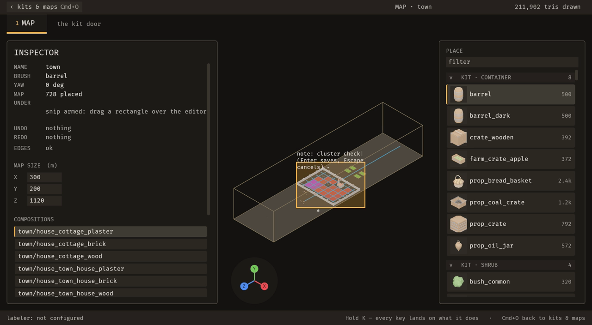

# bevy_emerge

World-building learned from an authored example, for Bevy 0.20: an editor that authors a library of pieces and example maps, a grammar learned from those maps, and wave function collapse that assembles new layouts from it.

The crates were extracted from [`foundation_vs_slop`](https://github.com/Ladvien/foundation_vs_slop) with their history kept (`git subtree split`), ported to Bevy 0.20, and relicensed MIT OR Apache-2.0. foundation_vs_slop still carries the GPL Bevy 0.19 originals (`crates/emerge-*`, `det_rng`, `deterministic_solver`) until it ports to this repo.

## Crates

|Crate|What it is|Engine|
|---|---|---|
|`bevy_emerge_core`|Schema (library, map, vocabulary), grammar learning, WFC, constraint solving, import and validation. Plain data and arithmetic.|none, enforced by `tests/engine_free.rs`|
|`bevy_emerge`|The runtime half: `spawn_descriptor` and a plugin that put a library and a map into a Bevy world.|Bevy 0.20|
|`bevy_emerge_anim`|Clip-weight blending on a skinned rig's `AnimationPlayer`.|Bevy 0.20|
|`bevy_emerge_mapper`|The editor application. Opens a project directory (`<root>/assets/emerge`) and writes what a game loads.|Bevy 0.20|
|`bevy_emerge_rng`|One deterministic ChaCha8 stream, shared by every crate.|none|
|`bevy_emerge_solver`|A deterministic SAT back-end (no clock, threads or entropy).|none|
|`bevy_devshot`|A frame on demand: touch a sentinel file and the next frame is written as a PNG.|Bevy 0.20|
|`bevy_debugger_bevy`|Companion plugin that registers BRP methods for screenshots, inspection and input injection.|Bevy 0.20|

Each crate has its own `README.md` and `CLAUDE.md`; the latter holds the crate's invariants.

## The editor

<video src="docs/media/demo.mp4" controls muted width="100%"></video>

[](docs/media/demo.mp4)

[`docs/media/demo.mp4`](docs/media/demo.mp4): 64 seconds of the running editor on the scratch town map, captured at 4 frames a second (frame n is at n/4 s). The camera is zoomed in and panned, an agent frames the town houses over MCP, a barrel is placed on a road tile (which replaces the tile), and Cmd+Z undoes it. An agent frames one wall and turns it 90 degrees with `placement_set_yaw`, and Cmd+Z takes that turn back. The agent then removes the wall's neighbour with `placement_remove` (frames 161 to 176: the gap), and Cmd+Z puts it back (frame 177). From frame 200 the person snips: an agent frames the whole map, Cmd+\ arms the snip (frame 216 reads "snip armed"), a drag draws a box over the walled town (frame 230), the note "cluster check" is typed (frame 237), and Enter saves it, with the receipt naming the file (frame 241). An agent then reads the snip back with `emerge_list_snips`; that read changes no pixels. The [guide](docs/guide/README.md) walks the same path with the keys and tools for each step.

## Licence

MIT OR Apache-2.0, at your option. See `LICENSE-MIT` and `LICENSE-APACHE`.

The licence covers the code. The models under `assets/` are test fixtures copied from foundation_vs_slop (where they were already public); third-party ones (Kenney, Quaternius, SCP community models and others) keep their own licences, and a folder's `README.md` says where it came from when it has one. The FiraMono font in `crates/bevy_emerge_mapper/assets/fonts/` is under the SIL OFL 1.1 (`FiraMono-OFL.txt`).

## Building

```sh
cargo test --workspace
cargo run -p bevy_emerge_mapper -- <project-root> [map-name] [--door <door>] [--kit <kit>]
```

The tests read fixtures from the repository's `assets/` directory (`crates/<name>/` sits two levels below it).

## Consumers

|Consumer|How it uses this repo|
|---|---|
|Sanctuary (`/Users/ladvien/sanctuary`)|Depends on `bevy_emerge_core` by path (`/Users/ladvien/bevy_emerge/crates/bevy_emerge_core`) to lay out town blocks by WFC learned from an authored example block. The editor runs against Sanctuary as a project: `cargo run -p bevy_emerge_mapper -- /Users/ladvien/sanctuary`. See Sanctuary's decision 0087.|

## Working with consumers

This repo and its consumers evolve together. The rules:

- Changes a game needs are made here, in their own commits, with tests here.
- A consumer never vendors or patches a copy of a crate from this repo.
- Every API change lists the consumer callsites it breaks (`grep` each consumer in the commit message).
- Before pushing, run `cargo test --workspace` here and `cargo test` in each consumer.
- A consumer change that depends on an unpushed commit here names that commit in the consumer's coordination notes.
