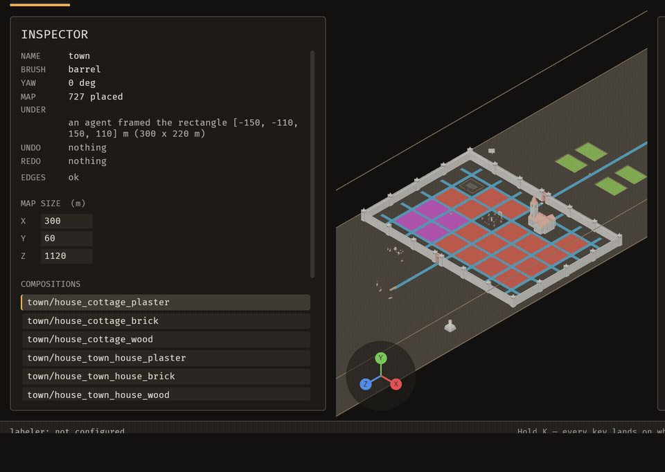
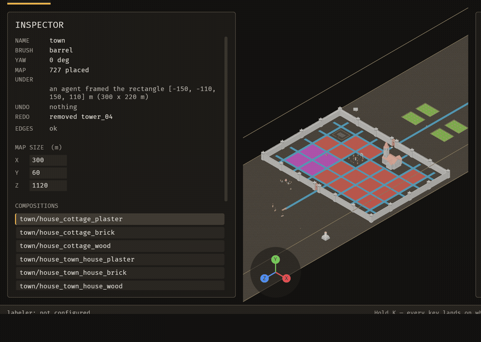

# bevy_emerge

[](https://github.com/Ladvien/bevy_emerge/actions/workflows/ci.yml)

bevy_emerge is a world editor for Bevy games that you and an AI agent drive together. You build and point: place pieces, drag a snip over a problem, write a note. The agent acts through the same operations you use: turn, remove, frame, capture, check. One Cmd+Z takes back either of you. It also learns a layout's grammar from maps you build and generates new layouts with wave function collapse.



The full recording is [`docs/media/demo.mp4`](docs/media/demo.mp4), 64 seconds long.

## Why

- **Show the agent a problem, not a description of it.** Snip a region and write a note. The agent reads both with `emerge_list_snips`.
- **The agent sees what you see.** Stills, sequences and framing give it the same view you have.
- **One undo history.** A change an agent makes is undone with the same Cmd+Z you use.
- **Edit a map on disk, see it live.** Change a map file in a text editor, and the running editor shows the change in well under a second (measured 0.1–0.6 s on a 727-piece map), with no rebuild.
- **Layouts follow your example.** The grammar comes from maps you built, so the output keeps their look and rules.

## Status

Works today:

- Placing and removing pieces in the editor, and saving the map with Cmd+S.
- Eleven MCP tools that let an agent act through the same operations.
- One undo history for you and the agent.
- Snips with notes, which agents read.

In progress:

- Box and stamp removal for agents.
- More operations for agents.
- A Home key for framing the view.

bevy_emerge is not yet published to crates.io. Use it by path or git.

## Quickstart

You need a Rust toolchain for edition 2024 and a machine that can open a Bevy window. Then:

```sh
git clone https://github.com/Ladvien/bevy_emerge
cd bevy_emerge
cargo run -p bevy_emerge_mapper -- <project-root> [map-name]
```

- `<project-root>` is a directory that holds `assets/emerge/`, the kit and maps the editor opens.
- `map-name` is the map to open. Cmd+O goes back to the menu.

For an agent, start the MCP server against the same project. Both ends read `BEVY_BRP_PORT`, which defaults to 15702:

```sh
cargo run -p bevy_emerge_mcp -- --project <project-root>
```

An MCP client config for it:

```json
{
  "mcpServers": {
    "bevy_emerge": {
      "command": "cargo",
      "args": ["run", "-q", "-p", "bevy_emerge_mcp", "--", "--project", "/path/to/project"],
      "cwd": "/path/to/bevy_emerge"
    }
  }
}
```

## How it fits a game

Sanctuary, a game built on Bevy, depends on `bevy_emerge_core` by path. It lays out town blocks with wave function collapse, learned from an authored example block. A project keeps its kit and maps in `assets/emerge/`: the editor opens that folder, and the game loads the same files.

`bevy_emerge_core` is engine-free, and `crates/bevy_emerge_core/tests/engine_free.rs` checks it. One seeded ChaCha8 stream (`bevy_emerge_rng`) serves every crate, so a seed gives the same layout.

| Crate | What it is | Engine |
|---|---|---|
| `bevy_emerge_core` | The engine-free world-building core: constraint IR, solvers, WFC and the deterministic RNG. | none |
| `bevy_emerge_snip` | Cuts one rectangle out of a PNG of the editor, shared by the editor and the MCP server. | none |
| `bevy_emerge` | The runtime half: `spawn_descriptor` and a plugin that put a library and a map into a Bevy world. | Bevy 0.20 |
| `bevy_emerge_anim` | Clip-weight blending on a skinned rig's `AnimationPlayer`. | Bevy 0.20 |
| `bevy_emerge_mapper` | The editor. It opens a project directory and writes what a game loads. It is AI-written and not line-by-line audited; read its [README](crates/bevy_emerge_mapper/README.md) before you rely on it. | Bevy 0.20 |
| `bevy_emerge_mcp` | An MCP server that lets an agent drive a running editor through typed operations. | Bevy Remote Protocol client |
| `bevy_emerge_rng` | One deterministic ChaCha8 stream, shared by every crate. | none |
| `bevy_emerge_solver` | A deterministic SAT back-end with no clock, threads or entropy. | none |
| `bevy_devshot` | A frame on demand: touch a sentinel file and the next frame is written as a PNG. | Bevy 0.20 |

## Common tasks

### Place a piece and undo it

Goal: put a piece on the grid, then take it back.

1. Pick a piece from the palette and click the grid.
2. Press Cmd+Z to take it back.

Review: the inspector's UNDO line names the step that Cmd+Z takes back. The [placing and undo guide](docs/guide/placing-and-undo.md) has the details.

### Snip a region for an agent

Goal: show an agent a region and get one change back that you can undo.

1. Press Cmd+\ to arm the snip, then drag a box over the region.
2. Type a note and press Enter.
3. The agent reads the snip with `emerge_list_snips` and changes a placement with an operation such as `placement_set_yaw`.
4. Press Cmd+Z to undo the agent's change.

Review: after Enter the status line confirms the snip. The GIF at the top shows the agent's turn and the Cmd+Z that takes it back.

### Move the camera

Goal: pan across the town.



Review: hold A and D to pan left and right. The [framing and camera guide](docs/guide/framing-and-camera.md) covers framing and the camera in full.

## Agents

The MCP server gives an agent the same typed operations a person uses. The [tool reference](docs/mcp-tools.md) lists the eleven tools and their parameters. An agent's change lands in the same operation log and undo history as yours.

Known gaps:

- `emerge_state` does not list each pin.
- Renaming a map does not rewrite other references to it by name.

## Documentation

- [Editor guide](docs/guide/README.md): every page of the editor's guide, from getting started to keys.
- [MCP tool reference](docs/mcp-tools.md).
- [The iteration loop](docs/guide/loop.md): how the editor's changes are proposed, proved and recorded.

## Contributing

Run `cargo test --workspace` before you push. CI runs it on Linux (see the badge). `AGENTS.md` holds the rules for agents working in this repo.

## Licence

MIT OR Apache-2.0, at your option; see `LICENSE-MIT` and `LICENSE-APACHE`. Models under `assets/` and third-party assets keep their own licences, as their folders' READMEs state.
