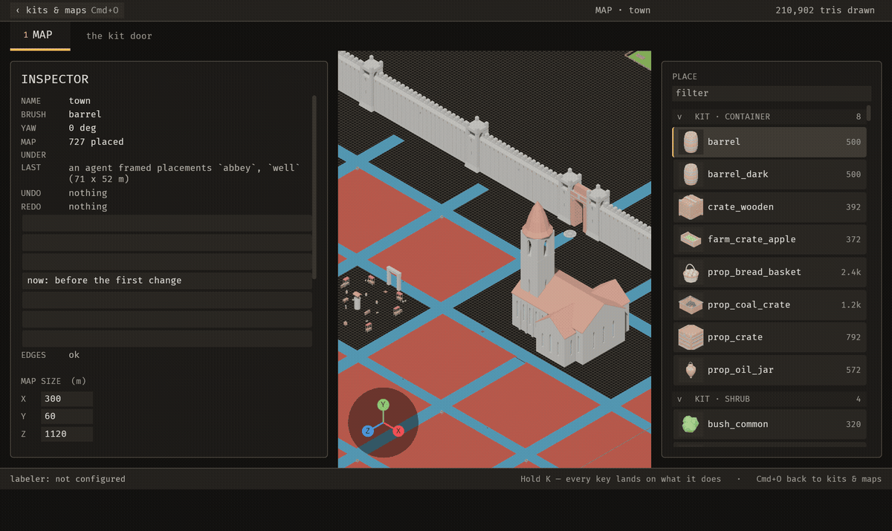

# bevy_emerge

[](https://github.com/Ladvien/bevy_emerge/actions/workflows/ci.yml)

bevy_emerge is a world editor for Bevy games, for game developers who want to build levels with an AI agent working beside them.



An agent calls `emerge_apply_operation` twice (a turn, then a removal). The inspector on the left names each change and who made it, and two presses of Cmd+Z take them back. [How agents work](docs/guide/agents.md).

The full recording is [`docs/media/demo.mp4`](docs/media/demo.mp4), 64 seconds long.

## Why

- **You and an agent use the same operations.** Turning, removing, pinning, renaming, opening a door and arming a piece are named operations. An agent changes the map only through them, so its change is the same kind of change as yours. Some of your keys still change the map without going through them.
- **One undo history.** Cmd+Z takes back the agent's last turn as well as your own. The agent's turn joins your history, so you do not need a second undo.
- **Snips show the agent what you mean.** Cmd+\ lets you drag a rectangle over the editor and write a note. The agent can list your snips, read each note, and get each picture from its file.
- **Edit data files and see the result.** The editor checks its project files every quarter of a second and re-reads the ones that changed.
- **Layouts learned from your maps.** You lay out a corner the way you want it. The editor learns the rules from that arrangement, then continues it with wave function collapse, so it adds more of your layout, not a generic one.
- **Labels that wait for you.** A vision model can propose a label for each piece. Each proposal is marked unchecked. To confirm an axis, toggle one of its label chips, which marks the whole axis as yours. No button confirms a proposal in place.

## Status

**Works today:** the editor (`bevy_emerge_mapper`) for building maps from kits; the MCP server (`bevy_emerge_mcp`) that lets an agent drive the running editor; snips; undo shared between you and the agent; the watcher that reloads project files; grammar learning and wave function collapse for continuing a layout.

**Install:** use the crates by path or git. `bevy_emerge_rng` and `bevy_emerge_solver` are marked `publish = false`.

The mapper editor is AI-written and has not had a line-by-line human audit. It is covered by tests, but read [`crates/bevy_emerge_mapper/README.md`](crates/bevy_emerge_mapper/README.md) before you trust it with a project you care about.

## Quickstart

You need a stable Rust toolchain and the graphics requirements of Bevy 0.20. Clone the repository and run the editor on its own project:

```sh
git clone https://github.com/Ladvien/bevy_emerge
cd bevy_emerge
cargo run -p bevy_emerge_mapper -- .
```

The editor opens a menu of the project's kits and maps. Each kit shows how many pieces it holds. Choose a map in the MAPS column to open it. [Getting started](docs/guide/getting-started.md) walks through your first map.

To let an agent drive the open editor, run the MCP server with the project directory. The editor must be running for the tools to answer:

```sh
cargo run -q -p bevy_emerge_mcp -- --project /path/to/project
```

Add it to your MCP client, for example:

```json
{
  "mcpServers": {
    "bevy_emerge": {
      "command": "cargo",
      "args": ["run", "-q", "-p", "bevy_emerge_mcp", "--", "--project", "/path/to/project"],
      "cwd": "/path/to/bevy_emerge"
    }
  }
}
```

The tools are listed in [MCP tools](docs/mcp-tools.md).

## What you can do

- **Build a map.** Place pieces, fill areas, and undo a placement. See [building maps](docs/guide/building-maps.md).
- **Make kits and labels.** Bring in meshes, group them into kits, and label each piece. See [kits and labels](docs/guide/kits-and-labels.md).
- **Work with an agent.** Let an agent turn and remove pieces, and frame and capture the map, while you watch and snip problems. See [agents](docs/guide/agents.md).
- **Use the data files.** Read and edit the files a game loads. See [data files](docs/guide/data-files.md).
- **Know the keys.** See [keys](docs/guide/keys.md).

## Use it in your game

Depend on the crates you need by path or git. `bevy_emerge_core` has no engine dependency and holds the grammar and solver, so a game can use it without the editor. Sanctuary, the game this was built for, depends on `bevy_emerge_core` by path and lays out its town blocks with it. See [your game](docs/guide/your-game.md) for the steps.

## Crates

| Crate | What it is |
|---|---|
| `bevy_emerge_mapper` | The standalone editor. Opens a project directory and writes the files a game loads. |
| `bevy_emerge_mcp` | The MCP server that gives an agent the editor's operations over stdio. It talks to the running editor. |
| `bevy_emerge` | The runtime half. Loads a library and a map into a Bevy world. |
| `bevy_emerge_core` | The world-building core: constraint representation, solvers, wave function collapse and the grammar learner. Engine-free. |
| `bevy_emerge_solver` | A deterministic SAT back-end. It reads no clock and uses no threads or entropy. |
| `bevy_emerge_anim` | Blends clip weights on a skinned rig's animation player. |
| `bevy_emerge_rng` | One deterministic ChaCha8 random stream. `bevy_emerge_core` re-exports it. |
| `bevy_emerge_snip` | Cuts one rectangle out of a picture of the editor. Shared by the editor and the MCP server. |
| `bevy_devshot` | A frame on demand. Touch a sentinel file and the next frame is written as a PNG from the GPU. |

## Documentation

- [Guide](docs/guide/README.md): every page, in reading order.
- [MCP tools](docs/mcp-tools.md): the tools an agent can call.
- [The development loop](docs/guide/loop.md): how the project is built, one iteration at a time.
- [Mapper README](crates/bevy_emerge_mapper/README.md): what the editor is and its status.

## Contributing

Run `cargo test --workspace` before you push. CI runs the same command under a virtual display (see `.github/workflows/ci.yml`). The badge at the top of this page shows its status. [`AGENTS.md`](AGENTS.md) sets the conventions the code follows. [The development loop](docs/guide/loop.md) describes how changes are proposed, tested and reported.

## Licence

Licensed under either of [Apache License, Version 2.0](LICENSE-APACHE) or [MIT licence](LICENSE-MIT), at your option.
