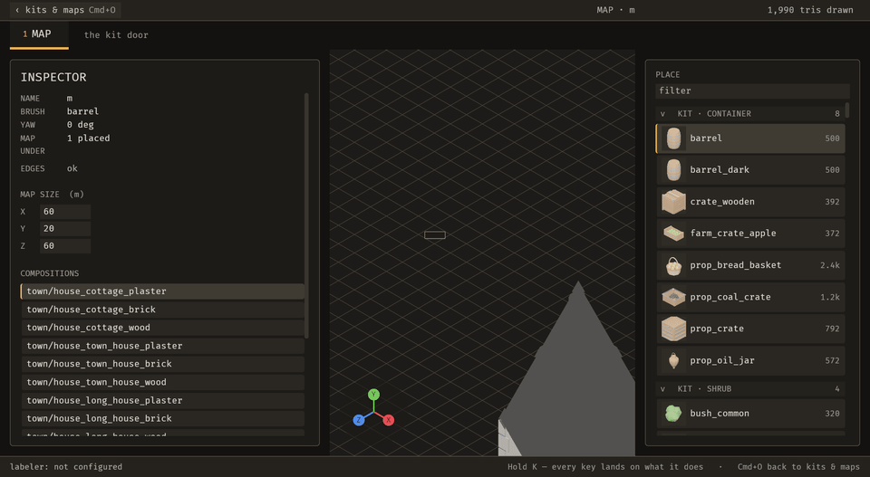
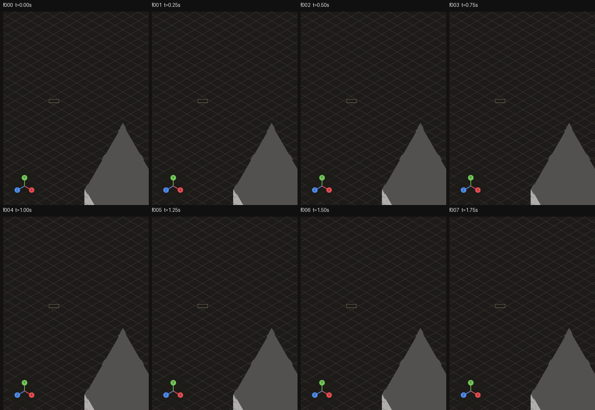
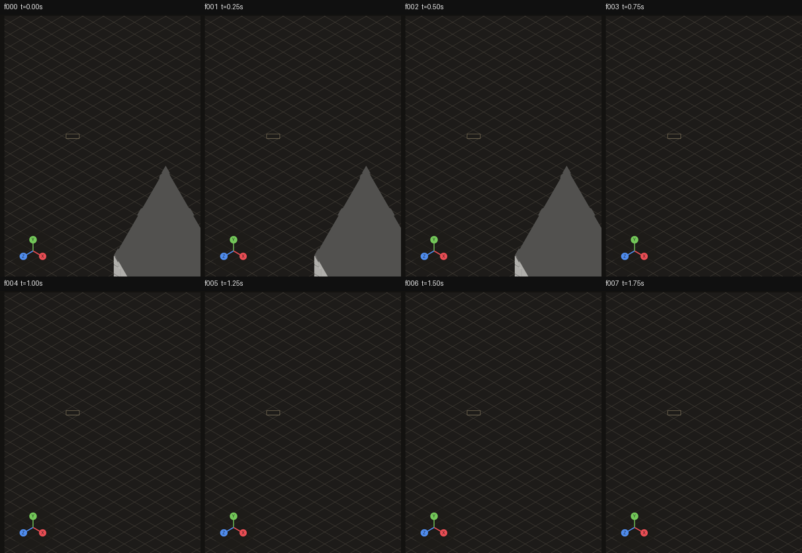

# 2026-10-21 hot-reload: a map edited on disk reaches the screen; the LAN preflight probes

Focus: configuration-based editing with immediate feedback over BRP · Commits: `814dfd8..0b4eaee` (+ this report) · Outcome: **fixes only**

## Summary
Two bugs fixed. **E-007:** before the fix, editing the map file updated the editor's map and inspector but never the pieces in the viewport. The viewport now redraws within one 4 fps frame of the save. **B-004:** the VLM preflight now probes a LAN host instead of reporting it ready unprobed. The planned enhancement, an `emerge_undo` tool (E-009), stopped after two failed attempts at the same design step. It was reverted and logged with the design to try next.

## Baseline
Gate at `814dfd8`: `cargo test --workspace` **1,325 pass / 0 fail**. Clippy `-D warnings` is red workspace-wide from pre-existing findings in 22 files, none of which this iteration touches. `cargo fmt --check` and `cargo doc -D warnings` are also red from pre-existing issues. No crate is published (E-006). Frame time: **not measured**, because the editor exposes no frame clock over MCP (deferred below). File edit-to-visible on the scene below: **never**, since the screen only updated after a restart. MCP edit-to-visible was not re-measured this iteration; the previous run measured the operation applied at 0.121 s and shown by frame 1 at 0.25 s.

Scene for all captures: a scratch copy of the Sanctuary kit (`/tmp/emerge_live/hotproj3`), map `m`, with one `town/tower` 21.6 m from the origin, in view.

## Bugs fixed

### E-007: a map edited on disk reached the editor's memory but not the screen
Must-fix: blocks **y** (wrong result: the map and the viewport disagree), common **y** (the file path is the hot-reload path), no workaround **n** (restarting works). Blocks = yes, so it is must-fix.

Root cause: `watch::adopt_map` replaced `OpenMap.map`, but pieces are entities spawned once by `editor::spawn_existing` on `OnEnter(Screen::Editor)`. Fix (`0643912`):
- `adopt_map` now reports whether the map changed.
- The watcher raises `Due::map_replaced`.
- A new `editor::redraw_the_map` system in `keys::Phase::Act` despawns every `Placement`, respawns from the new map with heights resolved over the whole map, and re-seeds `next_id`.

The first version had `redraw_the_map` in no set, unordered against the watcher's `Phase::Sense`. It ran first and always saw the flag down (diagnostic log: `adopt_map: changed=true` and no redraw). Moving it to `Phase::Act` fixed that.

Regression check: `tests/a_map_edited_on_disk_reaches_the_screen.rs::a_piece_moved_on_disk_stands_in_its_new_place`. It was committed failing first in `a4c3067` (`piece on SCREEN is at Vec3(0.0, 0.0, 0.0)` while the map said (12, −7)) and passes now. The assertion is on the entity's `Transform`, not on `OpenMap`, because `OpenMap` was already right before the fix.

Sequence: `emerge_capture_sequence`, 2.5 s at 4 fps, with the file edited about 0.60 s in. Pixel diff of the world panel against f000:
- Before (`814dfd8` sources): **no change in any of f000–f009.**
- After: no change in f000–f002, **changed from f003 (t=0.75 s)**, stable through f009.

| Before (unfixed) | After |
| --- | --- |
|  |  |
|  |  |

In both sheets, the tower in f000 is at (18, 12). After the fix it leaves at f003. Its new position (−18, −12) is outside the cropped panel, and the headless test pins the exact new transform.

### B-004: the VLM preflight reported a LAN endpoint that is down as ready
Must-fix: blocks **n**, common **y** (the LAN bind is the documented portable setup), no workaround **y** (no config makes the preflight run there). Two yes answers, so it is must-fix.

Root cause: `vlm::probe` returned `Reach::Ready` for any host not spelled `localhost`, `127.` or `::1`. That check ran before the resolved-address `is_near` check that the function's own comment describes. Fix (`f9a9ac6`): the spelling gate is removed, and the resolved address decides. Internet hosts are still not probed, which is unchanged.

Regression check: `vlm::tests::a_lan_host_that_is_down_is_not_reported_as_ready` connects to `192.168.1.113` on a port that was bound and then dropped. It failed before the fix (`Ready`) and passes now. There is nothing visual to capture for this one.

## Enhancement: none shipped (E-009, `emerge_undo`)
Plan: one registry operation, `undo`, plus an `emerge/undo` bridge command and an `emerge_undo` tool. Both the tool and `Cmd+Z` would pop the same `EditorState::undo` stack.

Goal: an agent can take its own change back in one step, in the same history as the human's `Cmd+Z`. The proof was to be a test that applies through the registry, undoes through the registry, and asserts the map is restored.

Candidates considered:
- **E-009 undo tool:** every agent edit is currently irreversible from the agent's side. High value, medium risk.
- **E-002 migrate a second workflow:** widens parity, but every new verb is another edit the agent cannot undo. Medium risk.
- **E-005 enclosure wish/weight as data:** a small data-driven fix off the agent's path. Low risk.

Why it stopped (Non-negotiable 5): the undo needs `Commands`, `AssetServer` and the `Placement` query, but `ops::Ctx` holds values only.
- Attempt 1: a borrowed callback in `Ctx` needs a lifetime on `Ctx`, which every user of it would have to carry.
- Attempt 2: a `'static` callback cannot capture the system's params (`lifetime may not live long enough`).

The work in progress was reverted, so no undo code is committed. The next design to try is recorded in `backlog.json` E-009 `last_failure`: a queued request and a `Phase::Act` system, the same shape as the E-007 fix.

## Performance
- File edit-to-visible on the scene above: before, **never** without a restart. After, **≤ 150 ms**: the edit landed at about 0.60 s, f002 (0.50 s) is unchanged and f003 (0.75 s) shows it. Independent still-polling measured 440 ms, which includes the ~200 ms still-capture round trip.
- Frame time and MCP edit-to-visible: not measured this iteration.
- Cost of the redraw: it runs only when the watcher adopts a changed map file, never in steady state, so per-frame cost is one bool check.

## Review
No independent reviewer pass: the enhancement did not ship, and the two fixes are each pinned by a test that fails on the unfixed code. Self-review found one inaccurate claim in my own fix and corrected it (`d131ce7`). The comment and the `0643912` commit message said an unset system runs before the configured chain, when Bevy actually leaves it unordered.

## Test diffs
- Added `tests/a_map_edited_on_disk_reaches_the_screen.rs` (new file).
- Added `vlm::tests::a_lan_host_that_is_down_is_not_reported_as_ready`.
- No existing test or assertion changed.

## Release
Not published. No crate in this workspace has ever been published (`cargo info` resolves all eight to local paths), and there is no `.github/workflows/release.yml`. The first publication is the owner's decision (backlog E-006). The changed crate, `bevy_emerge_mapper`, is unpublished. Commits are local and not pushed, per the brief (pushes happen only in Phase 6).

## Deferred / open
- E-009 `emerge_undo`: blocked; design for next time is in `last_failure`.
- Frame-time instrumentation: `emerge_state` has no frame clock, so frame time cannot be read over MCP. Not yet in the backlog.
- The headless E-007 test uses a 6 s wall-clock deadline for the watcher's 250 ms poll. That could flake on a heavily loaded machine.
- Workspace-wide clippy, fmt and doc gates are red from pre-existing issues: 22 clippy files, rustfmt drift, 91 rustdoc lines. This iteration added none.
- `backlog.json` carried an uncommitted rename of a duplicate `B-003` to `B-004` from a previous run; it is committed with this iteration.

## Next focus
E-009 with the queued-request design. An agent that can change the editor but cannot take the change back is still the biggest gap in the present step of the loop.
