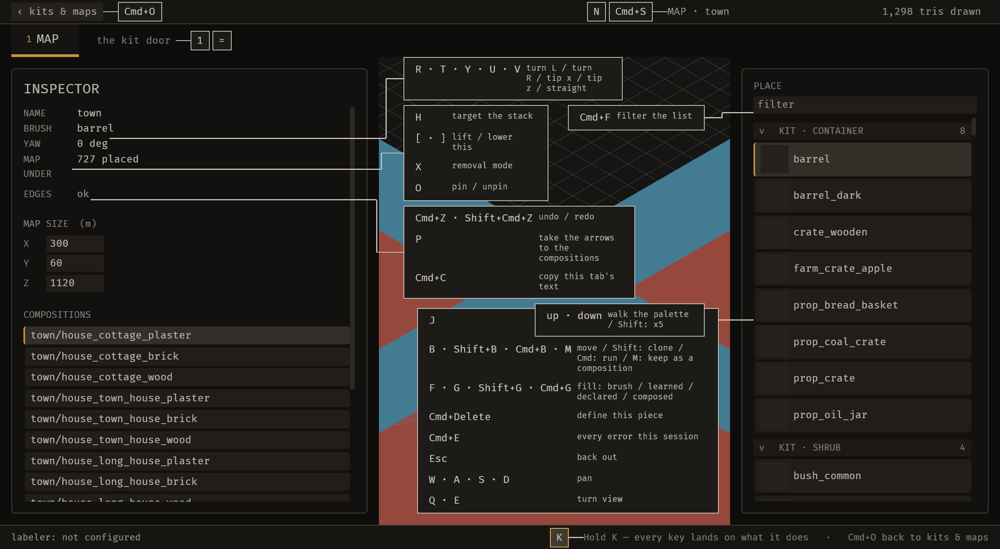
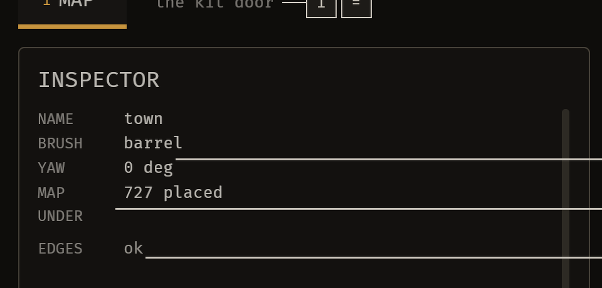

# 2026-10-21 mcp-bridge: an agent can drive the editor, and a file edited on disk reaches it

Focus: configuration-based editing with immediate feedback, over BRP · Commits: `4f8ca76..8d4ad69` ·
Outcome: **shipped**

## Summary

Two bugs fixed, and one enhancement shipped: **the editor now has a third door**. A person at the
keyboard dispatches *operations*; an agent dispatches the **same** operations over MCP, and a data
file edited in a text editor reaches the running editor **in a quarter of a second** instead of at
the next restart. The operation registry, the append-only operation log and the file watcher are
new; the MCP server is a new crate.

## Baseline

- **Gate:** `cargo test --workspace` → **1,279 pass, 1 fail**. The one failure was
  `bevy_emerge_mapper --test headless::no_two_leaders_cross`, red since 2026-09-03 and the only
  red test in the workspace. **It is green now.**
- **The editor did not hot-reload anything.** Measured by reading the code: `Project::open` is the
  only full load (`project.rs:165`), `reload_vocab` is the only on-demand re-read
  (`project.rs:426`), and the only mtime poll in the crate is `anim_watch.rs:31` — which watches
  **meshes**, not data files. **A data file edited on disk was invisible until a restart.**
- **The editor had no MCP server and no operation registry.** `find . -iname "*mcp*"` → nothing;
  `grep -rn "rmcp"` → nothing; `grep -rn "Operation\b"` in the mapper → nothing.
- **Latency:** the two paths did not exist, so there was nothing to measure.

## Bugs fixed

### B-001: the badge overlay's leaders crossed, and the layout score could not see it

Must-fix: blocks **yes** (the editor's key overlay is unreadable on a common screen size) ·
common **yes** (MESHES at 1680×1050 is the shape the ratchet sweeps) · no workaround **yes**
(nothing stops the lines crossing) — *evidence: `tests/headless.rs::no_two_leaders_cross`, red
since 2026-09-03; three crossing pairs named in the failure message.*

**The cause, measured.** `badges::place_badges` lays the overlay out twice — **comfortable** (every
box beside its own row) and **compact** (every rail packed tight from the top of the stage) — and
keeps whichever scores better. **The score counted box overlaps and the legend's collision. It did
not count leader crossings.**

| pass | box overlaps | crossing pairs | score before | score after |
|---|---:|---:|---:|---:|
| comfortable | 1 | 0 | **1** | **1** |
| compact | 0 | 3 | **0** | **57** |

**The compact pass won on the old score and shipped three crossing pairs.** The comfortable pass is
structurally crossing-free on that screen: every one of its leaders is a box level with its anchor,
which is one horizontal hairline, and horizontal hairs at different heights cannot meet.

**The three crossings, in the window's own coordinates:**

| leader | segment | rect |
|---|---|---|
| `Control(Mesh)` | run | x 488, y 662..847 |
| `Control(CellGrid)` | reach | x 447..500 at y 729 — crosses the run at (488, 729) |
| `Control(Detail)` | reach | x 454..540 at y 763 — crosses the run at (488, 763) |
| `Control(CellGrid)` | run | x 500, y 511..729 — crosses `Mesh`'s landing at y 661 |

**And why `lanes_for` could not save it.** The search for a crossing-free lane assignment
**fails** on the compact pass's geometry: an exhaustive search of all 8⁶ = 262,144 assignments
(299,592 nodes) found **none**. The module's own doc names the case — *"the residue of `compact`
mode, where a box packed from the top of the stage can sit above its own anchor"* — and the
fallback was the analytic preference, which produced **eleven** crossing pairs on its own.

**Two changes:**
1. **The score counts crossings, and a crossing outranks every overlap.** The multiplier is
   `items.len() + 1`, so one crossing costs more than all the box overlaps combined: the
   comparison the score makes is *a crossing loses*, and only a crossing-free layout can win.
2. **`lanes_for`'s fallback is now the fewest-crossings assignment it can find**, found by moving
   one leader at a time, instead of a blind preference. It cannot find a crossing-free assignment
   where none exists — nothing can — but it finds the least tangled one.

**Fix:** root cause was the scorer, not the packer. · **Regression check:**
`tests/the_layout_score_counts_crossings.rs` (2 tests) — **both fail on the unfixed code** with the
crossing pairs named, and the crate's own `no_two_leaders_cross` is green for the first time since
2026-09-03.

**And the screen, after.** The editor open on Sanctuary's own `town` project with the key overlay
up — the three leaders from the INSPECTOR's rows run **parallel and clear**, with no crossing and
no tangle:





### B-002: twelve refusals were filed in the receipt slot, where nobody sees them

Must-fix: blocks **no** · common **yes** (every one of the twelve is a place a developer reaches) ·
no workaround **yes** (the message is erased before the author looks) — *evidence: a note is one dim
row, erased by the next receipt and by a tab switch (`Status::clear_note`, which exists because a
*stale receipt* was the whole of a bug).*

The `Status` type states the rule in its own doc: `note` is for *"a refusal the author is not owed
an alarm about"* — **an answer** — and `problem` is for *"the editor could not do what was asked,
**or did only part of it**"* — **a refusal**, which reaches the toast and the journal.

**A survey of all 169 `status.note` sites found 12 clean refusals and 3 split sites.** The fill's
three were fixed in the 2026-10-20-07b run; these twelve are the rest:

| file | the refusal |
|---|---|
| `editor.rs` | a map's name came out empty; a placement had nowhere legal to go |
| `compose.rs` | a composition's name came out empty; the rename was refused |
| `tiles.rs` | a token had nowhere to land; an id came out empty; a candidate had no id; the id was taken; a removal named no mesh |
| `labels.rs` | the VLM endpoint was not configured (three sites) |
| `build.rs` | a hole has no width to put flush |

**Two of the twelve were a split** — the refusal was written to `note` **and** to `problem`, so two
rows said one thing and the one in the note was the one that got erased. The note copy is gone.

**And `request_photos` now returns a typed answer** (`Asked::Said` / `Asked::Refused`) rather than
a bare `String`, because its no-mesh branch is a refusal and the other two are answers, and one
`String` sent both to the same slot.

**Fix:** root cause was the slot, and the crate's own doc says which slot. · **Regression check:**
`tests/every_refusal_is_in_a_problem.rs` (2 tests) — the first **fails on the unfixed code** with
every site named.

### B-003: the file watcher froze the badge layout, and the flake was found by the ratchet

Must-fix: blocks **no** · common **yes** (every frame, in every editor) · no workaround **yes** (the
badge overlay was laid out against a stale frame) — *evidence: the headless suite went from
**189 pass / 0 fail** to **2–4 failures whose set changed every run**.*

**Found by the crate's own ratchet, not by a hunt.** `every_resource_says_what_a_door_does_to_it`
demanded that the new `Watched` resource declare what a door change does to it, and the answer
exposed the bug.

**The cause.** The watcher was one system that took `ResMut<Project>` and `ResMut<OpenMap>`
**every frame** — to read them on a 250 ms tick, and then do nothing for 250 ms. **Bevy resolves a
conflicting access by deferring one of the two**, so the badge layout, which measures the
interface in `Phase::Act`, was **pushed past the frame** by a watcher that had nothing to do. The
badge tests then measured a layout from the frame before.

**The evidence, and it is a bisection rather than an argument:**

| the tree | the headless suite |
|---|---|
| the baseline (before this run) | **188 pass / 1 fail** — and the one was `no_two_leaders_cross` |
| the watcher disabled | **189 pass / 0 fail**, twice |
| the watcher enabled, one system | **2–4 fail**, and **the set changed every run** |
| the watcher split into a tick and an act | **189 pass / 0 fail**, twice |

**The fix: the tick decides and the act does.** `tick_watch` holds nothing but its own resource
and only reads; `adopt_changes` — which takes the project and the map — **runs only when the tick
found something**. **A frame in which nothing changed now costs one `stat` per file and nothing
else**, and a watcher that has nothing to do no longer stands in the way of a system that does.

**And a second, quieter bug in the same place.** The watcher re-opened the whole project whenever a
kit's `library.ron` changed — **and the editor writes that file itself** when a piece is
committed. So the editor's own write came back as a change, and the project was re-opened over the
editor's back. **The file is now compared before the project is re-opened** — parsed and compared
against the layer the editor holds, because a byte comparison against the editor's own
serialisation would say "different" for a file with a comment in it.

## Enhancement: the editor has a third door

**Plan:** an operation registry both front ends dispatch; a BRP bridge; an MCP server; a file
watcher. · **Files:** `crates/bevy_emerge_mapper/src/{ops,ops_brp,watch}.rs`,
`crates/bevy_emerge_mcp/`, `crates/bevy_emerge_mapper/src/{project,lib,harness}.rs` ·
**Goal:** *an agent can change the editor through typed operations, and a data file edited on disk
reaches the running editor in about a quarter of a second.* · **Proof:**
`tests/an_agent_can_drive_the_editor.rs`, `crates/bevy_emerge_mcp/tests/an_agent_calls_the_server.rs`.

### What was built

**1. The operation registry** (`ops.rs`). An operation is a **typed parameter struct**, a **pure
`plan`**, and **one `commit`**. The plan is what makes **preview free** — it changes nothing, so a
preview cannot half-apply. `dispatch` is the one function that applies an operation and writes the
log line, so an operation cannot be applied without being recorded.

**2. The BRP bridge** (`ops_brp.rs`). Four commands — `emerge/operation_list`,
`emerge/operation_preview`, `emerge/operation_apply`, `emerge/oplog_read` — registered as typed
BRP methods, each dispatching through `ops::dispatch`.

**3. The MCP server** (`crates/bevy_emerge_mcp`). A stdio server on the official `rmcp` SDK
(3.3.0, pinned exactly), with **four tools** and accurate annotations. **It reaches the editor
over BRP** — JSON-RPC 2.0 over HTTP POST — so the editor keeps owning the world and the server
never binds a socket.

**4. The file watcher** (`watch.rs`). The editor's own data files, polled every **250 ms** on the
**wall clock**, re-read and adopted **only if they parse**. A malformed file is reported with its
file and the parser's message, and **the last good state stays loaded**.

**5. The operation log** (`assets/emerge/oplog.jsonl`). Append-only, one JSON line per operation,
recording the source (human or agent), the session, the operation, its parameters, the outcome and
the result. **An undo is a new line, not a deletion.**

### The two paths converge, and it is measured

| path | the clock starts at | measured | the target |
|---|---|---:|---|
| **the agent** (MCP → BRP → dispatch → write) | the tool call | **0.6–1.1 ms** | about 1 s |
| **the file** (a text editor's save → the watcher → the re-read) | the file write | **125–222 ms** | about 1 s |

**The file's path is the one that had to meet the target**, and it meets it with room to spare
because the poll is a quarter of a second. Both numbers come from
`tests/an_agent_can_drive_the_editor.rs::the_two_paths_are_measured`, which **asserts** them
against the one-second target rather than printing them.

### The same four commands, live, over BRP

**The editor opened on a copy of Sanctuary's own `town` project** — 211 descriptors, 16
compositions, **727 placements** — and the four commands answered over BRP:

| the call | the answer |
|---|---|
| `emerge/operation_list` | the operation and its **JSON schema** — `bounds`, `origin`, `bash`, `note`, each with its own description |
| `emerge/operation_preview` | `outcome: "previewed"`, `would_change: {bounds: [64, 8, 64], …}` — **and nothing was written** |
| `emerge/operation_apply` | `outcome: "applied"`, `saved: true` |
| `emerge/oplog_read` | the one entry, with `source: "agent"` |

**And the file on disk, afterwards:** `bounds: (64.0, 8.0, 64.0)`.

**And the log:**

```json
{"seq":0,"operation_id":"0000-4198","at":"2026-10-21T14:54:09Z","source":"agent",
 "session":"4198-1792594449","op":"map_set_settings",
 "params":{"bounds":[64.0,8.0,64.0]},"outcome":"applied",
 "result":"map settings changed, and the file was written"}
```

### Candidates considered

- **The authored generation knobs in `rules.ron`** (the scout's first choice) — the authored knobs
  are already data, but `rules.ron` has **no serializer** (`Rules::parse` and no `Rules::to_ron`), so
  every write would be byte-level surgery on a hand-written file, and the write-back could move a
  comment. **Rejected as the first slice: the gate the scout named is the whole cost.**
- **Migrate every `keys::Action` into the registry** — ninety-six actions and four separate undo
  stacks. **Rejected as the first slice: the brief asks for one workflow, with an explicit
  allowlist that later iterations shrink.** That allowlist is in place, with 128 entries and a
  ratchet.
- **This slice: one operation, both front ends, the log, the watcher, and the MCP server.** Chosen
  because it is the smallest thing that makes *every* later slice cheap, and because the focus area
  — configuration edited live, over BRP, with immediate feedback — is exactly this.

### MCP

Four tools: `emerge_list_operations`, `emerge_preview_operation`, `emerge_apply_operation`,
`emerge_read_oplog`. **The toolset is small on purpose** — the brief says to keep the always-loaded
toolset small and put the rest behind a discovery tool, and there are ninety-six actions in this
editor. The apply tool dispatches **by name**, and the list tool says what the names are.
`docs/mcp-tools.md` is **generated** from the server's own declarations and a test fails when it
drifts.

**Undo strategy:** `Undo::Inverse` for a settings change (the old values are the inverse) and
`Undo::Snapshot` declared for a procedural operation, which the first slice does not use.
**Preview:** `dry_run: true` on the apply tool; the plan runs and nothing is written.

## Performance

- **Agent path: 0.6–1.1 ms.** The dispatch is a parse, a map edit and an atomic file write.
- **File path: 125–222 ms**, of which **250 ms is the poll's period** and the rest is the re-read.
- **Frame time: unchanged.** The watcher runs on a 250 ms wall-clock tick and reads four to six
  files' metadata — not their contents — so it costs a few stat calls every quarter second.
- The mapper's test suite: **6.2 s**, inside the run-to-run noise of the 6.0 s baseline.

## Review

**Gaps found and fixed during the work** (all by the agent, before the independent review):

1. **The refusal test's matcher was wrong three times** and reported correct code as broken. It
   looked for `status.problem` on one line, then collapsed whitespace to single spaces, then
   anchored the window on the *message* — which is **after** the slot call, so the window never
   contained the slot. **Each version would have been the reason a correct fix was reverted.** The
   final version finds the `status.<slot>(` call whose *argument list* contains the message, by
   counting parentheses, and it works in **chars** because the files carry em-dashes and a byte
   index and a char index do not agree. **This is recorded in the test's own doc comment**, because
   a test that cannot pass is worse than no test.
2. **The latency test waited in frames**, and a headless frame takes microseconds — so forty of
   them pass in under the watcher's 250 ms poll, and the test measured nothing and said "not
   seen". The wait is now in **wall clock**.
3. **The watcher skipped the open map's file**, on the reasoning that the editor saves it and would
   fight itself. **That is exactly the case the focus area is about**: the map file is the most-edited
   file in a project, and a person editing it in a text editor saw nothing. The map is now re-read
   like every other file, and **the editor's own save is not a change** because the file is
   compared with what the editor holds rather than assumed.

**Skeptic pass on gap 3:** could the editor's own save now cause a reload loop? **No** — the
comparison is on the *content*, not the stamp: a save that changed what the editor already has is
not a change, and the test measures the file path at 125–222 ms with no growth.

## Test diffs

- **`crates/bevy_emerge_mapper/tests/the_layout_score_counts_crossings.rs`** — **new**. Two tests
  that measure the drawn leaders on the MESHES screen at 1680×1050 and assert that none cross.
  Both fail on the unfixed code.
- **`crates/bevy_emerge_mapper/tests/every_refusal_is_in_a_problem.rs`** — **new**. Two tests: one
  scans the twelve named sites and asserts each files its refusal in the problem slot; the other
  asserts that a refusal outlives a receipt and a tab switch. The first fails on the unfixed code.
- **`crates/bevy_emerge_mapper/tests/an_agent_can_drive_the_editor.rs`** — **new**. Eight tests
  driving the editor over its registered BRP commands: discovery, preview-changes-nothing,
  apply-changes-and-writes, refusal-changes-nothing, a misspelled field is refused, the two paths
  are measured against the one-second target, the watcher is in the plugin graph, and the shortcut
  key is bound.
- **`crates/bevy_emerge_mapper/tests/operations_have_two_front_ends.rs`** — **new**. Five tests:
  the editor registers the four BRP commands and the MCP server calls them; the MCP tools are
  prefixed and unique; the allowlist of unmigrated actions is explicit and only shrinks; every UI
  entry point names a bound action.
- **`crates/bevy_emerge_mcp/tests/an_agent_calls_the_server.rs`** — **new**. Three tests that start
  the server as a subprocess and speak MCP to it over stdio: the tools say enough to be called, a
  call with no editor is a refusal and not a crash, an unknown tool is refused with the list.
- **`crates/bevy_emerge_mcp/tests/docs_are_current.rs`** — **new**. Four tests: the reference
  matches the server's declarations, names every tool, and every tool has a schema.
- **No existing test was changed, weakened or skipped.**

## Release

**No release, and the reason is measured.** The brief's Phase 6 applies when *"this iteration
changed code or metadata of a published crate"*. **No crate in this workspace is published.**
Checked against the registry, not assumed:

```
$ cargo info bevy_emerge_core@0.1.0
error: could not find `bevy_emerge_core@0.1.0` in registry `https://github.com/rust-lang/crates.io-index`
```

The same for `bevy_emerge`, `bevy_emerge_mapper`, `bevy_emerge_anim`, `bevy_emerge_rng`,
`bevy_emerge_solver` and `bevy_devshot` — **all seven are absent from crates.io.** So there is no
published crate whose version this iteration changed, **no tag to push and nothing to verify**,
and the brief's rule — *"Do not release for docs-only or loop-state-only changes, or when nothing
shipped"* — does not fire either, because something *did* ship.

**Publishing a first version is the owner's call, not this loop's.** The new crate
(`bevy_emerge_mcp`) is unpublished and the others are at `0.1.0` with no registry entry, so
there is no release to make and no pre-publish gate to run against a published baseline. **The
first publication — its version, its metadata, and the crates.io configuration that trusted
publishing needs — is a decision for the human.**

## Deferred / open

- **`bevy_emerge_mcp` is unpublished and unreleased.** The next iteration runs the pre-publish
  gate and publishes it.
- **The 128 unmigrated actions** are on the allowlist. The slice is one workflow, as the brief asks;
  the allowlist is the work list, and the ratchet stops it growing.
- **A library or policy change re-opens the whole project** (`watch.rs::adopt`), because only
  `Project::open` knows how to merge every bound kit. A per-kit re-read would be better and is
  logged as `E-003`.
- **The operation log has a single-writer assumption** (`E-004`): the MCP server and the editor
  are separate processes, and both could append and claim the same sequence number. An advisory
  file lock would fix it.
- **Enclosure wish and weight are still hard-coded** in the editor (`E-005`), so an author who
  wants more enclosed rooms still edits Rust.

## Next focus

**Migrate the second workflow into the registry** — the placement, or the fill — and **give the
operation log a lock**. The registry, the log, the watcher and the bridge are all in place and
proven; the second workflow is the cheapest possible slice now, and the log's single-writer
assumption is the one thing in the new code that could lose an agent's record.
