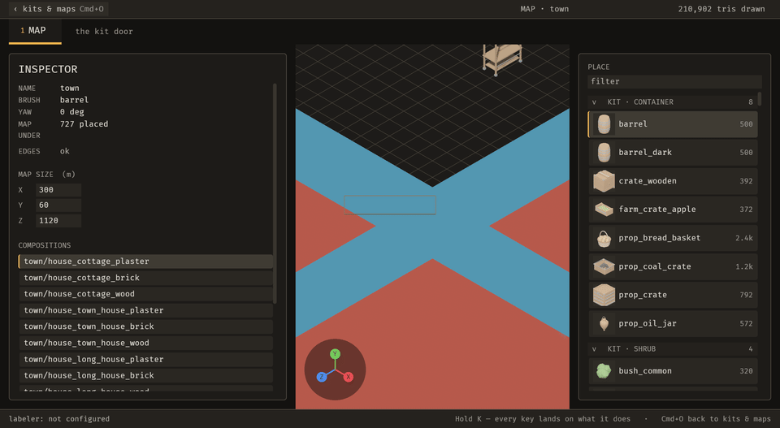
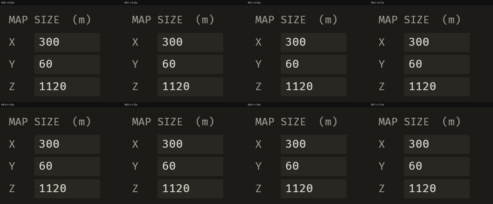
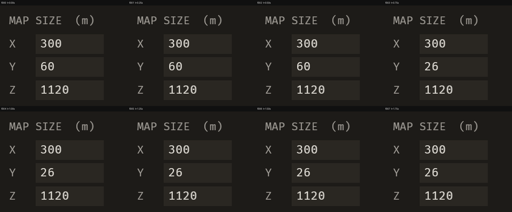

# 2026-10-21 undo: an agent can take its own change back; the clippy gate is green for the first time

Focus: none (chosen from evidence) · Commits: `556158d..39ab825` (+ this report) · Outcome: **shipped**

## Summary
Three bugs fixed:
- **B-005:** the required clippy gate had been red across the workspace with 233 findings. It now passes.
- **B-006:** the tool reference told agents that `emerge_apply_operation` is not destructive.
- **B-007:** `"note": null` was answered "applied" while leaving the note in place.

One enhancement: **`emerge_undo_operation`**. An agent takes a change back by the id `emerge_apply_operation` gave it, through the operation registry. The editor, the data file and the append-only log all reflect the undo. A newer change, whether in the log or outside it, blocks the undo rather than being overwritten.

## Baseline
- **Gate at `556158d`:**
  - tests 1,327 pass / 0 fail;
  - `cargo clippy --workspace --all-targets -- -D warnings` **red**: core 73, mapper 155, rng 2, solver 2, `bevy_emerge` 1. Core failed under clippy, so the crates depending on it were never linted at all.
- **Scene:** `town` (727 placements, real meshes), scratch copy of the Sanctuary kit.
- **Frame time:** 33.1 ms median over 5 × 2 s windows, from the `bevy_debugger/status` frame counter with no capture running. Two compiling subagents were loading the machine at the time.
- **MCP path:** `map_set_settings` call 48 ms; visible in the first still at ≤ 284 ms, which includes the ~225 ms still round trip.
- **File edit → visible:** ≤ 575 ms over 2 stills.

## Bugs fixed

### B-005: `cargo clippy --all-targets -D warnings` was red, so no gate could pass
- **Must-fix:** blocks n, common y (every gate run), no workaround y (the gate as written cannot pass).
- **Fix:**
  - `ada4a8d`: engine-free crates.
  - `093e3b6`: editor crate.
- **Behaviour-preserving rewrites only.** Negated float comparisons keep their NaN behaviour via `partial_cmp`. Let-chains were re-indented by hand, and the token stream is unchanged.
- **Three justified `#[allow]`s:**
  - `composition::Body`, `large_enum_variant`: boxing would change a public field Sanctuary uses.
  - `bevy_emerge::spawn_descriptor`, `too_many_arguments`: a public signature.
  - `tiles::on_shelf_click`, `too_many_arguments`: two ratchets check an observer's resources by reading its signature, so a `SystemParam` bundle would hide them. See E-012.
- **Check:** clippy 233 → **0** findings, with test counts unchanged in every crate.
- **Sanctuary:** 1,046 pass / 2 fail. Both failures, `siege::flankers` and `siege::research`, are in its known pre-existing set. The headless boot against its project passes.

### B-006: the tool reference said `emerge_apply_operation` is not destructive
- **Must-fix:** blocks n, common y, no workaround n (the live `tools/list` was right). Fixed because it is trivial and in files the enhancement touches.
- **Root cause:** `docs/mcp-tools.md` is generated from `docs::TOOLS`, a hand copy of the server's `#[tool]` attributes, and the test that ties them together compared names only. The copy said `destructiveHint: false` where the server says `true`, and three descriptions had drifted. One claimed "an undo is recorded as a new line", which nothing did.
- **Fix (`d8c45b8`):** the reference now copies the server's text and hints.
- **Regression check:** `docs_are_current.rs::the_reference_names_the_servers_own_tools` now compares each tool's description and three hints against the live server. It failed before, naming all four differences.

### B-007: `"note": null` was answered "applied" and left the note set
- **Must-fix:** blocks **y**, because a wrong result was reported as success.
- **Root cause:** `Option<Option<String>>` with a plain `#[serde(default)]` reads an explicit `null` as absent, though the schema says null clears. This was probed first in a throwaway crate (`{"note": null} -> None`).
- **Fix (`9261579`):** a present field deserializes to `Some(..)`.
- **Regression check:** `an_agent_can_drive_the_editor.rs::a_null_clears_the_note_and_the_bash`. It failed before and passes now, and it also pins that an absent field still leaves the value alone.

## Enhancement: `emerge_undo_operation`, take a change back by its id

**Plan.**
- Each `map_set_settings` log line records its inverse (the old settings) and the state it left (map name and four settings).
- `ops::undo_target` resolves which change to take back, refusing where needed.
- `ops::undo` dispatches the inverse through `dispatch`'s own path and appends a line with `undoes: <id>`.
- Front ends: the bridge command `emerge/operation_undo` and the MCP tool `emerge_undo_operation`.

**Files:** `ops.rs`, `ops_brp.rs`, `bevy_emerge_mcp/src/{main,docs}.rs`, `docs/mcp-tools.md`.

**Goal:** an agent that changed the editor takes its own change back in one call, by the id it was given. The editor, the file and the log all reflect it. A newer change blocks it instead of being overwritten.

**Proof:** `tests/an_agent_can_take_its_own_change_back.rs`. Its first 6 tests failed on the unchanged code with ``no method `emerge/operation_undo` is registered``.

**Candidates considered:**
- **E-009, undo:** every agent edit was irreversible from the agent's side, which affects every agent session. High saving. Medium risk, since undo touches the log and could overwrite other work.
- **E-002, migrate a second workflow:** wider parity, but every new verb would be one more edit nobody could take back.
- **E-005, enclosure tuning as data:** a small data fix, off the agent's path.

**Why the earlier attempt failed.** Last iteration tried to put the editor's Cmd+Z placement stack behind the registry and failed. That stack never held an agent's change: `map_set_settings` is a setting, not a placement. Undoing through the log needs no world access.

**MCP and undo semantics:**
- `emerge_undo_operation {operation_id?, dry_run}` is annotated `readOnly` false, `destructive` true, `idempotent` false.
- With no id, it takes back the newest change to the **open map** that is still in effect.
- It refuses, changing nothing, with a named reason when:
  - a newer change is still in effect (named, with whether a human or an agent made it);
  - the state differs from what the line left: a hand-edited file the watcher adopted, the menu, or another map open. The differing fields are named.
  - the change is on another map;
  - the line has no inverse;
  - a log line is unreadable (its line number is named).
- Undoing an undo is a redo, and the original id takes the change back again.
- `dry_run` previews without writing.

| Before (pre-change editor) | After |
| --- | --- |
|  |  |
|  |  |

**Sequence.** Before frame 0, an agent set Y to 60, and the undo was called about 0.6 s in. The sheets show the inspector's MAP SIZE block.
- **Before:** Y reads 60 in every frame from f000 to f009, and the file keeps 60. The reference ran the pre-change editor against the current server, whose call got "does not answer `emerge/operation_undo`"; the pre-change server has no undo tool at all.
- **After:** Y reads 60 in f000–f002 and **26 from f003 (t = 0.75 s)**, steady through f009, with X and Z unchanged.
- **State dump:** the editor and the file both read Y 26. The log gains `0001` with `undoes: 0000`.

**Live multi-step run, through MCP only** (`target/loop/2026-10-21-556158d/seq/live-multistep.txt`):
- Change X, then Z, then undo twice: back to `[300, 26, 1120]` in the editor and the file.
- A third undo is refused: "no change to the open map is still in effect".
- After a hand edit of the map file's `note`, the undo of a Y change is refused, naming `note`, and the editor and the file keep Y 44.
- With a malformed log line appended, the refusal names the line (`line 3 ... is not a log entry`) and the bounds are unchanged.

## Performance
- **Undo call:** 31–93 ms end to end over MCP, within the 100 ms discrete-command target. Visible in the first 4 fps frame after the call.
- **Per-frame cost of the enhancement:** zero, because it runs only inside a BRP request. The clippy rewrites are compile-time only.
- **Frame time:** 33.1 ms (baseline, two subagents compiling) → 20.2 ms (round-1 build, machine quiet) → 67.2 ms (final build, load average 30.8 from another session's `cargo test --release` of Sanctuary). These readings track the machine's load, not the editor, so **no frame-time change is claimed** (backlog E-011).

## Review
A fresh-context `reviewer` subagent, from the same model family because no other was offered, ran two rounds. Every gap survived the skeptic pass and was fixed, with a test written from each one; each test failed before its fix.

| Round | Gap | Severity | Fixed by | Test |
| --- | --- | --- | --- | --- |
| 1 | An undo line counted as a standing change, so after one undo no older change could be taken back | P1 | Changes modelled as chains (change, undo, redo) | `two_changes_are_taken_back_one_after_the_other` |
| 1 | After a redo, the change's own id was refused with a false message | P2 | Same chain model | `a_redone_change_is_undone_by_its_own_id` |
| 1 | Edits outside the log (watcher-adopted hand edits, the chooser's writers) would be overwritten; a different open map would be written | P2 | Recorded `after` state plus `Operation::state` comparison | `an_edit_outside_the_log_blocks_the_undo`, `an_undo_is_refused_on_a_different_map` |
| 2 | A newer change on **another** map blocked this map's undo | P2 | Chains are scoped to the open map | `a_change_on_another_map_does_not_block_this_maps_undo` |
| 2 | A logged change was blamed on an outside edit | P3 | The newest later line on the same map is named first | `a_redo_blocked_by_a_logged_change_names_that_change` |

## Test diffs
- **New files and tests:** `tests/an_agent_can_take_its_own_change_back.rs` (12 tests); `an_agent_can_drive_the_editor.rs::a_null_clears_the_note_and_the_bash`; `an_agent_calls_the_server.rs::the_undo_tool_says_what_it_does_and_refuses_without_an_editor`.
- **Strengthened:** `docs_are_current.rs::the_reference_names_the_servers_own_tools` now also compares descriptions and hints.
- **List update:** `operations_have_two_front_ends.rs`'s `MCP_TOOLS` gained `emerge_undo_operation`.
- **Mechanical changes from B-005**, with no test count changed in any file (checked per file against `ada4a8d~1`) and 5 assert lines changed beyond whitespace, all equivalent:
  - `iter().any(|c| *c == "F")` → `contains(&"F")`;
  - an assert on constants became `const _: () = assert!(..)`, which is still checked, at compile time;
  - three unused helpers removed from `a_label_and_its_value_are_two_things.rs`, plus one from `a_refusal_reaches_the_author.rs`, all flagged as dead code.

## Release
Not published. No crate in this workspace has ever been published (`cargo info` resolves all eight crates to local paths), and there is no `.github/workflows/release.yml`. The first publication is the owner's call (E-006). Commits are local and not pushed, per the brief.

## Deferred / open
- **E-010:** the human cannot undo a settings change. Cmd+Z is placements only, and no UI reverts by operation id.
- **E-011:** frame time can't be read reliably over MCP on a shared machine.
- **E-012:** the signature-reading ratchets can't see resources inside the 32 new `SystemParam` bundles.
- **E-004:** the log's single-writer assumption now matters more, because undo reads the log to decide what is newest.
- **Still red, though not in the brief's gate:** workspace-wide rustfmt and `cargo doc -D warnings`.

## Next focus
E-010. Make Cmd+Z, or a size-field revert, dispatch `ops::undo`, so the human and the agent share one settings history, as the brief's one-operation-layer rule asks.
