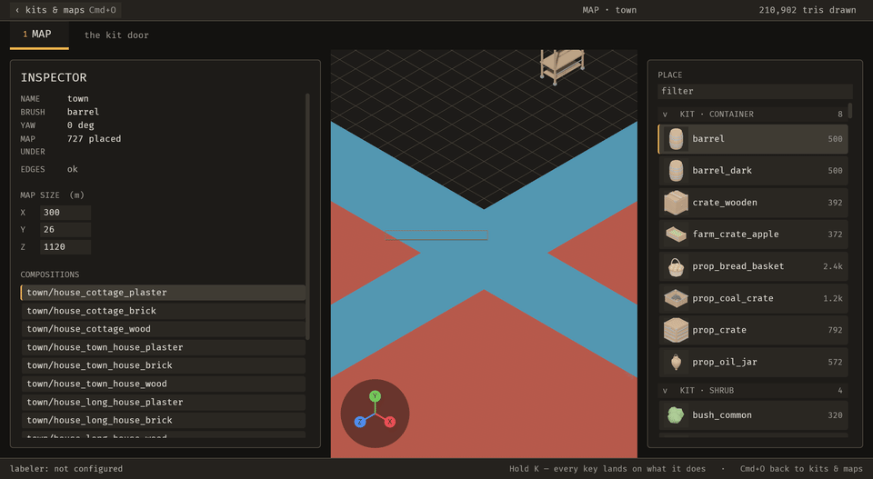
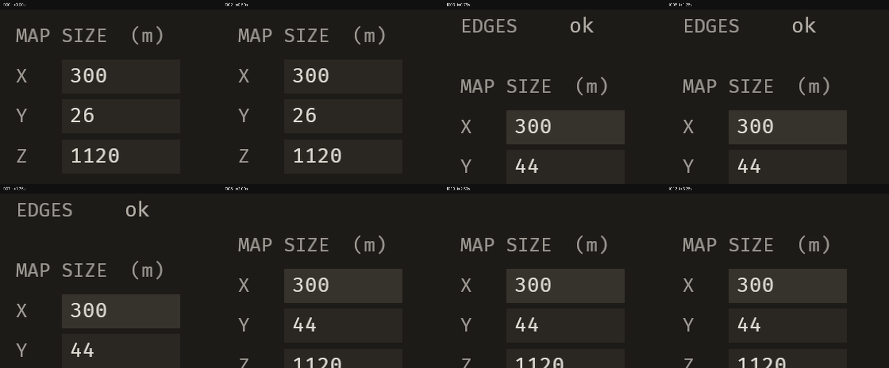
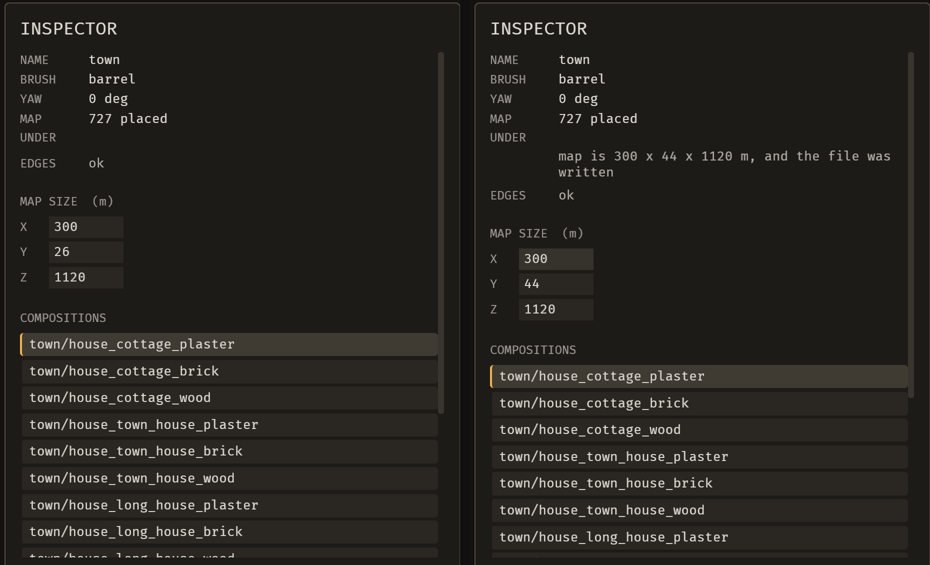

# 2026-10-21 undo: Cmd+Z after a resize takes back the resize, not an older placement

Focus: none (chosen from evidence) · Commits: `da9b549..5275c48` (+ this report) · Outcome: **fixes only**

## Summary
**B-008:** the size field's change never reached the editor's undo stack, so Cmd+Z after a resize removed an older, unrelated placement and kept the resize. It now records the change on that stack and undoes it through `ops::undo`, the function `emerge_undo_operation` uses, so a person and an agent share one settings history.

A second must-fix bug, **B-009** (the inspector reflows on every receipt), was found and logged. Phase 2 was **skipped** under the brief's context-budget clause. No enhancement was attempted.

## Baseline
- **Gate at `da9b549`:** clippy `--workspace --all-targets -D warnings` 0 findings; `cargo test --workspace` 1,341 pass / 0 fail.
- **Scene:** `town` (727 placements, real meshes), scratch copy of the Sanctuary kit.
- **Runtime numbers:** taken at a load average of **34.4**, from another session's Sanctuary build:
  - frame time 50.9 ms median, from `bevy_debugger/status` frames over 5 × 2 s, no capture;
  - MCP `map_set_settings` call 65 ms, visible ≤ 456 ms, which includes the still round trip;
  - file edit visible ≤ 869 ms;
  - still 301 ms; 4-frame sequence 1,389 ms.
- **Runtime sweep:** the editor log has no WARN or ERROR lines on this scene.

## Bugs fixed

### B-008: Cmd+Z after a map resize took back an older placement and left the resize
- **Must-fix:** blocks **y** (an unrelated edit is silently removed), common y (any resize followed by Cmd+Z), no workaround n (Cmd+Shift+Z, retyping).
- **Root cause:** the size field dispatches `map_set_settings` through the registry, which writes the file and the log but nothing on `EditorState`'s placement-only undo stack.
- **Fix (`5275c48`):**
  - The size field records `Undo::Settings { line }`, naming its log line.
  - That undo arm runs `ops::undo` with the map taken through the operation context.
  - The inverse is a `Settings` entry naming the undo's own line, so redo uses the same arm.
  - A refusal, for example when the agent already took the change back, goes to the problem slot.
- **Regression check:** `tests/one_undo_takes_back_the_newest_change.rs`. It drives the person's path: the field's own `Activate`, typed digits and Enter as `KeyboardInput`, and Cmd+Z / Cmd+Shift+Z as chords.
  - `cmd_z_after_a_resize_takes_back_the_resize_and_not_an_older_edit` failed on the unfixed code with `(bounds.y, placements) = (44, 0)`, meaning the resize was kept and the fence was gone. It passes now, including the file and two redos in order.
  - `cmd_z_does_not_undo_a_resize_the_agent_already_took_back` covers the shared history.
- **Live sequence:** a person clicks the Y field, types 44, presses Enter (at about 0.67 s), then presses Cmd+Z (at about 1.86 s), all injected through `bevy_debugger/input`. Captured with `emerge_capture_sequence` at 4 fps.
  - **Before:** Y reads 44 from f003 through f013. The status says "nothing to undo" and the file keeps 44.
  - **After:** Y reads 44 from f003 through f007, then **26 from f008 (t=2.00 s)**, steady through f013. The file goes back to 26 and the status reads "size back: map is 300 x 26 x 1120 m, and the file was written".
  - The live run had no fence placed, so the lost placements show only in the headless test.

| Before | After |
| --- | --- |
|  |  |
|  |  |

## Found, not fixed: B-009, the inspector reflows on every receipt
- **Must-fix:** blocks n, common **y**, no workaround **y**.
- **What happens:** the receipt row under UNDER is empty until a note arrives. "map is 300 x 44 x 1120 m, and the file was written" then wraps onto two lines and pushes MAP SIZE and the composition list down by two lines. They move back up when the note shortens: compare f002 → f003 and f007 → f008 in both sheets above.
- **Not new:** it is identical on the pre-fix build.

Deferred under the brief's budget clause ("or your context is getting heavy: fix the most damaging, log the rest, skip Phase 2").

## Enhancement
None. Phase 2 was skipped under the budget clause.

## Performance
- **Frame time:** 50.9 ms at load average 34.4 → **17.9 ms** at load average 6.0. That difference is load; the fix adds no per-frame work, since the undo arm runs only when Cmd+Z pops a `Settings` entry. **No change is claimed** (E-011).
- **Cmd+Z to visible:** at most 140 ms. The key was sent at 1.86 s and f008 at 2.00 s shows it. The 4 fps frames only bound it from above, so they cannot show whether it meets the 100 ms target.

## Review
No independent review. Nothing new was offered to an agent, and the fix is pinned by a test that fails on the unfixed code, driven through the real key path.

## Test diffs
- **New:** `crates/bevy_emerge_mapper/tests/one_undo_takes_back_the_newest_change.rs` (2 tests).
- **New test hook:** `editor::size_field_for_test` opens the field through the same `Activate` a click sends.
- **Changed:** no existing test or assertion.

## Release
Not published. No crate in this workspace has ever been published, and there is no release workflow; the first publication is the owner's decision (E-006). Commits are local and not pushed.

## Deferred / open
- **B-009:** the receipt-row reflow. Must-fix, deferred.
- **E-013:** the person's Cmd+Z cannot reject an agent's change.
- **E-011:** frame time over MCP tracks machine load.
- **E-012:** the signature-reading ratchets can't see inside `SystemParam` bundles.

## Next focus
**B-009** first: it is must-fix, it shows on every receipt, and the fix is small (reserve the row's height, or keep a receipt to one line). Then **E-013**, so a developer can reject an agent's change with the same Cmd+Z.
