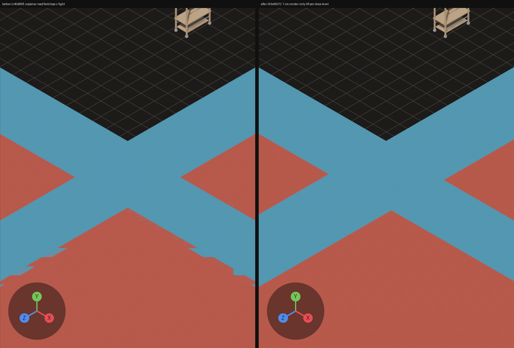
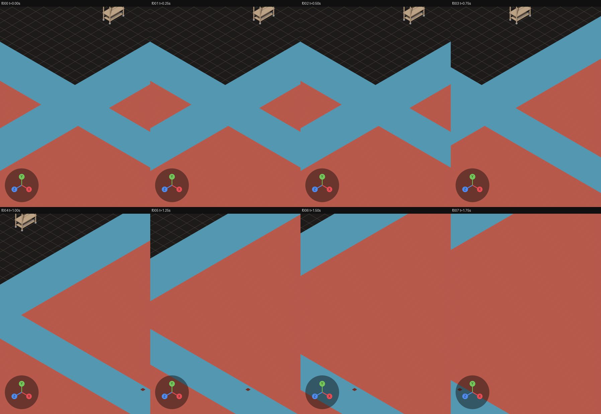
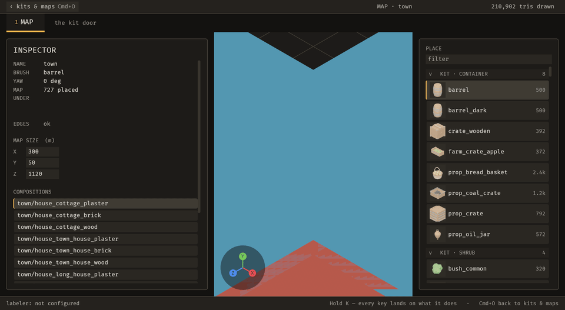
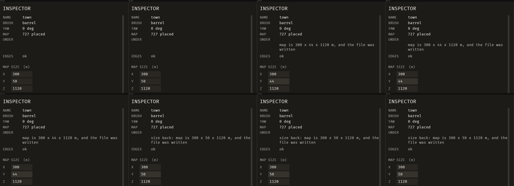
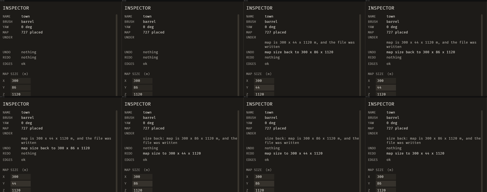
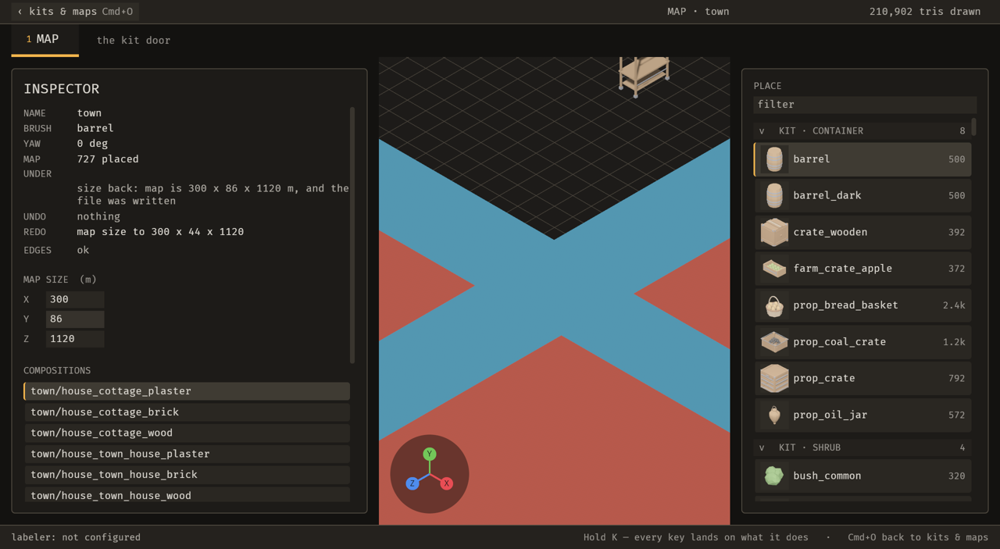

# 2026-10-21 undo: the inspector names what Cmd+Z will do, and roads no longer z-fight with fields

Focus: renzora/engine ideas · Commits: `98be109..63e6631` (+ this report) · Outcome: **shipped**

## Summary
**The enhancement** borrows renzora's history-panel idea: each undo entry carries a name. The INSPECTOR now shows what Cmd+Z and Cmd+Shift+Z will do, and `emerge_state` tells the agent the same words.

**The bug** was z-fighting where roads cross fields, which the developer pointed out. It is fixed with a render-only draw order, on the second of the two attempts the brief allows. The first attempt, depth bias, passed its tests but still z-fought in the live still.

## Baseline
- **Gate at `98be109`:** clippy 0, 1,347 pass / 0 fail.
- **Runtime, `town` (727 placements), load average 8.9:**
  - frame time 17.8 ms median;
  - MCP change 37 ms, visible ≤ 170 ms; file edit visible ≤ 460 ms;
  - still 131 ms, 4-frame sequence 989 ms.
- **Runtime sweep:** no WARN or ERROR lines.
- **Open bugs:** none must-fix (B-012 and B-013 were not must-fix).

## Bugs fixed

### B-015: roads and fields z-fought where they overlap
- **Must-fix:** blocks n, common **y** (every road crossing in the developer's town), no workaround **y** (only by editing the authored map).
- **Root cause:** `town/road` and `town/field` are mesh-less 0.05 m markers standing on the floor, so every top face sat exactly at y = 0.05. The editor also ignored authored `Placed::paint`; the game applies it.
- **Attempt 1 (`bd5116a`):**
  - authored paint now applies in the editor, as in the game;
  - `bevy_emerge_core::draw_order::draw_levels` orders overlapping flat pieces: the smaller footprint on top, then the later placement on top when the areas are equal. On this map that puts roads over fields, which matches the game (Sanctuary `town.rs:60`, `ROAD_LIFT`).
  - The levels reached the screen as depth bias only. The headless tests passed, but the **live still still showed the lower crossing striped**: one bias step (`PAINT_STEP = 1.0`) is below a field-sized quad's interpolation error at the Map's ~2,000 m depth range.
- **Attempt 2 (`63e6631`):** a render-only lift of each flat marker's mesh, 1 cm per draw level (about 40 depth steps at that range). Stacking and picking read placement data and `stack::resolve_y`, not the lifted meshes (`editor.rs:9196-9198`). No map or library data changed.
- **Regression check:** `tests/roads_and_fields_do_not_z_fight.rs`, 4 tests. All four failed before the lift, with both tops at 0.05 m, e.g. "its top is 0.05 m against the field's 0.05 m … the z-fight". They pass now. The relevel test also fails with the relevel system removed.

| Before (`c40d89f`) / after (`63e6631`), same view | After, while panning (4 fps): edges stay clean |
| --- | --- |
|  |  |

## Enhancement: the inspector names what Cmd+Z and Cmd+Shift+Z will do
- **Plan:** `Undo::describe` phrases, two one-line UNDO and REDO rows in the INSPECTOR's status block, and four additive `emerge_state` fields.
- **Files:** `editor.rs`, `ops_brp.rs`, the MCP tool description (`main.rs`, `docs.rs`), `docs/mcp-tools.md`.
- **Goal:** before pressing Cmd+Z, the author reads what it will take back, and an agent reads the same words.
- **Proof:** `tests/the_next_undo_is_named.rs`. It failed before the rows existed ("no drawn text reads \"nothing\"") and passes now, with 5 tests.
- **Candidates considered:**
  - **E-016, the labelled history (renzora `renzora_history`).** The user problem is a blind Cmd+Z; it comes up on every undo; it saves trial-and-error undos; low risk. Chosen.
  - **E-015, an action palette (renzora `renzora_command_palette`).** High value, but firing an action from a palette means changing `keys::just_pressed` at more than 100 call sites. Deferred.
  - **E-014, snip.** The developer asked for it, but it is larger: a gesture, a capture and a text field. Deferred.
- **MCP:** `emerge_state`'s editor section gains `undo_next` (`string|null`), `undo_depth`, `redo_next` and `redo_depth`. No new operation, so the parity test is unchanged. The four fields read the person's undo stack only; an agent's own changes are taken back with `emerge_undo_operation`, and how the two histories meet is E-013.
- **Sequence:** resize Y through the field at 0.68 s, then Cmd+Z at 1.87 s, injected through `bevy_debugger/input`, 4 fps.
  - **Before:** no row says what Cmd+Z will do.
  - **After:** UNDO reads "map size back to 300 x 86 x 1120" after the resize, then REDO reads "map size to 300 x 44 x 1120" after Cmd+Z. UNDO, REDO, EDGES and MAP SIZE hold their y in every frame.

| Before | After |
| --- | --- |
|  |  |
|  |  |

| Default window (2560 × 1406) | Narrower window (1800 × 1406) |
| --- | --- |
|  |  |

## Performance
- **Frame time, interleaved A/B:** base `98be109` vs final `63e6631`, 3 rounds each, same scene, no capture, load average 6–8.

  | Round | Base (ms) | Final (ms) |
  | --- | --- | --- |
  | 0 | 19.07 | 17.81 |
  | 1 | 18.45 | 16.95 |
  | 2 | 17.20 | 17.05 |
  | **Median** | **18.45** | **17.05** |

  No regression.
- **Noise calibration:** a first A/B accidentally ran the base binary against itself, because of a shared-target collision explained below. It still differed by 1.0 ms median-of-medians, with per-round swings up to 8 ms, so a single 23.8 ms reading on the final build was noise.
- **Edit-to-visible on the final build:** MCP change 59 ms, visible ≤ 220 ms; file edit visible ≤ 662 ms (load 7.0). Both are under the one-second target.
- **New per-frame cost:** the UNDO and REDO rows are recomputed only when `EditorState` or `OpenMap` changed, and the paint and lift systems are change-driven.

## Review
- **Enhancement:** a fresh-context reviewer found two should-fix gaps and three nits, and nothing blocking. All five were real after a skeptic pass and are fixed in `4a3ae38`, which has a failing-before test for each:
  - a grouped change was named by its first part only (it read "remove 1 fence (+1)");
  - a hint moved the UNDO row (y 273.0 → 289.0) after my reorder in `c40d89f`;
  - the REDO row said "back" where it meant "again";
  - a stale index read as an undo that would succeed;
  - tests were missing for the first two.
- **My own check:** `c40d89f` moved the pair below the receipt, because the unlabelled receipt read as REDO's value.
- **B-015:** no separate reviewer. The deciding evidence is the live still and the panning sequence, after the first attempt failed that same check.

## Test diffs
- **New:**
  - `tests/the_next_undo_is_named.rs` (5 tests)
  - `tests/roads_and_fields_do_not_z_fight.rs` (4 tests)
  - fixture helpers `flat_descriptor` and `place_painted` in `tests/fixtures/mod.rs`
- **Changed:**
  - `the_inspector_names_the_next_undo_and_redo`, an expected REDO phrase: "map size back to" became "map size to" (the wording fix in review gap 3).
  - The four z-fight assertions moved from "bias differs" to "tops separated in world y by at least `LEVEL_LIFT`". That's stronger: the bias-only code passes the old check and fails the new one.
- **Unchanged:** no test was loosened.

## Release
Not published. No crate in this workspace has ever been published, and there is no release workflow; the first publication is the owner's decision (E-006).

Per the developer's instruction, the commits are pushed on a branch, opened as a PR, merged, and pulled back into local main. That is not a crates.io release.

## Deferred / open
- **E-018:** the full history list with click-to-jump.
- **E-014:** snip.
- **E-015:** action palette.
- **E-017:** agent camera framing.
- **E-019:** Sanctuary's `ROAD_LIFT` is content in code.
- **E-020:** ghosts and previews have no draw levels, and relevel is O(n²).
- **B-012, B-013, B-014:** not must-fix.
- **Process note:** a scratch worktree at an older commit that shared the target directory overwrote this repo's artifacts, which have the same package hash, and cargo then called the stale artifacts fresh. I caught it by checking the binary's strings, removed the worktree, touched the sources, and rebuilt. The final gate ran after that rebuild.

## Next focus
**E-014 (snip)** together with **E-017 (agent camera framing)**. The developer has asked twice to show the agent what they see, and both iterations' best finds came from full-window pictures.
