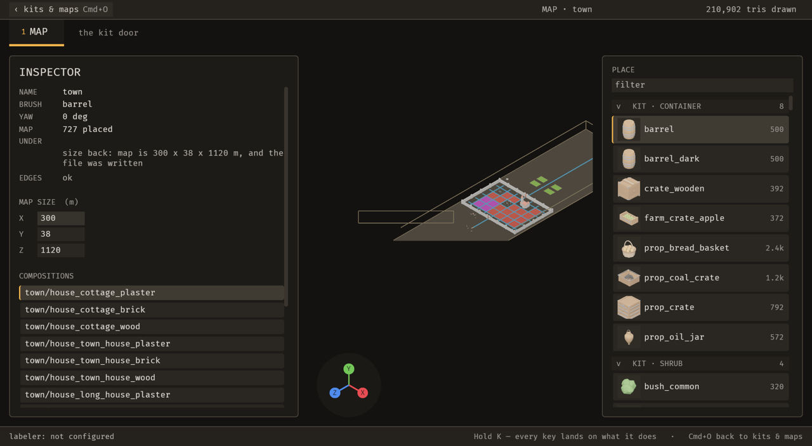
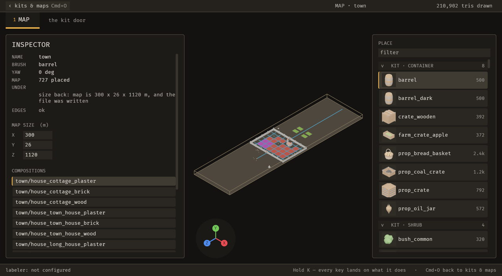
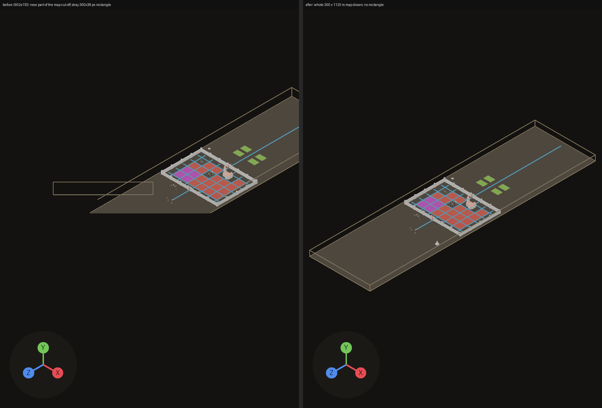
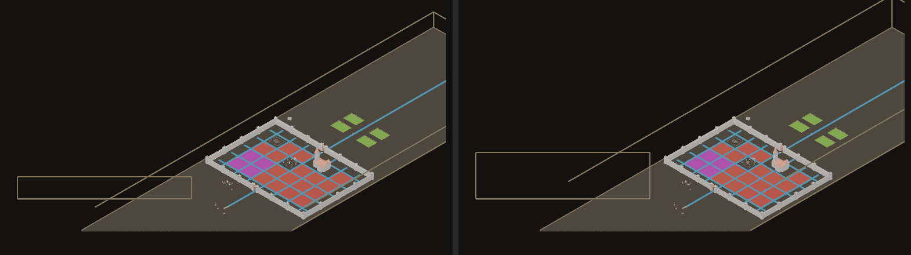
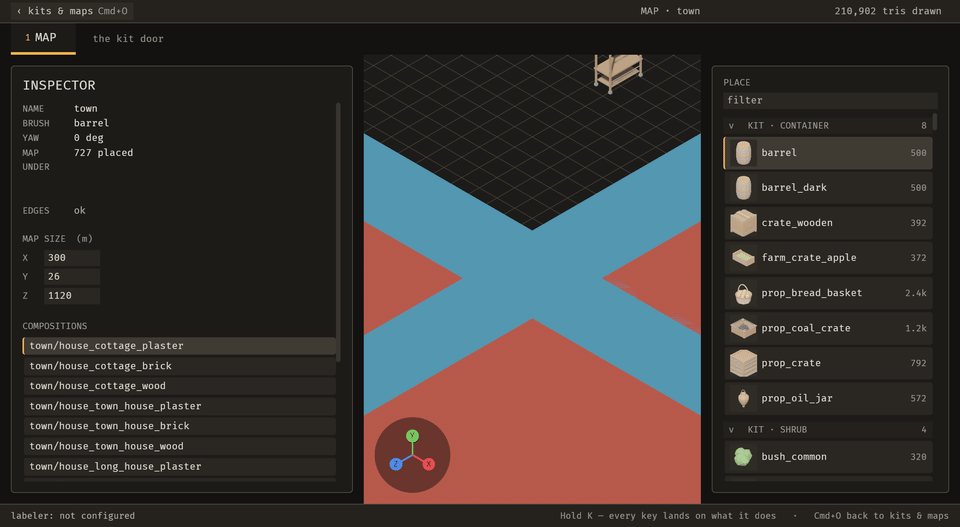
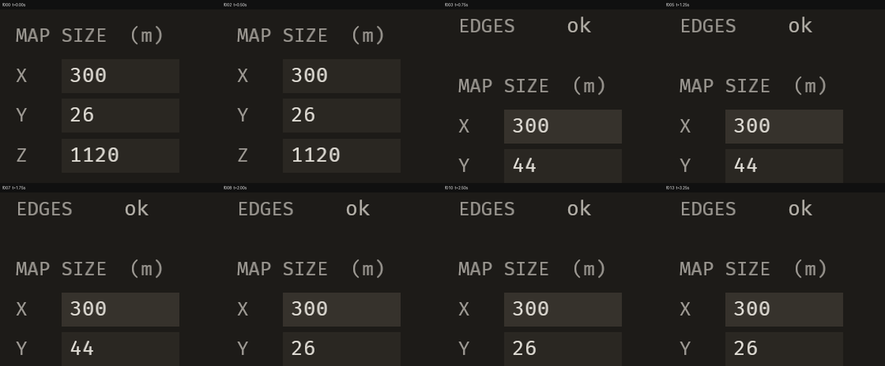
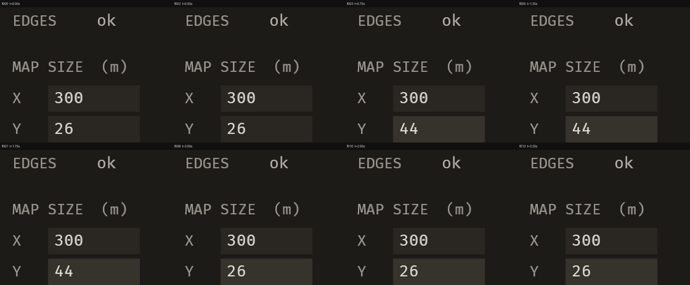

# 2026-10-21 view: large maps are drawn whole, the stray rectangle is gone, and receipts no longer move the panel

Focus: renzora/engine ideas, then the developer's request to "capture a few screenshots of the full window so you can see the problems that I'm seeing" · Commits: `602e1f3..15be05c` (+ this report) · Outcome: **fixes only**

## Summary
Full-window stills of Sanctuary's 300 × 1120 m town (scratch copy) showed two bugs nobody had logged. Part of the map was not drawn at all: **B-010**, a camera depth range sized for a room. A rectangle floated over the map: **B-011**, the interface camera drawing the world's gizmos. Both are fixed, along with the open **B-009** (every receipt pushed the inspector down two lines).

The renzora survey produced backlog items, not code. Phase 2 was **skipped** under the brief's budget clause, after three must-fix bugs and a heavy image review.

## Baseline
- **Gate at `602e1f3`:** clippy 0, 1,343 pass / 0 fail.
- **Runtime, `town` (727 placements), load average 42:**
  - frame time 78.7 ms median (5 × 2 s windows, no capture);
  - MCP change 150 ms, visible ≤ 481 ms; file edit visible ≤ 979 ms;
  - still 383 ms, 4-frame sequence 1,193 ms.

## The screenshots

| Before (`602e1f3`), zoomed out | After (`15be05c`), zoomed out |
| --- | --- |
|  |  |

## Bugs fixed

### B-010: the near part of a large map and every piece on it was not drawn
- **Must-fix:** blocks **y** (pieces on the map are invisible), common **y** (any map past about 40 m, including the developer's town), no workaround **y** (panning moves the cut, and zooming out never shows the whole map).
- **Root cause:** the Map camera is orthographic and sits 20.8 m from its focus with `OrthographicProjection::default_3d()` (near 0, far 1000). `view::max_zoom` widens the view to 1.25 × the map, but not the depth range.
  - At the camera's own transform (read over BRP), two of the four ground corners were 67 m and 240 m behind the near plane.
  - The cut line x + z = 293 projects to y = 758 px, and the slab ended at y = 757 in the still.
- **Fix (`02cadc7`):** `view::depth_range` spans every corner of the map's bounds along the camera's forward axis, plus a quarter of the bounds' diagonal, and is never narrower than the default. It is applied in `setup` and `drive`, the only two writers of that projection. The camera does not move, because an orthographic image does not depend on distance.
- **Regression check:** `tests/the_whole_map_is_inside_the_cameras_depth.rs`.
  - `a_town_sized_map_is_not_cut_off_by_the_near_plane` failed before the fix (corners at −625.8 and −627.6 m against near 0.0) and passes now.
  - `a_room_sized_map_is_still_drawn_whole` passes before and after.

### B-011: a rectangle the size of the map's front face sat at the window's centre
- **Must-fix:** blocks n, common **y** (every map), no workaround **y**.
- **Root cause:** Bevy draws a gizmo on every camera whose `RenderLayers` meet the gizmo group's, and both default to layer 0. `surface::SurfaceCamera`, the 2D camera that draws the interface, had none, so it drew the bounds box through its own projection: 300 × 38 px at one pixel per metre. How it was identified:
  - a BRP query found no UI node under it;
  - changing the map's height with `map_set_settings` from 38 to 80 m changed its height (below; taken back with `emerge_undo_operation`);
  - zooming the map left it in place.
- **Fix (`b097613`):** `RenderLayers::none()` on that camera, as `SurfaceGround` already has. Bevy's UI renderer never reads `RenderLayers`.
- **Regression check:** `tests/world_gizmos_stay_in_the_world.rs::only_the_world_camera_draws_gizmos` failed before the fix (`403v0 None on RenderLayers([0])`). It also asserts the Map camera still shares a layer with the gizmos.

| B-010 and B-011, before / after (viewport) | Rectangle at map height 38 m / 80 m |
| --- | --- |
|  |  |

### B-009: every receipt pushed MAP SIZE and the lists down two lines and back
- **Must-fix:** blocks n, common **y**, no workaround **y**. Carried over from the last iteration.
- **Fix (`ef1dd7c`):** the receipt row keeps two lines of room when empty. The height is `chrome::BODY_LINE_H`, Bevy 0.20's default line height at `text::BODY`, rounded up to a whole pixel. Two lines because 165 of 174 receipt sites are ≤ 80 characters; a longer receipt still grows rather than being cut short.
- **Regression check:** `tests/a_receipt_does_not_move_the_panel.rs`. It failed before the fix (the 32 px receipt pushed MAP SIZE down by 32.0 px), failed at 1.0 px with an unrounded reserve, and passes now. It also asserts the receipt is drawn and wraps.
- **Sequence:** resize Y through the field at 0.67 s, then Cmd+Z at 1.83 s, injected through `bevy_debugger/input`, 4 fps. In the after sheet, MAP SIZE holds the same y in every frame. The before reference is the same script on `5275c48` (same inspector code as `602e1f3`), where the block moves between f002 and f003.

| Before | After |
| --- | --- |
|  |  |
|  |  |

## Enhancement
None; Phase 2 was skipped under the budget clause. These candidates were logged:
- **E-014, snip.** The developer asked for it: drag a rectangle, and the agent gets the crop plus map, camera, panel text and placements.
- **E-015, action-search palette.** From renzora's `renzora_command_palette`.
- **E-016, labelled undo history.** From renzora's `renzora_history`.
- **E-017, the agent cannot frame the camera.** A parity gap hit in this review, which had to inject wheel events to zoom.

The rest of the renzora survey (toast severities, rebindable keys with stable ids, sealed gesture undo) is lower value or high risk here, and was not logged.

## Performance
- **Fixed build, load average 7.6:** frame time 17.4 ms median. MCP change 38 ms, visible ≤ 149 ms; file edit visible ≤ 349 ms; still 120 ms.
- **Comparison:** the baseline ran at load average 42, so the two are not comparable. The nearest same-load figure is 17.9 ms at load 6.0 on `5275c48` (previous iteration), which has the same view and inspector code. No regression is claimed in either direction.
- **New per-frame cost:** eight dot products in `depth_range`.

## Review
A fresh-context reviewer read the three diffs and the stills.
- **Blocking gaps:** none.
- **B-010 checks:**
  - picking still works, because rays now start on the moved near plane, behind the map;
  - shadows are unaffected, because cascades come from their own settings;
  - `drive` is the only writer of the Map camera's projection.
- **Three nits**, after a skeptic pass:
  1. The room test's doc overstated what it checks. Reworded in `15be05c`.
  2. The receipt test should prove its receipt wraps. Assertion added in `15be05c`.
  3. The hint row has the same zero-height shape. It was already like that; logged as B-013, not must-fix, since it needs a surface or mounted piece armed.
- **Also from the reviewer:** coplanar road and field patches flicker against each other in Sanctuary's town. That's map data, and the wider depth range moves where it shows but didn't cause it. Not logged.

## Test diffs
- **New:**
  - `tests/a_receipt_does_not_move_the_panel.rs`
  - `tests/the_whole_map_is_inside_the_cameras_depth.rs`
  - `tests/world_gizmos_stay_in_the_world.rs`
- **Changed after review (`15be05c`):** one assertion added (stronger) and one doc comment reworded. No existing test or assertion was weakened.

## Release
Not published. No crate in this workspace has ever been published and there is no release workflow; the first publication is the owner's decision (E-006). Commits are local and not pushed.

## Deferred / open
- **B-012:** the receipt reads as UNDER's value. Not must-fix.
- **B-013:** the hint row reflows. Not must-fix.
- **E-014 – E-017** above.
- **Not captured:** the kit door. The injected `2` key did not switch to it, and I did not confirm its binding.

## Next focus
**E-014 (snip)**, because the developer asked for it and this iteration showed what a picture of the developer's own view finds. Building E-017 first would let the agent frame what a snip points at.
