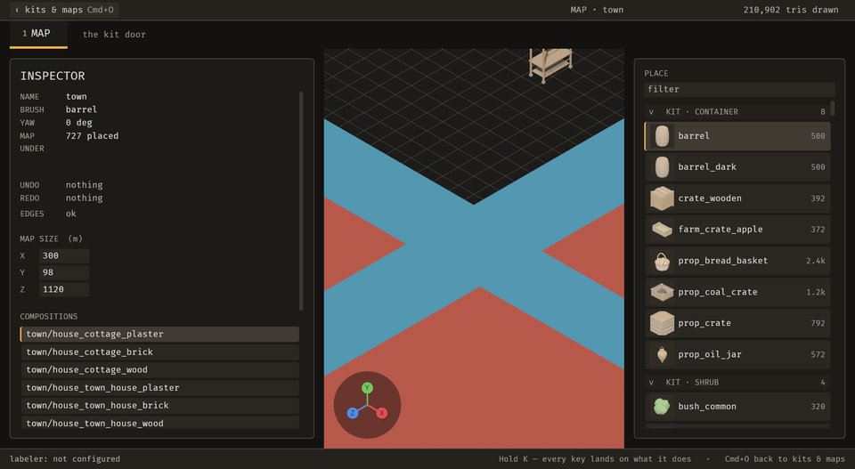
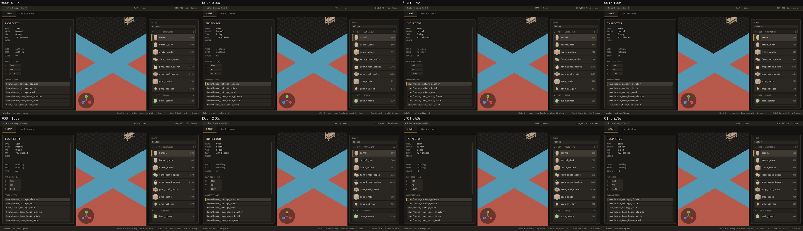
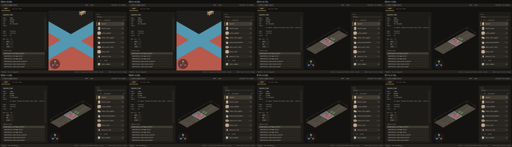
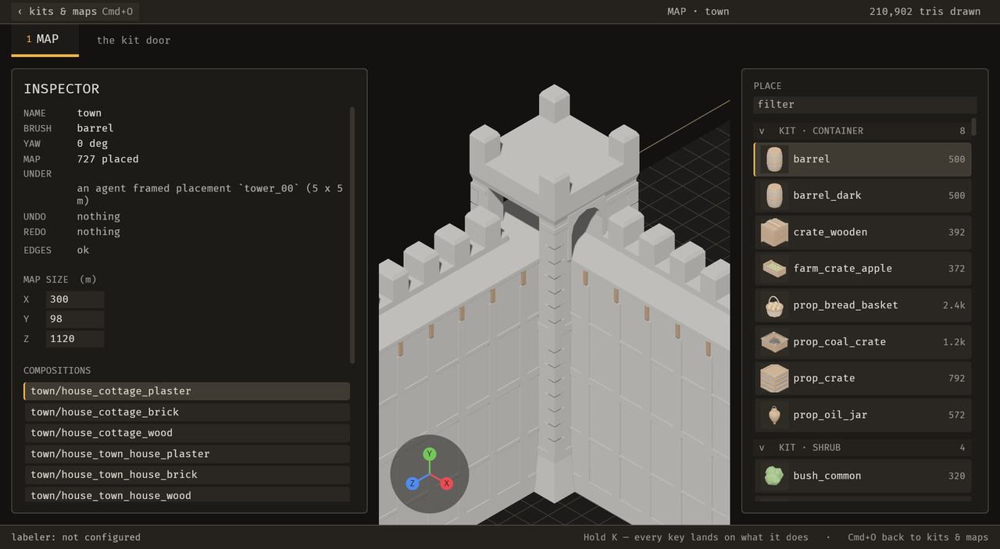
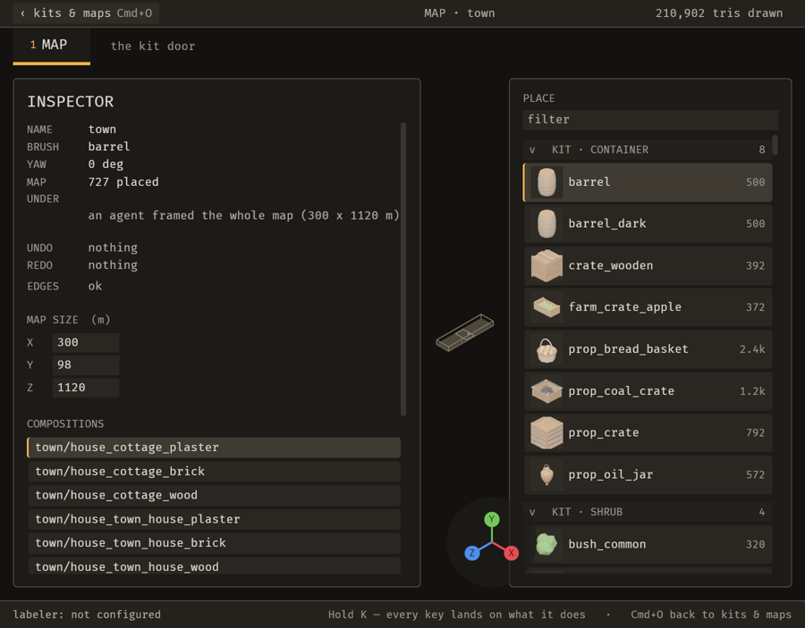

# 2026-10-21 view: an agent can frame the map, a placement or a rectangle

Focus: renzora/engine ideas ("frame selected / view all") · Commits: `b6ee5af..8c97677` (+ this report) · Outcome: **shipped**

## Summary
`emerge_frame_view` lets an agent point the Map camera at the whole map, the locked placement, placements by id, or a map-space rectangle. It works through one pure `view::frame_box`, and it leaves a receipt so the person sees why the view moved. That closes E-017: the last two reviews had to inject wheel events to look at anything.

The zoom ceiling is also fixed. It was too low to show a large map whole under the 45° iso view, which affected the person's mouse wheel too. The person's own Home key was built, then taken out: the parity ratchet only accepts a new non-operation action together with a migration (E-021).

## Baseline
- **Gate at `b6ee5af`:** clippy 0, 1,363 pass / 0 fail.
- **Runtime, `town` (727 placements), load average ~6:**
  - frame time 27.8 ms (a single run);
  - MCP change 51 ms, visible ≤ 252 ms; file edit visible ≤ 528 ms;
  - still 196 ms, 4-frame sequence 1,070 ms.
- **Runtime sweep:** no WARN or ERROR lines.
- **Open bugs:** none must-fix.

## Bugs fixed
None were open or found. One must-fix-class problem surfaced and was fixed inside the enhancement: `view::max_zoom` was 1.25 × the longer side. Under the iso view and a viewport narrower than tall, that allows 1,400 m where an 1,120 m square needs about 1,880 m, so the whole map could never be seen, by wheel or by frame.

## Enhancement: an agent frames the view
- **Plan:**
  - one pure `view::frame_box`, fitting a box for the rig's settled yaw and elevation and the real viewport aspect, with a margin;
  - `editor::resolve_frame` / `apply_frame` for the targets;
  - BRP `emerge/frame_view` and the MCP tool `emerge_frame_view`;
  - a ceiling that can show the whole map: `max_zoom = max(MAX_ZOOM, 1.25 × ground diagonal ÷ min(aspect, 1))`, shared by the wheel and the frame.
- **Files:** `view.rs`, `editor.rs`, `ops_brp.rs`; `bevy_emerge_mcp` `main.rs` and `docs.rs`; `docs/mcp-tools.md`.
- **Goal:** an agent can look at exactly the region being discussed.
- **Proof:** `tests/frame_the_view.rs`, 6 tests, plus the `view` unit tests and the MCP tool listing.
  - `framing_the_map_shows_the_whole_map` **fails with the old ceiling restored**: "after framing, a corner of the 1120 m map is still outside the camera's view". It passes now.
  - The other new tests failed first by not compiling, since there was no `frame_box` and no tool.
- **Candidates considered:**
  - **E-017, agent camera framing (renzora's "frame selected").** Every inspect and present step on a large map needs it; it replaces fake wheel input; low risk. Chosen.
  - **E-014, snip.** The developer asked for it, but it is larger, and it wants framing first.
  - **E-018, the undo history list.** Lower frequency.
- **MCP:**
  - `emerge_frame_view {target: "map" | "selection" | {"placements": [ids]} | {"rect": [x0, z0, x1, z1]}}`, annotated readOnly false, destructive false, idempotent true.
  - Camera state only: not a registry operation, not logged, not undoable.
  - It refuses atomically, moving nothing, on an unknown id, an empty selection or a flat rectangle.
  - It returns what was framed, the focus and the view height.
  - Outside-agent check: tools listed, description read, call made. The answer was `{"outcome":"framed","what":"the whole map","height_m":1471.8, …}` in 9 ms (`seq/enh_after-result.json`).
- **Sequence:** an agent calls the tool at 0.6 s, 4 fps.
  - **Before (`b6ee5af`):** the call is refused ("does not answer `emerge/frame_view`") and the view stays on the close-up.
  - **After:** f003 (t = 0.75 s) frames the whole 300 × 1120 m map with every bounds edge in view, and the inspector says "an agent framed the whole map (300 x 1120 m)". It holds through f011.

| Before | After |
| --- | --- |
|  |  |
|  |  |

| One placement, `tower_00` (default window) | Whole map, narrower window (1800 × 1406) |
| --- | --- |
|  |  |

- **The person's Home key, built and taken out:** a new `keys::Action` that is not a registry operation grows the unmigrated allowlist. `operations_have_two_front_ends::the_allowlist_of_unmigrated_actions_only_shrinks` pins that list at 128, and says a new entry is "paid for in the same commit that migrates one". Raising the literal would weaken the check, so the key waits (E-021).
- **A misread I caught:** in the 1/4-scale sheet the framed tower looked cropped, so I built a "frame what is drawn" variant. The full-resolution frame shows the tower whole. What ran out of view were the adjoining wall segments, which are other placements. Both variants framed identically (focus y = 8.2296 = half the authored 16.46 m height), so the variant was unneeded and is not in the commit.

## Performance
- **Frame time:** 9 interleaved A/B rounds, both run orders, same scene, no capture, load 6–8.

  | Build | Median frame time |
  | --- | --- |
  | Base `b6ee5af` | 22.9 ms |
  | Final `8c97677` | 24.7 ms |

  Paired difference per round: −3.1, +1.8, +2.9, +0.6, +4.0, +3.2, +4.7, −1.3, +0.8 ms. That's a mean of +1.5 ms (s.d. 2.5), paired t = 1.79, below the 95% threshold of 2.31 at df = 8. **Not distinguishable from noise, but leaning slower.** Identical binaries differed by 1.0 ms in the previous iteration's calibration.
- **No per-frame work was added** apart from `view::drive` reading the viewport aspect from its projection. **No change is claimed.** A profiler check is logged (E-023).
- **Edit-to-visible:** unchanged paths. The baseline above applies.

## Review
Not run separately this iteration. The gate, the failing-before checks and the live sequences are the evidence. The build agent (fresh context) and my own skeptic pass on the tower still are recorded above.

## Test diffs
- **New:** `tests/frame_the_view.rs` (6), five `view` unit tests, and `the_frame_tool_says_it_only_moves_the_camera` in `bevy_emerge_mcp/tests/an_agent_calls_the_server.rs`.
- **Changed:** `view::tests::the_zoom_ceiling_grows_with_the_map_and_never_shrinks_below_the_constant` now asserts the new rule (the diagonal over the aspect). The old pins encoded the ceiling that could not show the map whole. Same intent ("a town sees itself whole"); the old numbers were the bug.
- **Unchanged:** no assertion was loosened, and the allowlist ratchet is untouched.

## Release
Not published. No crate here has been published and there is no release workflow (E-006).

## Deferred / open
- **E-021:** the person's frame key, to ship with one registry migration.
- **E-022:** open the map framed, or on its saved view.
- **E-023:** profile the possible +1.5 ms frame time between `b6ee5af` and `8c97677`.
- **E-014:** snip.
- **E-018:** the history list.
- **B-014:** in a narrow window the viewport is a thin strip.

## Next focus
**E-014 (snip)**. The agent can now frame what a snip points at, so the developer's request to show the agent what they see is the natural next step.
