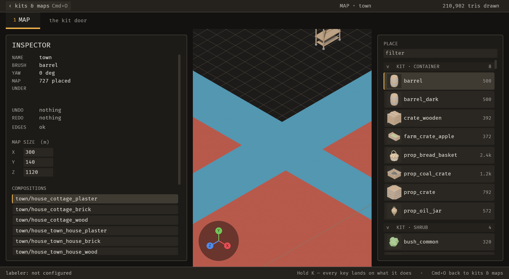
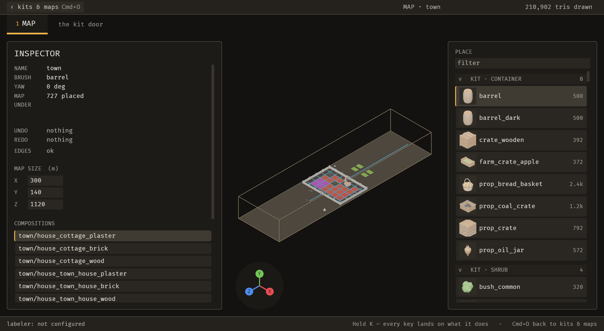

# 2026-10-21 view: the Map opens framed on the whole map

Focus: renzora/engine ideas, from the handoff · Commits: `b51da72` (feature) + the docs commit that adds this report · Base: `1a3f571` · Outcome: **shipped one enhancement (E-022); no bugs fixed**

## Summary
Every opening of Sanctuary's 300 × 1120 m town showed an 18 m close-up of the origin: ground, barrels and a bench, with the map off-screen. A person had to zoom out to find the map before doing anything. The first Map opening now frames the whole map, through the same `resolve_frame` / `apply_frame` path the agent's `emerge_frame_view` uses. No new key, no new operation, no ratchet change.

## Baseline
- **Gate at `1a3f571`:** `cargo build --workspace` 0; `cargo clippy --workspace --all-targets -- -D warnings` 0; `cargo test --workspace` 0, **1384 passed, 0 failed**. Logs: `target/loop/2026-10-21-1a3f571/`.
- **Runtime, `town` (727 placements, bounds [300, 128, 1120]):**
  - frame time per 2 s window: 16.65, 16.67, 16.67, 16.67, 16.68 ms (median 16.67 ms, the 60 fps vsync cap);
  - still 123 ms; 4-frame sequence 963 ms;
  - MCP edit-to-visible: call 27 ms, first changed still 150 ms; file edit-to-visible 437 ms;
  - editor log: 0 WARN / ERROR / panic lines.
- **Open items at baseline:** the full-window still shows the UNDER row empty (B-012) and the view on the 18 m close-up.

## Triage (Phase 1)
- **B-012** (receipt sits in the UNDER column): logged, not must-fix (Blocks no; Common, No workaround not both yes). Not fixed.
- **B-013** (zero-tall hint row): logged, not must-fix. Not fixed.
- **B-014** (narrow window shows a thin viewport strip): logged, not must-fix. Not fixed.
- **Must-fix bugs this iteration: none.** So the bug phase had no commits.

## Enhancement: the Map opens framed on the whole map (E-022)
- **Why this one:** the first thing both a person and an agent do on every opening is zoom out to find the map. It is a one-screen change with no new key, no new operation and no new persistence file.
- **Why not E-021 (Home key):** a new `keys::Action` that is not a registry operation grows `UNMIGRATED` past its ratchet (`operations_have_two_front_ends::the_allowlist_of_unmigrated_actions_only_shrinks`, `UNMIGRATED_MAX = 128`), and `emerge/frame_view` is documented as a BRP command, not an operation. Adding the key means either raising the ratchet or migrating an action in the same commit. That is a design decision for the developer. Deferred.
- **Change** (`crates/bevy_emerge_mapper/src/editor.rs`, `src/screen.rs`):
  - `frame_map_on_open` runs in `Update` while `Screen::Editor` is active. It waits until the camera's laid-out viewport size is unchanged across two updates (the first-frame guess was aspect 1.778; the laid-out aspect was 0.926, and framing on the guess put corners outside the view). Then it calls `resolve_frame(&FrameTarget::Map, …)` and `apply_frame`. A refusal goes to `state.status.problem`.
  - Its one-shot state is a door resource, `MapFraming { done, last_size }`, listed in `screen::door_state!` and in `OWNERSHIP` as `Door`. The first version used `Local`, which `reset_door_state` cannot reach, so only the first Map opening per process was framed. A reviewer caught it; fixed before commit.
- **Tests:**
  - `tests/the_map_opens_framed.rs::the_map_opens_framed_on_the_whole_map` (new). **Failing before:** on `1a3f571` it fails with "on opening, a corner of the 1120 m map is outside the camera's view". **Passes after.** It asserts all 8 corners of `map_bounds(OpenMap)` inside the MainCamera's ortho area, with fill ≥ 0.6.
  - `tests/the_map_opens_framed.rs::the_map_opens_framed_after_the_door_state_resets` (new). **Not failing-before evidence:** it names `MapFraming`, which does not exist on `1a3f571`, so it cannot compile there. It simulates the door reset by inserting default `view::Rig` and `MapFraming`, because `close_the_door` despawns MainCamera and the headless harness never respawns it. Door-list coverage comes from the existing ratchet `screen::the_door_resets_what_it_says_it_owns`.
- **Sequence / stills:** `launch-before` (HEAD `1a3f571` editor, same scratch project `/tmp/emerge_live/hotproj3`) and `launch-after` (`b51da72` editor, same project), captured by `/tmp/emerge_live/launch_still.py`, both at 2560 × 1406.
  - **Before:** ground, barrels and a bench fill the frame; the map is off-screen.
  - **After:** the whole 300 × 1120 m box is in view with the town block at its centre; the gizmo and inspector and palette panels are intact; `emerge_state` reports `bounds [300, 140, 1120]`, 727 placed, `dirty false`.

| Before (`1a3f571`) | After (`b51da72`) |
| --- | --- |
|  |  |

- **Test diffs (none weakened; each listed):**
  - `tests/frame_the_view.rs::framing_the_map_shows_the_whole_map`: **precondition only.** Added a comment, `resource_mut::<Rig>().height = 18.0`, and two `app.update()` calls before `let before = seen(...)`, so the test starts at the close-up it was written against. Its assertions are unchanged. The old default is what the new behaviour removes; the agent's `frame` call still does the framing under test. Reviewer confirmed the edit is legitimate.
  - No other test changed. No golden, snapshot or `tests/protected/` file touched.

## Gates (final, on `b51da72`)
- `cargo clippy --workspace --all-targets -- -D warnings`: **exit 0** (`target/loop/2026-10-21-view/clippy.log`).
- `cargo test --workspace`: **1386 passed, 0 failed** (1384 at base + 2 new), exit 0 (`target/loop/2026-10-21-view/test.log`), wall time 364 s.
- `cargo build -p bevy_emerge_mcp -p bevy_emerge_mapper`: exit 0. The mapper binary contains `frame_map_on_open` (`strings`), so the captured editor was built from the final code, not a stale artifact.
- Formatting: the three edited pre-existing files and the new test file show no diffs inside the added hunks. `editor.rs` has 112 pre-existing rustfmt diffs, the same count at HEAD. `tests/fixtures/mod.rs` churn was not committed.

## Performance
- **Frame time: not re-measured on the final build.** The change adds one flag check per `Update` after framing (`MapFraming::done` short-circuits). The baseline frame time sits at the 60 fps vsync cap, so the method cannot resolve a cost of that size. The profiler question for E-023 is still open and is not closed by this change.
- **Edit-to-visible: not re-measured.** The framing does not sit on the edit path; the baseline figures above (150 ms MCP, 437 ms file) still describe it.

## Review
- One fresh-context reviewer pass on the first version: `incorrect`, P1 = the `Local` reset defect (fixed). It confirmed the `frame_the_view.rs` precondition edit as legitimate and found the ordering fine.
- **The final `MapFraming` refactor has not been re-reviewed** (the review budget of two rounds was one used). The gate and the stills are the evidence for the final state.
- **Reviewer P3, not fixed:** `resolve_frame` for `FrameTarget::Map` calls `heights()` → `resolve_y` although `map_bounds` does not need it (`editor.rs` ~3112). A map whose stacking does not resolve opens unframed at 18 m and raises a stacking-problem toast on opening. Logged here; no backlog id yet.

## Scope reductions (named)
- E-022 frames on **each Map opening only**. The backlog's suggested "last view saved per map as an editor preference" is **not** done: it needs a new persisted file, which the backlog itself lists as the risk. Left open.
- The reviewer's P3 (above) is not addressed.

## Test diffs
- New: `tests/the_map_opens_framed.rs` (2 tests).
- Changed: `tests/frame_the_view.rs::framing_the_map_shows_the_whole_map` (precondition only, +7 lines, assertions unchanged).

## Release
Not published. No crate in this repo has been published and there is no release workflow (E-006). No release was cut.

## Deferred / open
- **E-021:** the person's frame key (Home). Needs a developer decision: raise the ratchet or migrate one action in the same commit.
- **E-014:** the human snip drag gesture (too large for one iteration).
- **E-015:** the action palette.
- **E-018:** the undo history list with click-to-jump.
- **E-023:** profile the possible +1.5 ms frame time between `b6ee5af` and `8c97677`.
- **B-012, B-013, B-014:** logged, not must-fix.
- **P3 (framing stacking):** see Review.

## Next focus
The developer's Home key (E-021), once the migrate-or-raise decision is made. Otherwise **B-012** (the receipt in the UNDER column), which is the same slot class as the 18 refusals still mis-slotted.
