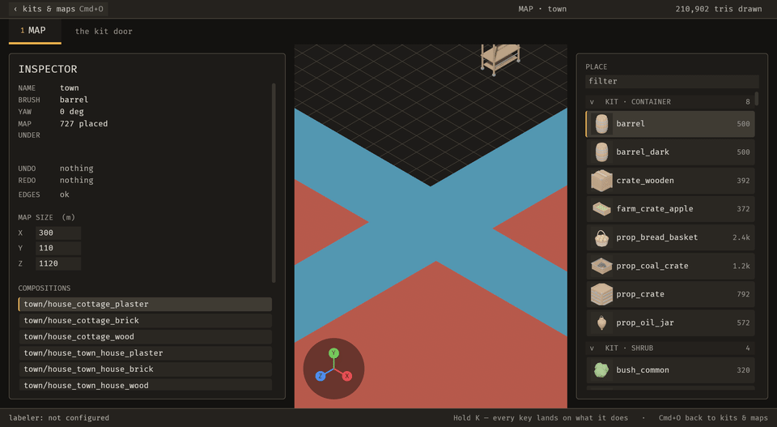
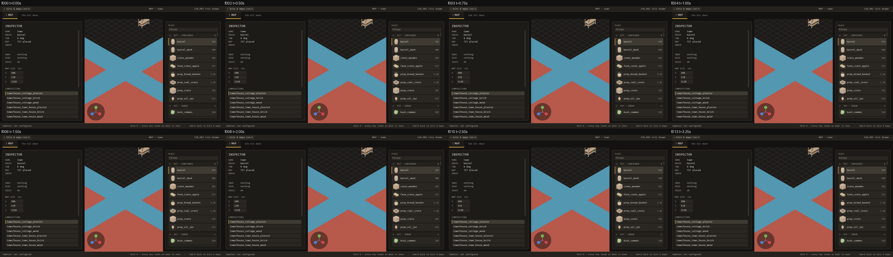
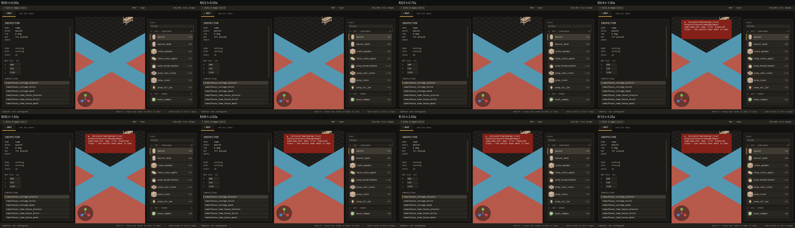
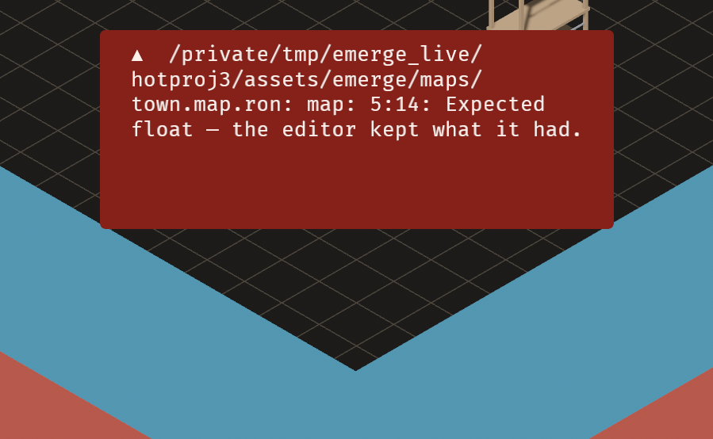

# 2026-10-21 watch: a map file saved with a typo is now refused on the Map door, not in silence

Focus: renzora/engine ideas · Commits: `0ab53a0..d8b3d5e` (+ this report) · Outcome: **fixes only**

## Summary
A hands-on pass found that a map file saved with a typo was refused silently on the Map door (**B-016**). The last good map stayed loaded, which is right, but nothing said why, because the watcher wrote its refusal into the kit door's status. It is fixed.

Phase 2 was **skipped under the brief's budget clause**. This session's context is very heavy after several iterations, and last iteration's fresh-context build agent stalled twice. So no enhancement was attempted. The renzora candidates stay logged: E-015 (palette), E-018 (history list) and E-021 (frame key).

## Baseline
- **Gate at `0ab53a0`:** clippy 0, 1,375 pass / 0 fail.
- **Runtime, `town` (727 placements), load average 21.9 (1 min):**
  - frame time 20.0 ms median;
  - MCP change 41 ms, visible ≤ 200 ms; file edit visible ≤ 585 ms;
  - still 160 ms, 4-frame sequence 855 ms.
- **Runtime sweep:** no WARN or ERROR lines.
- **Open bugs:** B-012, B-013 and B-014, all not must-fix.
- **Hands-on MCP pass:**
  - `emerge_frame_view {"target": "map"}` framed the whole map (height 1,472 m);
  - a malformed `map_set_settings` call was refused with what to change ("unknown variant `q`, expected one of `x`, `y`, `z` …");
  - a malformed map file was **not reported** (B-016).

## Bugs fixed

### B-016: a map file saved with a typo was refused silently on the Map door
- **Must-fix:** blocks **y** (the author's edit is silently not applied, and the screen shows the old map with no reason), common **y** (any typo in a hand-edited map while the Map door is open), no workaround **y** (nothing indicates a problem).
- **Evidence:** with `bounds: ((` written into `town.map.ron`, after 6 s the status was unchanged, `problems: []`, and the journal held 0 entries (`seq/b016_before-state.json`).
- **Root cause:** `watch::adopt_changes` wrote the refusal only into `tiles::ImportState`, the kit door's status, never into `editor::EditorState`. `EditorState` is what the Map door's toast and journal and `emerge_state` read.
- **Fix (`d8b3d5e`):** the open map's file refuses into the Map door's status. Any other project file refuses into the door that is showing: the Map door when a map is open, else the kit door. The text names the file, line and column: "…/town.map.ron: map: 5:14: Expected float — the editor kept what it had."
- **Regression check:** `tests/a_map_edited_on_disk_reaches_the_screen.rs::a_malformed_map_on_disk_is_refused_on_the_map_door`. It failed before ("the Map's problem slot reads \"\"") and passes now. It also asserts the last good map stays loaded.
- **Sequence:** a typo saved at 0.6 s, 4 fps.
  - **Before:** no card in any frame.
  - **After:** the red card appears at f004 (t = 1.00 s) and holds through f013, while the map stays as it was.

| Before | After |
| --- | --- |
|  |  |
|  |  |

## Enhancement
None; Phase 2 was skipped under the budget clause.

## Performance
- **Change:** the fix adds one system parameter to `adopt_changes`, which returns at once on a frame with nothing to adopt. No per-frame work was added, so no change is claimed and no A/B was run.
- **Numbers:** the baseline above stands.

## Review
No independent review. The change is two refusal sites in one function, and the evidence is the failing-before test plus the before/after sequences.

## Test diffs
- **New:** `a_malformed_map_on_disk_is_refused_on_the_map_door`.
- **Changed:** no existing test.

## Release
Not published. No crate here has been published, and there is no release workflow (E-006).

## Deferred / open
- **Not must-fix:** B-012, B-013, B-014.
- **Enhancements:** E-014 (snip), E-015 (palette), E-018 (history list), E-021 (frame key, with one migration), E-022 (open the map framed), E-023 (profile a possible +1.5 ms).
- **Nit:** the refusal card is taller than its text (`B-016-after-card.png`).

## Next focus
Start the next iteration in a **fresh context**, as the brief intends. Then **E-014 (snip)**: the developer asked for it, and `emerge_frame_view` is ready to frame what it points at.
