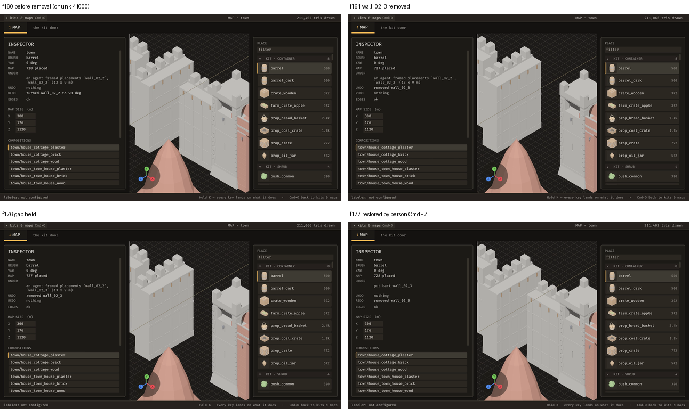

# 2026-10-22 remove: an agent can remove one placement, and Cmd+Z puts it back

Focus: placement removal (`placement_remove`) · Commits: 12b8c26..57b48fe · Outcome: shipped

## Summary
An agent can now remove one placement by id with `placement_remove`, and the removal joins the editor's one undo stack, so the person's Cmd+Z restores it exactly. The person's X-click on a placement dispatches the same operation. Review found that an agent's out-of-turn undo, and a put-back the person had superseded, could change the wrong piece; both are refused now, and four gaps were fixed before merge. The forward-direction row-shift risk is left open as B-027.

## Baseline
Gate: at 57b48fe, `cargo clippy --workspace --all-targets -- -D warnings` exit 0; `cargo test --workspace --no-fail-fast` 1411 passed / 0 failed / 2 ignored. Frame time: not reported in absolute terms (machine loaded, load 6–12; both builds above the 16.66 ms handoff baseline). Latency p95 and edit-to-visible: not measured (captures are banned during perf runs; no key injection in the driver). Scene: scratch map `town` (300 × 1120 m, 728 placements).

## Bugs fixed
None from the backlog. Review gaps in the new operation were fixed before merge (see Review).

## Enhancement: placement_remove
Plan: `placement_remove {id}` in the operation registry; `remove_placement` in `editor.rs` dispatches it on the placement click; `Action::Remove` (X) stays unmigrated; undo via the unified stack · Files: `ops.rs`, `editor.rs`, `ops_brp.rs`, `keys.rs`, tests, `docs/guide/placing-and-undo.md`, `docs/guide/agents-and-mcp.md` · Goal: an agent removes a placement, and the person's Cmd+Z restores it, with the same record in the editor and on disk · Proof: five tests in `tests/placement_remove.rs`, the person-path test, and the on-screen demo (below).

Candidates considered:
1. `placement_remove {id}` for one placement (chosen): one verb, one undo entry, the same record for click and agent.
2. Migrate `Action::Remove` wholesale: rejected, because X also deletes stamps and box-removes rows outside the registry (E-029).
3. Leave removal editor-only: rejected, because the agent could not remove or restore a piece.

MCP: `placement_remove` added to the operation registry (`emerge_apply_operation`, `emerge_undo_operation`). Undo strategy: a put-back of the exact placement at its logged rows, refused unless it is the undo of its own logged removal (`only_as_undo`). Preview: a dry run refuses a put-back outside undo, the same way apply does.

Visuals (the demo's frames 156–181, which hold the removal and restore; the status rows in them are read from the editor):

| Key frames (labelled) | Removal, then restore |
| --- | --- |
|  |  |

Key frames: f160 before removal (728 placed, redo "turned wall_02_2 to 90 deg"); f161 "removed wall_02_3" (727 placed); f176 the gap held; f177 "put back wall_02_3" after the person's Cmd+Z (728 placed).

## Performance
Frame time: not reported in absolute terms. Paired head − base −0.04 ms, t ≈ −0.12, n = 6, debug binaries, interleaved in both orders over 3 rounds, loaded machine; no significant change. Latency p95 and edit-to-visible: not measured (state the reason above). Runs: 6 paired, no capture.

## Demo
Attempt 1 succeeded (second attempt not needed). 50.0 s, 200 frames at 4 fps, 1280 × 704, H.264 yuv420p +faststart, 328,001 bytes (`docs/media/demo.mp4`, replacing the 37 s demo of 331,348 bytes). Poster `docs/media/demo-poster.png` now frame 161. Frame-exact check with ffmpeg `select='eq(n,N)'`, viewport crop x < 700, mean absolute luminance difference vs the previous frame: removal at frame 161 (diff 1.115), frames 162–176 flat (≤ 0.004), restore at frame 177 (diff 1.392). The gap holds for about 4 s (frames 161–176). The scratch map was restored from backup and verified byte-identical (`cmp`).

Known gap: the person's on-screen X-click was not captured. The demo's removal is agent-driven over MCP; the person's Cmd+Z restores it. The human Delete path is untested.

## Review
Reviewer: no blockers; four should-fix, two notes; confidence about 0.75. Verdict then: correct on a map nobody else changed; incorrect when an agent and a person's undos interleave.

- Gap 1 (should-fix): an agent's out-of-turn undo of a removal shifted rows under the person's row-recorded entries. Fixed in `e0c1b00`: an undo of `placement_remove` is refused while a row-recorded entry sits above its logged removal. The check is conservative (it can refuse some safe undos).
- Gap 2 (should-fix): `put_back` was accepted as a plain apply. Fixed in `8f4737b`: a new `only_as_undo` trait method; `dispatch_as` and `ops::preview` refuse it outside undo. Weaker than the reviewer's form: the undo path is not re-compared against the logged line; the undo path passes the logged inverse by construction.
- Gap 3 (should-fix): `Action::Remove` was migrated though X still deletes stamps and box-removes rows. Fixed in `844a0dc`: `Action::Remove` is unmigrated again, `UNMIGRATED_MAX` stays 125. The ratchet check is by string and parity, not a behavioural test of X.
- Gap 4 (should-fix): no committed person-path test. Fixed in `eddb4a4` (click → Cmd+Z → Cmd+Shift+Z); docs fixed in `57b48fe`.
- Notes 5 and 6: a click removal saves the file, so it is refused where the map cannot save; box and stamp removal have no agent operation. Documented in `57b48fe` (`placing-and-undo.md`, `agents-and-mcp.md`).
- Forward-direction row shift (fixer's unfixed finding): not fixed; recorded as B-027.

## Test diffs
- `tests/placement_remove.rs`: new file, five tests (`12b8c26`); header comment corrected (`844a0dc`); gap-2 test added (`8f4737b`).
- `tests/a_person_removes_a_piece_and_undoes_it.rs`: new file, person-path test (`eddb4a4`); gap-1 test added (`e0c1b00`).
- `tests/fixtures/mod.rs`: added `place_on(id, host, at)` (~line 642), which places a rider standing on a host by patching `on: None,` in the last placement row; the same pattern as `place_painted`. No existing fixture changed.
- `tests/operations_have_two_front_ends.rs` (net): one `UI_ENTRY_POINTS` row for `placement_remove`; `Action::Remove` stays on `UNMIGRATED`, moved within the list; `UNMIGRATED_MAX` unchanged at 125.
- No assertions loosened.

Failing-before, stated plainly:
- The person-path test fails on the parent's code at the file-agreement assertion: the held map drops the piece, the file keeps both (`left ["site/wall@0","site/wall@1"]`, `right ["site/wall@1"]`).
- Gap 1 test: `left: "applied"`, `right: "refused"` on HEAD before the fix.
- Gap 2 test: `left: "applied"`, `right: "refused"`; the dry-run assertion was not observed failing on HEAD.
- Gap 3: the ratchet failed on HEAD with `Remove is on the unmigrated list but names the operation placement_remove`.
- The five agent tests in `tests/placement_remove.rs` fail with `operation unknown` at the BRP call when the registry line is commented out, not at their own assertions. This is weak evidence for those five.

## Release
Version: none · no release, E-006: no crates.io release workflow. Loop-state and docs changes only.

## Deferred / open
- B-027 (new): an agent's forward `placement_remove` shifts row indices under the person's row-recorded entries; unreproduced.
- B-026 (open, unchanged): a refused stale undo drops its entry; judgment 1 of 3, not must-fix.
- B-020 (open, unchanged): the status receipt is stale after an agent operation; visible in f161–f177 of the demo (the status row shows the previous framing receipt).
- E-029 (new): migrate X's stamp delete and box removal, so `Action::Remove` can be honestly migrated.
- Reviewer gap 2 stronger form: `put_back` is not re-compared against the logged inverse at dispatch.
- Human X-click on screen and the human Delete key path: not captured or tested.
- Latency p95 and edit-to-visible: not measured this iteration.
- `tests/placement_remove.rs` has rustfmt drift from earlier commits, left alone.

## Next focus
B-027. A headless repro (a person's `Moved` entry above an agent's forward removal, then Cmd+Z) decides whether the row-shift risk is real. It is the one open path where a Cmd+Z can change the wrong piece, and it is cheaper to settle now than after E-029.
