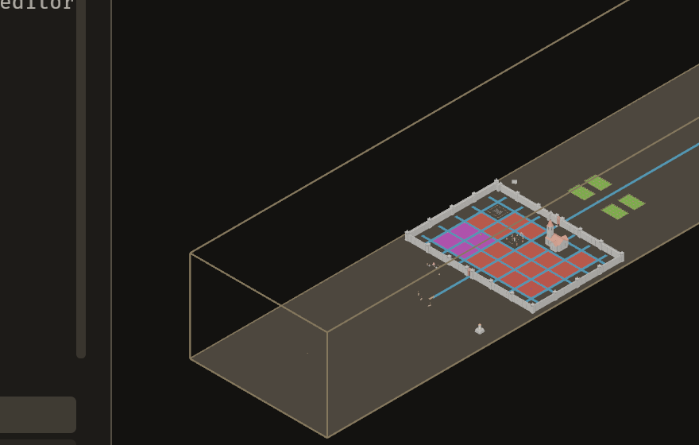
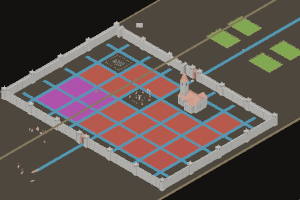
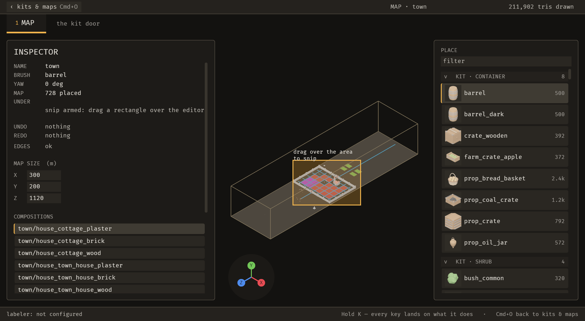

# 2026-10-22 snip: the person snips a rectangle of the editor; map_rename pays for it

Focus: snip (E-014) · Commits: 13ee8d5..a5b4dc0 (14 commits on `main` a2c28de) · Outcome: shipped

## Summary
E-014 ships: Cmd+\ arms a snip, a drag over the editor saves a PNG crop with a note, and an agent reads it back with `emerge_list_snips`. `map_rename` is the registry operation that pays for the new unmigrated key (UNMIGRATED_MAX 125 against `main`). Review found 16 gaps: 11 fixed with tests, gap 15 partly fixed (B-032 open), and gaps 12, 13, 14, 16 logged as B-029, B-030, B-028 (must-fix, open) and B-031. B-033 (cosmetic) is a separate finding.

## Baseline
Gate: green on `a5b4dc0`. `cargo clippy --workspace --all-targets -- -D warnings` exit 0; `cargo test --workspace --no-fail-fast` 1440 pass / 0 fail / 2 ignored (main baseline 1426, +14 new tests). Frame time 24.81 ms (base, median of 6 medians, load1 ~6). Latency p95 not measured. Edit-to-visible not measured (no edit path changed).

## Bugs fixed
Review gaps (reviewer numbering). Backlog items B-028 to B-033 hold the logged ones.

- **Gap 1 (blocks ship): the crop was scaled twice.** `view.rs:488` already multiplies the pointer by the scale factor; `snip.rs:248-255` multiplied again. Pre-fix crop: 880×560 for a 440×280 window drag at scale 2, at picture px [800,480,1680,1040] instead of [400,240,840,520]. Fix in `b3acf3f`. Regression check: `snip::tests::the_crop_is_the_drag_in_surface_pixels_at_scale_two` (failed before, passes after).
- **Gap 2 (blocks ship): the overlay was not divided by `UiScale`** (`snip.rs:374-380`); a 440×280 drag at 2.4 drew 1056×672. Fix in `b3acf3f`. Regression: `snip::tests::the_overlay_is_divided_by_ui_scale`; `the_drag_rectangle_is_drawn_where_it_was_dragged_at_scale_two` (failed before, passes after).
- **Gap 3:** window rectangle in logical px (`d381465`). Regression: `snip::tests::the_window_rectangle_is_in_logical_pixels` (compile error before, passes after).
- **Gap 4:** placements under the drag are listed; a fractional drag rounds once (`b3acf3f`). Regression: `a_placement_under_the_drag_is_listed`, `a_fractional_drag_rounds_once` (not recorded failing before; passes after).
- **Gap 5:** a rename that cannot remove the old file names the old file (`b382ccf`). Regression: `a_rename_that_cannot_remove_the_old_file_names_the_old_file` (before: error named the new file).
- **Gap 6:** a refusal routed to the note slot now goes to a problem (`70dd44b`). Test row `cannot rename the map` in `every_refusal_is_in_a_problem.rs`; see Test diffs.
- **Gap 7:** the record reads the cursor where the drag was released (`1ecfccc`). Regression: `the_record_reads_the_cursor_where_the_drag_was_released` (compile error before, passes after).
- **Gap 8:** a drag released outside the window is cleared (`b3acf3f`). Regression: `a_drag_released_outside_the_window_is_cleared` (`from` stayed `Some(300,200)` before).
- **Gap 9:** `project_root` reports the open map's name after a rename (`bee534c`). Regression: `the_door_switch_crosses::a_crossing_reopens_the_map_that_was_renamed`; `a_map_can_be_renamed_through_the_registry::project_root_names_the_renamed_map_while_it_is_open` (`left: "m", right: "renamed"` before).
- **Gap 10:** a missing picture is named and the list still answers; a record cannot send its picture outside the snips folder (`a443f86`). Regression: `a_snip_whose_picture_is_missing_is_named_and_the_list_still_answers`, `a_record_cannot_send_the_picture_out_of_the_snips_folder` (before: "No such file or directory"; `picture_path` ended `../../escape.png`).
- **Gap 11:** dependency removed (`a2da443`); covered by the gate, no dedicated test.
- **Gap 15 (partly fixed):** picking is disabled while armed (`233fc64`). Regression: pointer tests in `a_person_snips_an_area_of_the_editor.rs`. Before, a drag placed 27 pieces (left 29, right 2); after, left 2, right 2. The remove tool before removed both pieces; after, nothing is removed. Not covered: a press already in progress at arming still presses (B-032).
- **Ratchet fix** `5c38487`; **clippy** `a5b4dc0` (needless_borrow).

Logged, not fixed:
- **Gap 14 / B-028 (must-fix, blocks=true, open):** a rename whose old-file removal fails leaves both files and the renamed map, yet returns a refusal (`ops.rs:1950-1956`). Logged per Main's decision. Open; must be fixed before any release.
- **Gap 12 / B-029:** the `rules.ron` example points at a missing file (`editor.rs:10502, 10621`).
- **Gap 13 / B-030:** the oplog is keyed by map name (`ops.rs:531-580`).
- **Gap 16 / B-031:** the snip record omits StampedPiece stamp members.
- **B-032:** a press in progress at arming still presses the button (`button.rs:60-72`).
- **B-033 (cosmetic):** the overlay label overlaps the box top edge (visible in the mid-drag still).

Visual proof for the crop bug (pre-fix and post-fix crops of two different drags at scale 2; the pre-fix drag was [400,240,840,520] window px, the post-fix drag [640,350,790,450]; the point is the size and placement of the crop, not the same drag):

| Before (880×560, drag 440×280 px, wrong place) | After (300×200, drag 150×100 px, the cluster) |
| --- | --- |
|  |  |

## Enhancement: snip (E-014) with `map_rename` as the registry payment
Plan: Cmd+\ arms a rectangle snip of the editor; the drag saves a PNG crop and a snip record (note, rectangle, scale, placements, cursor, camera) to `target/loop/captures/snips/`. `emerge_snip` (MCP) takes a label and rect; `emerge_list_snips {limit}` (1..=20) reads them back. A snip is a capture, not a registry operation: no `snip_capture` op; `Action::Snip` is unmigrated. `map_rename` is the registry operation (`13ee8d5`) and pays for `Snip` in `operations_have_two_front_ends.rs:385`: UNMIGRATED_MAX 124 → 125 at commit B; net 125 against `main`.
Goal: a person marks an area and an agent reads the same crop with its metadata.
Proof: the pointer-gating tests and the snip-behaviour tests in `a_person_snips_an_area_of_the_editor.rs`, the rename tests in `a_map_can_be_renamed_through_the_registry.rs` and `a_rename_is_all_or_nothing.rs`, `an_agent_calls_the_server.rs`, and the full gate (clippy and 1440 tests).
Candidates considered: not recorded in this report; the builder's plan is in the iteration notes (`local://builder-notes.md`, not committed).
MCP: `emerge_snip {label, rect}`, `emerge_list_snips {limit}`. Undo: none (a snip writes a file and changes no map). Preview: the overlay box and the armed status in the inspector; the receipt names the file.

Visual proof, the gesture in the demo clip (`docs/media/demo.mp4`, 4 fps; the GIF is frames 12–54 with a 2 s hold on the last frame):

Mid-drag still (the overlay box over the walled cluster, the inspector reads "snip armed"; the label sits on the box top edge, B-033):

Before: n/a for the feature (no snip existed on `main`). The pre-fix crop above is the before for the crop bug.

## Performance
Frame time 24.81 → 26.69 ms (median of medians); paired head−base mean +0.745 ms (+3.0%), sd 1.749, t = 1.044 on 5 df: not significant at 0.05 (critical 2.571). Latency p95 not measured; edit-to-visible not measured; 6 runs (3 forward base→head, 3 reverse head→base); machine loaded (load1 4.6–6.9; frames ~20–28 ms). Snip key latency on head not measured (no BRP-visible arming state).

| Round | Order | Base median (ms, load1) | Head median (ms, load1) | Head − base |
| --- | --- | --- | --- | --- |
| r0 | fwd | 26.84 (4.62) | 27.03 (5.25) | +0.19 |
| r1 | fwd | 26.85 (5.31) | 28.30 (5.25) | +1.45 |
| r2 | fwd | 25.67 (5.67) | 28.46 (6.67) | +2.79 |
| r0 | rev | 23.95 (6.83) | 26.34 (6.77) | +2.39 |
| r1 | rev | 21.97 (6.52) | 20.51 (6.94) | −1.45 |
| r2 | rev | 22.62 (6.76) | 21.72 (6.17) | −0.91 |

Raw logs: `/tmp/emerge_ab/perf_snip_ab_fwd.log`, `/tmp/emerge_ab/perf_snip_ab_rev.log`. Base binary: `main`'s mapper (no `map_rename` string, `placement_remove` present).

## Review
Fresh-context reviewer: 16 gaps (see Bugs fixed). Gaps 1 and 2 blocked ship; both are fixed with failing-before tests. Gaps 3–11 were should-fix and are fixed (gap 11 by dependency removal, gate-covered). Gap 15 is partly fixed. Gaps 12, 13, 14, 16 are logged. The reviewer's root cause for gap 1: `view.rs:488` already scales the pointer, and `snip.rs:248-255` scaled it again.

## Test diffs
- `keys.rs`: Snip variant; Cmd+\ bound at Global; `keys::tests::no_context_gains_a_key` Global 18 → 19 for Snip (documented in `keys.rs`).
- `operations_have_two_front_ends.rs`: `UNMIGRATED_MAX` 124 → 125 (`map_rename` pays for Snip; net 125 against `main`, approved by Main).
- `every_refusal_is_in_a_problem.rs` (+/−5): the gap-6 row `cannot rename the map`. The reviewer flagged this row change as a loosening before the fix; it is listed here as a test diff with its justification: the refusal now asserts a problem (the correct slot), not a note.
- `leaf.rs` (+4).
- `the_door_switch_crosses.rs` (+52/−): the gap-9 crossing test.
- New files: `a_map_can_be_renamed_through_the_registry.rs` (257 lines), `a_person_snips_an_area_of_the_editor.rs` (585 lines), `a_rename_is_all_or_nothing.rs` (36), `an_agent_calls_the_server.rs` (256).

## Release
Version: none (no bump) · semver-checks: not run (no release) · Channel: not published; E-006 (no release): a new editor feature is for the human to schedule.
Tag: none · crates.io: none · docs.rs: none.
Package: none · Changelog: none.

## Demo
`docs/media/demo.mp4`: 14.0 s, 117,151 bytes, H.264 yuv420p, 1280×704, 4 fps, +faststart. Frame n is at 0.25 × n s. Frame-checked with `select='eq(n,N)'`:
- 4: map framed by an agent (`emerge_frame_view`).
- 16: "snip armed: drag a rectangle over the editor".
- 26 to 34: the box is drawn over the walled cluster (drag held until release at about frame 34).
- 36: note prompt empty; 37: note reads "cluster check".
- 40: still "armed"; 41: receipt "snip saved to target/loop/captures/snips/snip-1792693508610.png" (first frame showing it; Enter at about frame 40).
- 46: agent reads the snip with `emerge_list_snips {limit:1}`. The read changes no pixels; the frame shows the receipt that it reads.
- 54: last frame (about 2 s after the read).

Poster `docs/media/demo-poster.png` is frame 37 (box and note). First encode (attempt 1): 15.25 s with a 3.5 s static tail after the read; trimmed to 14.0 s for attempt 2. The README's 50 s caption is replaced.

## Deferred / open
- **B-028 (must-fix, open):** a rename whose old-file removal fails leaves both files and the renamed map, but refuses. Not fixed in this iteration (Main's decision, logged). Blocks the next release.
- **B-029, B-030, B-031, B-032, B-033:** see Bugs fixed.
- **Not ours:** duplicate comment in `crates/bevy_emerge_mcp/Cargo.toml` `[dev-dependencies]`; left as is.
- **Not measured:** snip key latency; p95 latency; edit-to-visible.
- **Placement count** in the snip record (715 for the walled cluster) is not independently verified inside the rectangle.
- **Demo caveat:** the agent read is not visible in pixels (a read-only tool); the receipt is the visible evidence.
- **E-021** unchanged (`map_rename` is not a frame verb).

## Next focus
B-028 (must-fix): a rename that refuses must not leave both files and the renamed map. It blocks the next release and is a data-integrity bug in the registry, so it comes before any new enhancement.
