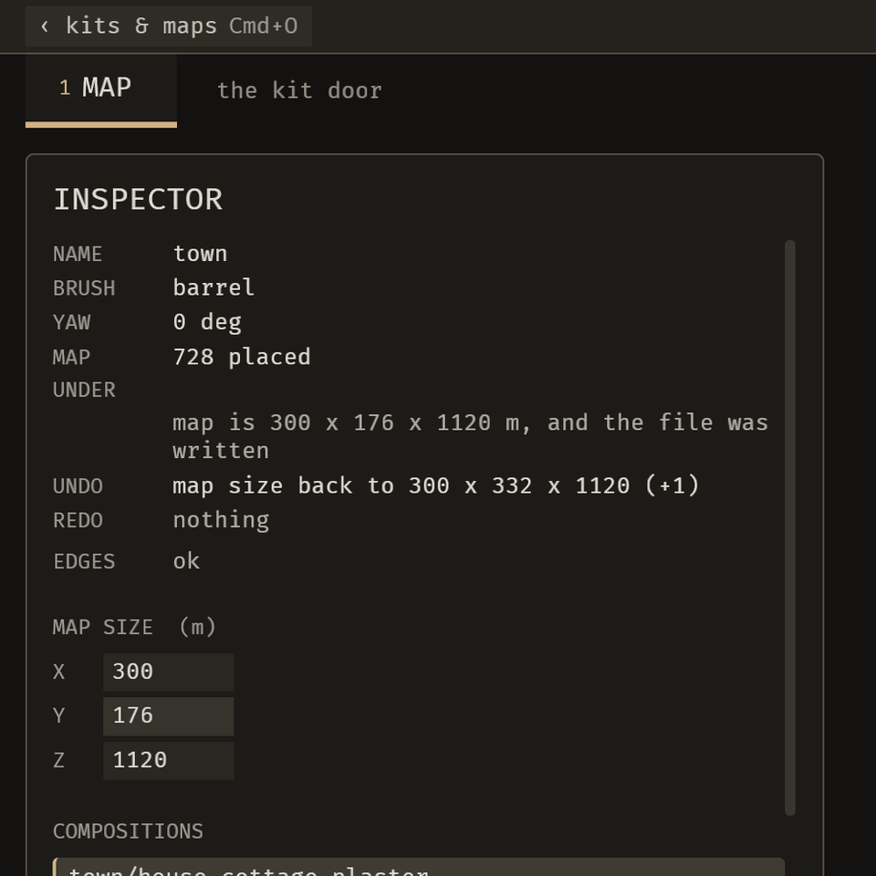
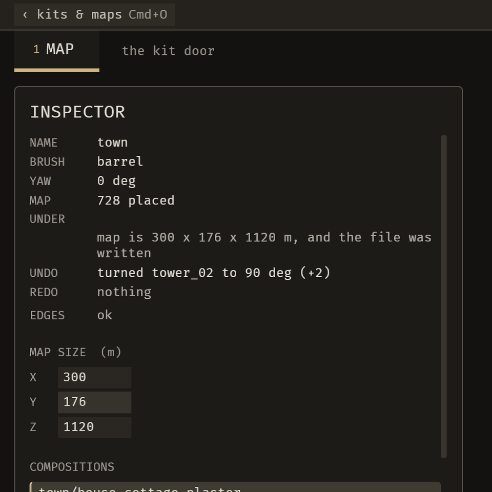

# 2026-10-22 undo: one undo history takes back an agent's change too

Focus: undo · Commits: ab98e7d..b436ca3 · Outcome: fixes only (B-019 fixed; E-013 shipped; E-027 open)

## Summary
Cmd+Z now takes back the newest change still in effect, whether the person or an agent made it. An agent's `placement_set_pin` and `placement_set_yaw` land on the same stack as the person's edits, so Cmd+Z reverts an agent's turn instead of saying "nothing to undo". Review round 1 found two real defects (a turn undone without a redraw; a put-back that bypassed the history); both are fixed and each has a failing-before test. The demo was re-recorded to show an agent turn and its Cmd+Z.

## Baseline
Gate: `cargo clippy --workspace --all-targets -- -D warnings` clean; `cargo test --workspace --no-fail-fast` pass=1403 fail=0 ignored=2 (at b436ca3). Frame time 59.5 fps median (16.8 ms) at base ab98e7d, interleaved A/B; latency (BRP state-level): key→state 17.16 ms, file→state 20.22 ms, MCP call→state 45.83 ms, on the scratch copy of the town map.

## Bugs fixed
### B-019: An agent's placement_set_pin is not on the Cmd+Z stack, so Cmd+Z says "nothing to undo"
Must-fix: blocks no, common yes, no workaround yes (author) / no (fresh reviewer) — 2 of 3 by the author's judgment, so must-fix; the disagreement is flagged here.
Fix: agent applies of `placement_set_pin` and `placement_set_yaw` are recorded in `EditorState`'s undo stack (`4364dd4`); a put-back by `emerge_undo_operation` joins the same history through a `restores` flag on `UndoPlan` (`3630155`); an undone turn triggers a full-map redraw (`3630155`). Root cause: the agent path wrote only the oplog, not the editor's stack.
Regression check: `tests/one_undo_takes_back_the_newest_change.rs` (5 tests, pass). The review's two failing-before tests passed after the fix: the P1 redraw test (failed: "still shows the agent's angle (33.0 degrees off)") and the P2 put-back test (failed: `left: 33.0, right: 0.0`). The B-019 test file itself was not run against the base commit, so "failed before" is not established for it; the live before (below) is the evidence.
Live before (fcc4e02, BRP): after an agent's yaw change, Cmd+Z reverted only the person's resize and left the agent's yaw at 90. After 4364dd4 the same sequence reverted the agent's yaw 90→0 and left the person's size at 176.

| Agent turn lands in UNDO | Cmd+Z takes it back |
| --- | --- |
|  |  |

Both GIFs are 960×960 crops of the inspector, checked frame by frame. Left: UNDO goes from "map size back to 300 x 332 x 1120 (+1)" to "turned tower_02 to 90 deg (+2)". Right: after Cmd+Z, UNDER reads "turned tower_02 to 0 deg" and REDO reads "turned tower_02 to 90 deg".

## Enhancement: one undo history (E-013, E-027)
Plan: route agent pins and turns through the editor's undo stack and make `emerge_undo_operation` a put-back on that same history · Files: `crates/bevy_emerge_mapper/src/editor.rs`, `ops.rs`, `ops_brp.rs`, `sequencer.rs`, `tests/one_undo_takes_back_the_newest_change.rs`, `docs/guide/agents-and-mcp.md`, `docs/guide/placing-and-undo.md` · Goal: one history per map, whoever made the change · Proof: the undo test file (5/5) and the live before/after above.
Candidates considered: not recorded for this iteration; the scope was fixed by the open B-019 and E-013 items.
MCP: `emerge_undo_operation` is unchanged in its inputs; it now takes back a logged change by operation id, or puts it back, only when no newer change to the same map is in effect (otherwise it refuses and names the change to undo first). Cmd+Z uses the same history. No preview change.
E-027 (a human turn writing two undo records) is addressed by the same change, but the proof is incomplete: no test shows a human turn writing one entry rather than two. E-027 stays open.

## Performance
Frame time 59.5 → 54.5 fps median (paired −3.25 fps, t=−1.87, n=4; not significant). Discrete key→state 17.16 → 17.51 ms (t=0.40, n=40). File→state 20.22 → 19.01 ms (t=−0.20). MCP call→state 45.83 → 45.83 ms (t=−0.20). MCP first still ~180 → ~180 ms. File first still 308 → 340 ms (t≈−0.78, n=6; not significant). Base ab98e7d vs new 4364dd4, both orders interleaved, 4 runs for frame time. These are BRP state-level numbers, not photon-to-present. No measurement was taken after the P1/P2 fixes; the redraw runs on undo and redo, not in the frame loop, so the frame-loop cost should be unchanged, but that is unmeasured.

## Review
Round 1 (fresh reviewer and the author's own pass):
- P1 (confirmed, fixed in `3630155`): an undone turn updated the map and file but left the piece at the old angle.
- P2 (confirmed, fixed in `3630155`): an agent's put-back was never recorded, so the next Cmd+Z was refused and the resize entry was lost.
- P3 (confirmed, fixed): the `agents-and-mcp.md` claim about `emerge_undo_operation` was overstated; corrected.
Not fixed: a refused undo of a stale entry drops the entry permanently. See B-026 in the backlog.
Round 2 review: not run.
Skeptic outcome: the B-019 must-fix judgment was disputed (author yes, reviewer no); recorded as must-fix.

## Test diffs
- New file `tests/one_undo_takes_back_the_newest_change.rs` (added in 4364dd4). No existing assertion was changed.
- `b436ca3` only reflowed lines in the new file to rustfmt's shape.
- `3630155` also changed `ops.rs` by +4 lines (the put-back's `restores` flag).

## Demo
`docs/media/demo.mp4` re-recorded: 37.0 s, 148 frames at 4 fps, 1280×704 H.264, 331 KB. It shows a wall turned by an agent, then Cmd+Z taking the turn back. Frame-exact check against the source captures: frames 80 and 81 bracket the turn (mean diff 4.68); frame 129 matches the pre-turn frame 80 (diff 0.34). Poster `docs/media/demo-poster.png` taken from the turned frame. README line 28 updated to describe the revert. Recorded on a scratch copy of the town map.

## Release
Version: unchanged (no crate published, E-006) · semver-checks: not run (no published baseline) · Channel: not published, reason: E-006
Tag: none · crates.io: none · docs.rs: none
Package: not built · Changelog: none (no release)

## Deferred / open
- E-027: proof of "one entry, not two" for a human turn is missing; needs a test.
- B-026 (new): a refused undo of a stale entry drops it permanently (`editor.rs` `undo()` pops at line 6929, and a refused `apply` pushes nothing back at 6933-6935). Found by reading the code; not reproduced live. Judgment: blocks no, common no, no workaround yes → not must-fix.
- B-020: the agent's `placement_set_pin` receipt can still be stale in the status row. The yaw turn's UNDO row did update in the demo; the pin path was not re-measured.
- B-025: file edit-to-visible 132 → 245 ms was not reproduced at BRP state level (20.22 → 19.01 ms). Still unconfirmed: the metric differs from the original measurement.
- E-028: an agent turn saved but not logged leaves screen and file disagreeing (code review, not reproduced). Unchanged.
- Latency and frame time after the P1/P2 fixes: unmeasured.

## Next focus
B-026 is a silent loss of undo history that a common mixed human/agent session could reach; it is the next correctness item in this area. B-020 (stale receipt after an agent's pin) is the next visible item if the pin path is still wrong. Both need a failing test first.
