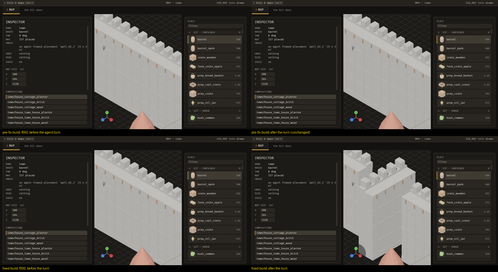
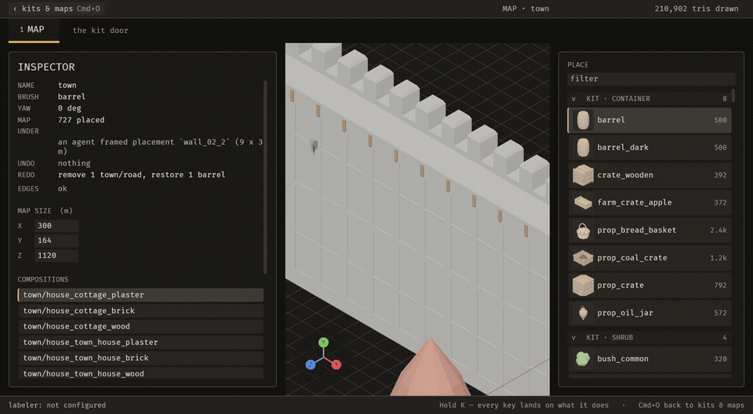

# 2026-10-22 yaw: an agent can turn a placement, and the person's R and T go through the same operation

Focus: renzora/engine ideas, applied to the set-up step · Commits: 6aa6185..(this commit) on base 837bfc8 · Outcome: shipped (one enhancement, two bug fixes found while proving it)

## Summary
The registry gains `placement_set_yaw`. The Map door's R and T keys dispatch it, and an agent calls it through `emerge_apply_operation`. Before this, an agent could not turn anything it had placed. Proving the change on screen exposed two bugs where an agent's saved change never reached the screen (B-023, B-024). Both are fixed, and the demo video now shows an agent turning a wall.

## Baseline
Gate at 837bfc8: clippy `-D warnings` 0; `cargo test --workspace` 1393 pass / 0 fail. Frame time median 55.0 fps; discrete input-to-state (KeyB → `editor.tool`) median 19.1 ms; file edit-to-visible median 132 ms. MCP edit-to-visible: not measurable on the base build, because there was no verb to turn a piece. Scratch project `/tmp/emerge_live/hotproj3`, map `town` (727 placements). n = 4 rounds, noisy machine.

Final gate (this commit): `cargo clippy --workspace --all-targets -- -D warnings` exit 0; `cargo test --workspace --no-fail-fast` 1400 pass / 0 fail, including the parity test, the `docs_are_current` MCP docs tests and `an_agent_calls_the_server.rs`.

## Bugs fixed
### B-023: an agent's saved change was never redrawn
Must-fix: blocks y (the screen showed a wrong result while the file and the log said the turn happened), common y (every agent edit), no workaround n (reopening the editor). Found while proving the enhancement.
Fix: `a862342`. `ops_brp.rs` `operation_apply` and `operation_undo` saved the map, but the watcher adopts a file that matches the open map and does nothing. Root cause: neither path set `watch::Due::map_replaced`. Both now set it when the save lands.
Regression check: `an_agent_can_drive_the_editor.rs::an_agent_turn_stands_on_the_screen`. It failed before with "the piece on SCREEN turned 0.0 degrees" while the file and the map said 90, and passes after. The same defect affected `placement_set_pin` (E-024).

### B-024: an operation inside a capture sequence was never redrawn
Must-fix: blocks y (an agent checking its own work with `emerge_capture_sequence` saw no change), common y, no workaround n.
Fix: `14fb80c`. `sequencer.rs` `drive_sequencer` dispatched the operation and wrote the map back without setting `Due::map_replaced`, so the redraw system returned early.
Regression check: `an_agent_turn_in_a_sequence_stands_on_the_screen.rs::an_operation_inside_a_sequence_is_redrawn_on_the_screen`. It failed before because the entity was never respawned (`763v0` before and after), and passes after.

Pixel proof: piece `wall_02_2`, yaw 0 → 90, applied inside a sequence on the live editor, frames 2560×1406. On the pre-fix build, the frame after the turn differs from f000 in 0 px (diff bbox `None`). On the fixed build, 368,607 px change, all inside the bbox (1125, 218)–(1789, 1289) around the piece. An outside-sequence apply at `a862342` changed 368,608 px; a tower turn changed 32,126 px. The raw stills are in `target/loop/2026-10-22-a74c897/pixels/` (not committed).

| Before (pre-fix, top) and after (fixed, bottom)                     | After, over time (demo frames 60–116, 4 fps)        |
| ------------------------------------------------------------------- | --------------------------------------------------- |
|  |  |

The GIF starts with `wall_02_2` framed side-on. It turns 90° at the start of the sequence, then holds the turned state to the end, with no flicker or revert. The pre-fix sequence frames weren't kept; the identical-pixel still pair stands in for them.

## Enhancement: `placement_set_yaw`
Plan: add one registry operation, modelled on `placement_set_pin`, with validation, an oplog line, preview and inverse-delta undo. R and T dispatch it through `editor::set_yaw`, and `keys::Action::operation()` names it for `TurnPieceLeft` and `TurnPieceRight`. Files: `ops.rs` (`placement_set_yaw`), `editor.rs` (`set_yaw`), `keys.rs` (`operation()`), and the parity test. Goal: an agent can turn a placed piece by id, and the person sees it turn. Proof: `tests/placement_set_yaw.rs`:
- `an_agent_turns_a_placement_and_the_file_says_so` (applied, saved, and undone in the editor and on disk);
- a facing wraps into one full turn;
- an unknown placement or field is refused and nothing changes;

plus the on-screen tests above. Before this commit the registry had no such operation, so every one of these calls was refused.

Candidates considered:
- **`placement_set_yaw`, chosen.** Agents can't turn anything: the registry held only `map_set_settings` and `placement_set_pin`. Every agent layout hits this. It migrates two actions, so the ratchet goes 127 → 125. Risk: low.
- **`placement_remove`.** The same gap for removal, one action. Logged as the next migration.
- **E-021 (Home frame key) or E-014 (snip gesture), paid for by a migration.** The person gains one key, but agents still can't edit. Deferred.

MCP: no new tool. `placement_set_yaw {id, yaw}` is listed by `emerge_list_operations`, previewed by `emerge_preview_operation`, applied by `emerge_apply_operation`, and undone by `emerge_undo_operation` (inverse delta: the piece's previous facing). The tests drive the operation over BRP (`an_agent_can_drive_the_editor.rs`), the transport those MCP tools forward to. No MCP tool's surface changed, so the existing MCP-client test (`an_agent_calls_the_server.rs`) is unchanged, and no MCP-client test names `placement_set_yaw` (scope note). After review, an undo checks only the turned piece's facing, so an unrelated edit made by hand doesn't block it. Regression: `placement_set_yaw.rs::an_unrelated_hand_edit_does_not_block_the_undo_of_a_turn` fails without the `ops.rs` change (panic at line 183) and passes with it.

## Performance
Measured at `a862342` (base / enhancement / fix, n = 4, no capture, `/tmp/emerge_live/lat.py`). The final build was not measured: the base binary failed to rebuild and the disk had 5.5 GB free.

| Measure (median) | base 837bfc8 | 6aa6185 | a862342 |
| --- | --- | --- | --- |
| Frame rate (fps) | 55.0 | 50.5 | 53.0 |
| Discrete input → state (ms) | 19.1 | 18.3 | 18.1 |
| File edit → visible (ms) | 132 | 162 | 245 |
| MCP turn → visible (ms) | n/a | never (4 of 4 runs) | 48.5 (Transform) |

- **Frame rate:** no significant change claimed at n = 4.
- **File edit-to-visible:** the median rose, on a path none of these commits touches. It isn't explained, so it's logged as B-025 (unconfirmed) for an interleaved A/B, not dismissed.

## Review
An independent fresh-context review of the diff, the stills and the gate output reported four gaps. All survived the skeptic pass and are fixed in this commit:
1. The guide overstated R/T. It now says R and T turn the placed piece under the cursor (`docs/guide/agents-and-mcp.md`, `placing-and-undo.md`), and the guide index's demo row links the README instead of a nonexistent `demo.md`.
2. The sequence test could pass on a refused turn. It now asserts the sequence reported the turn as applied.
3. An undo of a turn compared every piece's facing, so any unrelated hand edit blocked it. It's now scoped to the turned piece (above).
4. E-027's "no defect is shown" was an inference. Reworded, and E-028 added from the same read.

## Test diffs
- `operations_have_two_front_ends.rs`:
  - adds a dispatch check for `("placement_set_yaw", "set_yaw(")`;
  - removes `TurnPieceLeft` and `TurnPieceRight` from `UNMIGRATED`;
  - lowers `UNMIGRATED_MAX` 127 → 125.

  This is a tightening: two actions moved behind the registry, and the ratchet follows them.
- New:
  - `placement_set_yaw.rs` (5 tests);
  - `an_agent_turn_in_a_sequence_stands_on_the_screen.rs` (1 test, with the stronger "applied" assertion from review);
  - `an_agent_can_drive_the_editor.rs::an_agent_turn_stands_on_the_screen`, plus MCP-client coverage.
- No existing assertion was loosened.

## Release
Version: none. No crate is published and there is no release workflow (E-006).

## Deferred / open
- **B-019, now sharper:** after an agent's `placement_set_pin` or `placement_set_yaw`, Cmd+Z undoes the person's own last edit, which may be a different one, and the agent's change stays. Until E-013 unifies undo, `emerge_undo_operation` is the way back.
- **B-020:** an agent's apply leaves the person's receipt line stale. Visible in the GIF: the inspector still reads "an agent framed placement `wall_02_2`" after the turn.
- **B-025 (unconfirmed):** file edit-to-visible median 132 → 245 ms at n = 4.
- **E-027:** a human R/T turn writes two undo records (an oplog line and `Undo::Turned`).
- **E-028:** a turn that is saved but can't be logged leaves the screen and the file disagreeing.
- **Next migrations:** `Straighten` → `placement_set_yaw`, and `Remove` → `placement_remove`.
- B-018, B-021, E-026, E-014, E-015, E-018, E-021 unchanged.

## Next focus
Unify undo so Cmd+Z takes back the agent's last step too (B-019 / E-013). With agents now able to turn pieces, Cmd+Z silently undoing a *different* edit is the riskiest gap in the "every change undoes in one step" promise. Then `placement_remove`, which pays for E-021 or E-014.
