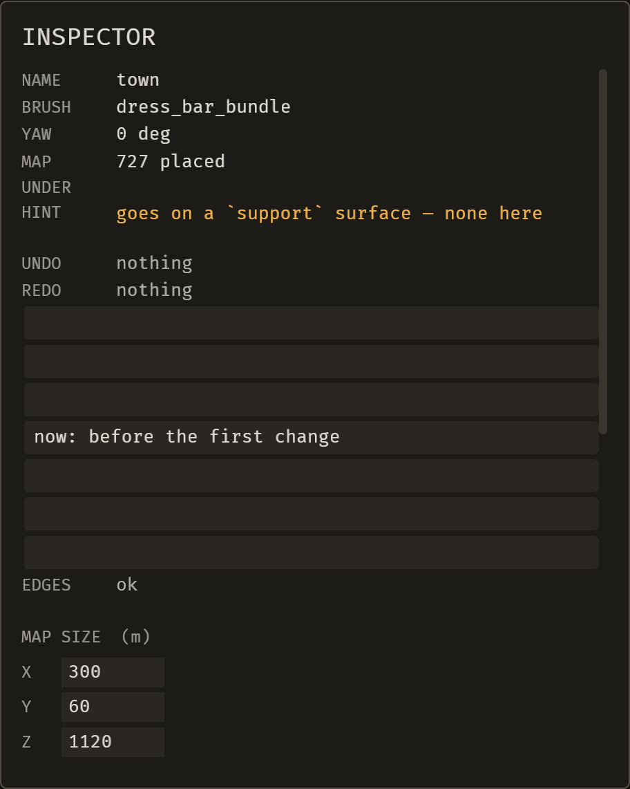
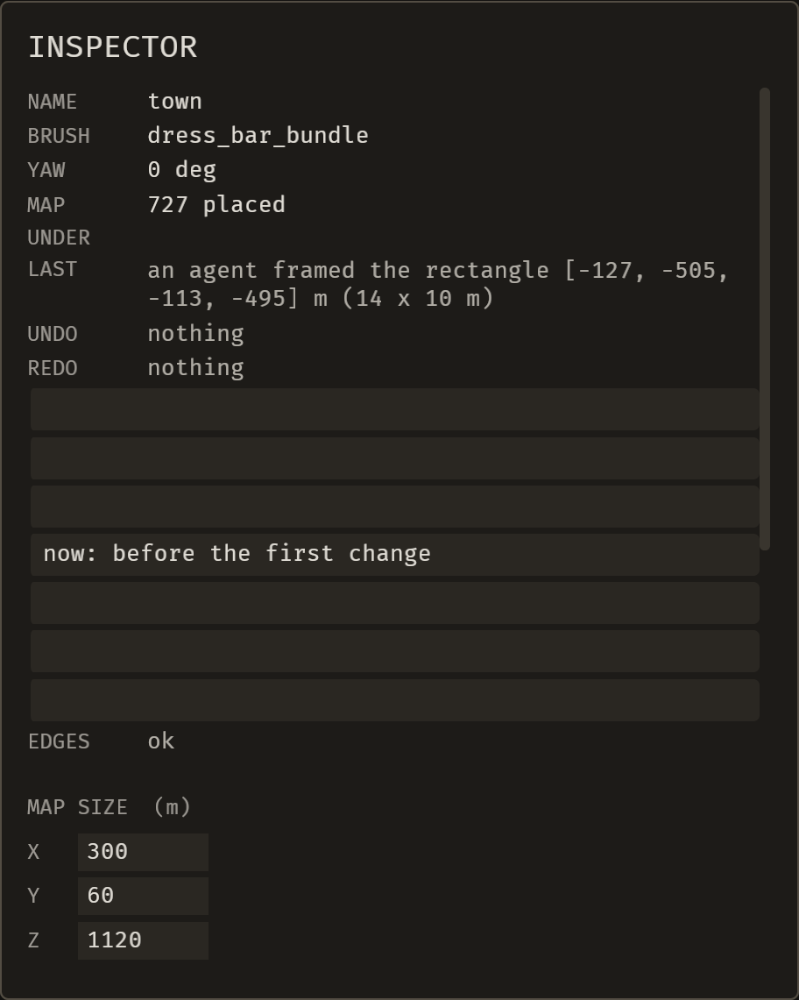

# 2026-10-23 cycle 6 (f34d8f4): an agent arms a brush piece, a snip is listed while it saves, the review's 13 gaps closed, one clip ships

Focus: operations parity (brush arm), snip pending state, review fixes, video. Branch `loop/2026-10-23-cycle6`, base `ab5ebf8` (cycle 5 merge). Outcome: one enhancement (E-037) and one bug (B-042) fixed; the fresh-context review's 13 gaps all fixed (no blockers); one clip shipped (agent-removes-then-undo, new); three clips not shipped; four new items recorded (B-043, E-039, E-040, E-041).

## Summary

- **E-037 (fixed):** `brush_arm` is a registered operation. It arms a piece (`Undo::None`: logged and receipted, not in Cmd+Z history). The palette click dispatches it through `editor::arm_piece`. An agent can now arm a brush, so the hint state can be captured over MCP.
- **B-042 (fixed):** a confirmed snip is listed as `pending` (status "being saved") until its picture lands. Stale pending records age out, finished stems are listed once, and broken records are reported.
- **B-013 live stills (evidence, no code):** the cycle-5 hint layout is now captured live. UNDO does not move in either still.
- **B-041 (unconfirmed):** not reproduced on a fresh copy. Main's hypothesis is recorded below.
- **Review:** a fresh-context reviewer found 13 gaps and no blockers. Two claims were false: the refusal named no ids, and stale pending snips were not handled. All 13 are fixed. Each has a commit below.
- **Video track:** 1 of 4 clips re-shot this cycle ships: `agent-removes-then-undo.gif`. `frame_the_map`, `move_the_camera` and `hero` fail and keep their old GIFs.
- **Records:** E-037 and B-042 are archived as fixed. E-033 and E-038 stay open with updated evidence.

## Baseline

- Cycle 5 HEAD `ca6d1ef` (merged as `ab5ebf8`): clippy exit 0; `cargo test --workspace --no-fail-fast` 103 suites, 1497 passed / 0 failed / 2 ignored.
- HEAD `f34d8f4` (this report's code): `cargo clippy --workspace --all-targets -- -D warnings` exit 0; `cargo test --workspace --no-fail-fast` 106 suites, 1524 passed / 0 failed / 2 ignored.
- Before the merge, the pre-merge gate run on the branch gave clippy exit 0 and 1523 passed / 1 failed. The failure was `census` (a rendered count drifted from the census counter), fixed by `95388c4`. The ratchet test is unchanged.
- `bevy_emerge_core` is unchanged (`git diff ab5ebf8..HEAD -- crates/bevy_emerge_core` is empty), so Sanctuary was not run.
- Gate logs are outside the repo. CI was not waited on.

## Enhancement

### E-037: an operation arms a brush piece (`f030b70`, review fixes listed below)

- **Judgment:** 1 of 3 (common; an agent could not arm a piece, so the hint state was uncapturable over MCP).
- **Design:** `brush_arm` takes a `descriptor` and arms it as the brush. It is `Undo::None`: it is logged and receipted, and does not enter Cmd+Z history, because arming is not a map change. The palette click dispatches the same operation through `editor::arm_piece`, so the person and the agent take one path. `descriptor: null` disarms (added in review gap 8).
- **Failing before:**
  - The test file `tests/brush_arm_is_an_operation.rs` did not compile on `ab5ebf8`: unresolved `editor::arm_piece` (E0432), recorded in the builder notes.
  - The old binary's live answer, recorded on the `ab5ebf8` build (`/tmp/cycle6/bin`) by the still-capture agent with the same descriptor: `emerge/operation_apply: brush_arm is not an operation this editor knows. The known ones are: map_set_settings, placement_set_pin, placement_set_yaw, placement_remove, stamp_remove, map_rename.` `brush_arm` is also absent from that build's `emerge_list_operations`. This is the behavioural red.
  - A first version of the test assumed the headless editor starts with no brush. It starts with one, so the before-assertion became `assert_ne!(armed, Some("site/gate"))`.
- **Passing after:** `brush_arm_is_an_operation` 3/3; `operations_have_two_front_ends` 8/8.
- **Live (scratch copy of town):** `emerge_apply_operation brush_arm {descriptor:"town/torch"}` → applied, summary "armed town/torch", operation `0045-5657`, armed piece `town/torch`, undo depth unchanged (Undo::None).
- **Live stills for B-013** (`5f36e05`): taken through `brush_arm dress_bar_bundle` and a cursor over bare floor. See B-013 below.

**Review gaps on E-037** (from `local://c6-review.md`; the review was done on this operation and on `emerge_state`):

| gap | what the review found | fix |
|---|---|---|
| 1 | the keyboard palette walk armed a piece without `arm_piece` (`editor.rs` 2750–2753), should-fix | `7e630cc`: the arrows dispatch `brush_arm`; `UNMIGRATED_MAX` 125 → 123 (`PalettePrev`/`PaletteNext` migrated); test `the_palette_walk_arms_through_the_operation_as_a_person` in `headless.rs` |
| 2 | the refusal named no ids; `emerge_state` gave counts only | `94e2e65`: the refusal names the closest ids; `emerge_state` adds `descriptor_ids` (paged by 50), `descriptor_ids_next`, `descriptors_from`, `how_to_read_more_ids`; test `emerge_state_names_the_library.rs` |
| 4 | a failed log write gave a false message | `c39c987`, `abc4419`: the refusal says "nothing was changed" when true (`ops.rs` `take_back`) |
| 5 | the op checked less than the click (a kit the bash hides) | `579ae45`: refuses a kit the map's bash hides |
| 7 | undoing an arm by id gave a false refusal | `2098e21` |
| 8 | no way to clear the brush | `e6854d9`: `descriptor: null` disarms |
| 11 | `emerge_apply_operation` description was wrong for `brush_arm` | `a6b1122` (description and guide) |
| 12 | a needless second `ops::find` | `855bfa2` |

`95388c4` is not a review gap: the `emerge_state` composition count now comes from `census::of_catalog`, fixing the one failing test in the pre-merge run. The census ratchet is unchanged.

## Bugs fixed

### B-042: a confirmed snip is not listed while its picture is being saved (`315e184`, review fixes listed below)

- **Judgment:** 1 of 3 (common: an agent that lists right after Enter sees 0 snips and assumes the save failed).
- **Cause:** `snip_commit` queues a screenshot; the observer writes the `.png` and `.json` on readback, a frame or more later.
- **Fix:** on confirm, write `pending-<stem>.json` synchronously and list it under `pending` with status "being saved". Clear it on success or failure. `docs/mcp-tools.md` regenerated (one line).
- **Failing before:**
  - `an_agent_calls_the_server::a_snip_still_being_saved_is_listed_as_pending` (line 782): left `Null`, right `"snip-3000"`; total 0, no `pending` field.
  - A compile red (E0425: `write_pending`, `read_pending`, `clear_pending`) in the `bevy_emerge_snip` module.
- **Passing after:** `bevy_emerge_snip` 9/9; `bevy_emerge_mcp` 14/14; `a_person_snips_an_area_of_the_editor` 9/9.
- **Live:** no snip was committed in the live check. The race is shown in code only.

**Review gaps on B-042:**

| gap | what the review found | fix |
|---|---|---|
| 3 | a stale pending snip was listed forever | `9db260c`: a pending entry ages out as abandoned after 10 s |
| 6 | the headline properties were untested | `7f39d90`, `96294cd`: tests, and the startup sweep of every pending record (`a_stale_snip_is_swept_on_open`) |
| 9 | a snip was listed twice briefly | `9db260c`: a finished stem is listed once |
| 10 | a broken pending file was reported nowhere | `9db260c`: broken records go to `not_snips`; the list respects `limit` |
| 13 | the pending-write refusal lacked "nothing was saved" | `d6f62cf` |

### B-013: the hint layout, live stills (`5f36e05`, evidence only)

- **Status:** fixed in cycle 5. This cycle adds the live layout that cycle 5 could not capture (E-037 made it possible).
- **Stills:** `docs/loop/iterations/assets/2026-10-23-cycle6/B-013-after.png` (HINT "goes on a `support` surface — none here") and `B-013-nohint.png` (LAST holding a two-line receipt). Both taken through `brush_arm dress_bar_bundle`, with the cursor over bare floor. Main inspected them.
- **Reading:** UNDO is at crop rows 372–388 in both stills, REDO at 411–427. The UNDO row does not move when the hint takes the receipt's slot.

### B-041: a translucent gate house after removing `block_3_1` (unconfirmed, not reproduced)

- **Result:** not reproduced on a fresh copy. With `block_3_1` removed and undone, no translucent house appears.
- **Hypothesis (Main's):** the cycle-5 recording had the gate house armed from place_and_undo's trial, so the house was the brush ghost under the cursor, not a rendering defect.
- **Status:** stays unconfirmed. The cycle-5 evidence (`docs/loop/iterations/assets/2026-10-23-cycle5/B-041-arn-cmp.png`) is kept. The cause is not established.

## Records

- **E-037** fixed (`f030b70` and review fixes); archived.
- **B-042** fixed (`315e184` and review fixes); archived.
- **E-033** stays open: 2 of 5 clips re-shot (place-and-undo in cycle 5, agent-removes in cycle 6). Hero, frame_the_map and move_the_camera remain.
- **E-038** stays open: updated with this cycle's results.

## Video track

Clips were recorded and checked with `tools/demo/record.py` and `tools/demo/check.py`. Bars: scene ≥ 40% of frame, change ≥ 5% per change moment, static ≤ 1.5 s, size ≤ 3.0 MB. Loads were 10–25 while recording. A clip that passes `check.py` is necessary, not sufficient: Main inspected the shipped clip's contact sheet, and the move_the_camera visual review rejected two attempts that had passed `check.py`.

| clip | result | check.py numbers | state |
|---|---|---|---|
| agent_removes_then_undo | PASS (attempt 2, `0024999`) | scene min 77.7%; agent change 43.19% at 0.10 s; undo 43.36% at 1.46 s; static 1.27 s; final hold 1.93 s; 0.57 MB. Attempt 1 failed static (1.60 s) | **shipped**: `docs/media/agent-removes-then-undo.gif`, in the README `## Agents` section. Main inspected the sheet: removed at f8, restored at f23, keycap shown. The "person: ⌘Z" caption lands at f30, about 0.47 s after the restore |
| frame_the_map | FAIL ×2 on `town` (Home key): scene 32.2% on both attempts (bar 40%). `town_block` Home probe: 36.9% | the whole 300×1120 m map fills about a third of the crop | not shipped; cycle 1 Home GIF kept. Tracked as E-040 |
| move_the_camera | `check.py` PASS ×2 (scene 91%, static ≤ 0.67 s, 1.4–1.7 MB) | visual review FAIL ×2: the last 1.5 s shows an empty plaza, not the town | not shipped; old GIF kept (E-038) |
| hero | FAIL ×2. Houses are about 2 m, so a removal is 1.76% of the frame; the snip drag outline was 0.87% at README size | static 3.07–3.40 s; attempt 1 scene min 54.5%, attempt 2 88.3% | not shipped; old GIF kept. Tracked as E-039 |
| place_and_undo | unchanged this cycle (shipped in cycle 5) | — | — |

Note on move_the_camera: it is the second clip this cycle that passed `check.py` and failed visual review. The check's bars do not see a frame that is empty of the subject.

## Performance

- Frame time not re-measured. No item this cycle was measured for frame time; the editor changes are operation and palette code, and no measurement was taken to show they leave the frame path unchanged. If a later cycle changes the frame path, measure then.
- Load during video recording was 10–25; those numbers are not a performance measurement.

## Test diffs

Test files changed in `ab5ebf8..f34d8f4` (the brief's pattern `crates/*/src/**/tests*` matched no files; inline `#[cfg(test)]` modules in `src/` were not checked separately this cycle):

- `crates/bevy_emerge_mapper/tests/brush_arm_is_an_operation.rs` (added, 409 lines; E-037): new file. Its first version assumed the headless editor starts with a brush; corrected to `assert_ne!(armed, Some("site/gate"))` (no weakening; the premise was wrong).
- `crates/bevy_emerge_mapper/tests/operations_have_two_front_ends.rs` (modified, +5/−3; E-037 and gap 1):
  - **Addition:** `("brush_arm", "arm_piece(")` in `UI_ENTRY_POINTS`, so the new op is checked for a palette entry point.
  - **Tightening:** `PalettePrev` and `PaletteNext` removed from `UNMIGRATED`, and `UNMIGRATED_MAX` 125 → 123. The allowlist shrinks; no check was loosened.
- `crates/bevy_emerge_mapper/tests/headless.rs` (modified, +72, additions only; gap 1): `the_palette_walk_arms_through_the_operation_as_a_person`.
- `crates/bevy_emerge_mapper/tests/emerge_state_names_the_library.rs` (added, 96 lines; gap 2).
- `crates/bevy_emerge_mapper/tests/a_stale_snip_is_swept_on_open.rs` (added, 36 lines; B-042 gap 6): the startup sweep of pending records.
- `crates/bevy_emerge_mcp/tests/an_agent_calls_the_server.rs` (modified, +131, additions only; B-042 and gaps 3, 9, 10): `a_snip_still_being_saved_is_listed_as_pending` and the pending-age, finished-stem, cap and broken-record tests.

No test assertion was deleted or weakened. The only deletions in test code are the two `UNMIGRATED` entries above, which are the tightening.

## Review fixes

The fresh-context review (`local://c6-review.md`): 13 gaps, no blockers. The 13 gaps are tracked in the tables under E-037 and B-042 above. Each fix has a commit listed there.

## Release

None. No version bump (E-006).

## Deferred / open

- **B-043 (new):** the snip rectangle's outline is about 0.9% of the frame at README size, too faint to see in a demo, and maybe for the person. Should the snip overlay fill or thicken? Not must-fix (1 of 3).
- **E-039 (new):** a hero storyboard built on a big building (the abbey): snip it, the agent turns or removes it, ⌘Z.
- **E-040 (new):** `frame_the_map` needs a crop or window aspect where the Home view fills at least 40%, for example a landscape crop for a long, thin map. Moving the bar is the developer's call.
- **E-041 (new):** the headless harness has no `Activate` event, so `on_row_click` is untested. The parity test checks the entry-point string, not the click.
- **B-041 (unconfirmed):** see above.
- **E-036 overrun (from cycle 5):** the chunk overrun (planned 3 s, captured about 5.36 s) still has no established cause.
- **E-033:** open (2 of 5 clips re-shot).

## Next focus

1. E-040: the developer's call on the frame_the_map bar or a landscape crop.
2. E-039 and E-038: hero on a big building; short holds and larger snip rects for move_the_camera.
3. B-041: reproduce on a fresh editor with a BRP capture after removal, if the cycle-5 setup can be recreated.
4. E-041: add an `Activate` event to the headless harness so the click path is tested.
5. B-043: a decision on snip overlay weight, then a single demo frame at README size to check it.
