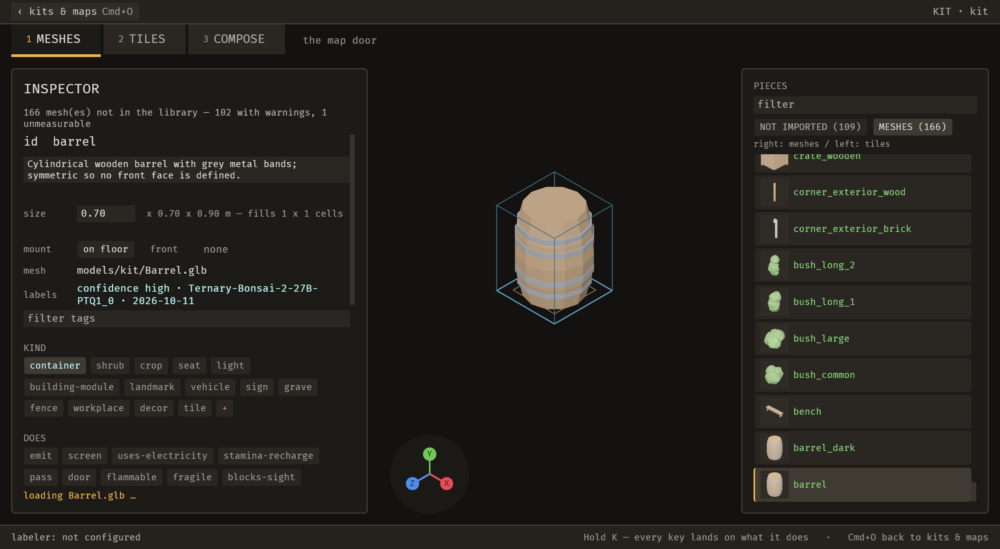
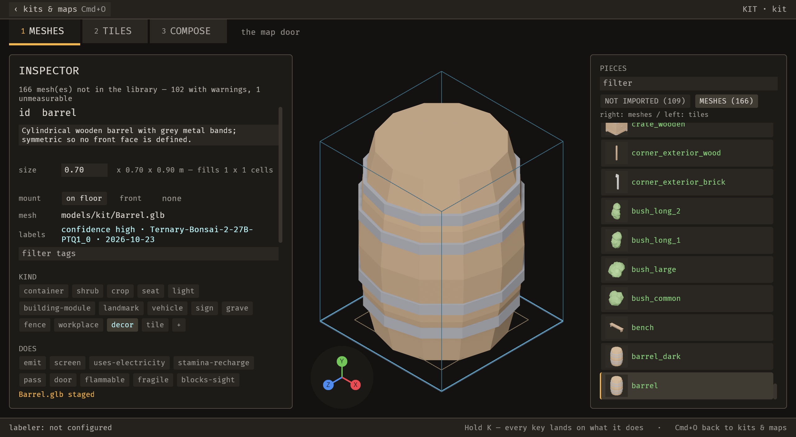

# 2026-10-23 cycle 9 (c966e73): kit labels, agent writes and selection

**Focus:** kitbashing and mesh labelling (the developer, 2026-10-23).

Branch `loop/2026-10-23-cycle9`, range `a5dcbb0..c966e73` (first cycle 9 commit `dbfc9c3`).

## Summary

- **E-044 `piece_select`** is an operation. A Meshes shelf row click, the arrow walk and agents select through it.
- **E-042 `label_set`** sets one axis's tokens through the vocabulary gate. A new core variant `By::Agent` marks agent writes; `By::Human` marks a person's. The chip click dispatches it, and undo restores the record exactly.
- **Bug fixed while proving E-042** (`e49b39a`): after an agent edit the labels row credited the model with today's date.
- **Review:** 1 blocker and 7 should-fix from `local://c9-review.md`. All fixed. Five notes are open as E-049 to E-052.
- **Demo:** the `agent_corrects_a_label` clip did not ship. The label change is too small in the frame. That is a UX finding, filed as E-048.
- **Gate:** clippy clean; `cargo test --workspace` 1,592 passed, 0 failed, 2 ignored.
- **B-044** (Linux flake) is still open. A state trace was running on big when this cycle merged, and it was not waited on; its result lands in the next PR.
- No release (E-006). Performance not re-measured.

## Baseline

Starting point `a5dcbb0`. Cycle 8 closed at `0cd1e1b`, an ancestor of `a5dcbb0`. Working tree clean apart from the untracked `docs/loop/iterations/.Rhistory`, which is not ours and was not touched.

## Enhancements

### E-044 `piece_select` (`dbfc9c3`, `5b91906`)

- One operation, `Undo::None`, behind the shelf row click, the arrow walk and the agent's select call.
- It refuses:
  - outside the kit door's Meshes panel;
  - for a piece hidden by the filter, or one with no measurement;
  - for another kit's piece, naming that kit in the refusal.
- Stills: `piece-select.png` (barrel selected, agent source, operation 0048-8047).

### E-042 `label_set` (`46b88f8`)

- Sets one axis's tokens through the vocabulary gate.
- New core variant `By::Agent` (`crates/bevy_emerge_core/src/descriptor.rs`). Model and Agent axes count as unconfirmed (`any_unconfirmed`, `descriptor.rs:279`).
- The chip click dispatches it (`5b91906`, `b2b8289`).
- Undo restores the record exactly.
- Sanctuary: 0 callsites; 1,141 passed, 0 failed.

## Bugs fixed

### The labels row credited the model with today's date (`e49b39a`)

After an agent write, the labels row read "confidence high · <model> · <today>". `stamp_by` set `at` before it pinned `model_at`, so the row used the wrong date. The row now reads `confidence high · <model> · 2026-10-11 · agent set kind`.

- Failing-before: `the_meshes_pane_says_how_sure_the_labels_are`: 4 passed, 4 failed before the fix.
- Test diff: `an_open_model_axis_keeps_the_models_date_and_says_when_a_person_touched_it` is renamed to `…_names_who_wrote_the_rest`. Its expectation changed from `touched 2026-10-21` to `confidence high · gemma-x · 2026-10-20 · by hand set look`. The date belongs to no single source, so the new text is more truthful. The doc comment explains why.

## Records

- **Stills** (`docs/loop/iterations/assets/2026-10-23-cycle9/`, each viewed by Main):

- **Gate** at the code of `bfc538b`. Clippy clean after `5975cd8`. `cargo test --workspace`: 119 suites, 1,592 passed, 0 failed, 2 ignored. That run came before the clippy-only collapse; `label_set` (7/7) and `piece_select` (6/6) were re-run after it.
- **Sanctuary:** `label_set` has 0 callsites and `piece_select` has 0 callsites there; 1,141 passed, 0 failed.
- **`UNMIGRATED_MAX`:** unchanged at 119. `operations_have_two_front_ends.rs` gained two entries (`piece_select`, `label_set`). The walk keys also walk the candidate list, which no operation covers.
- **Disk:** with the developer's approval, Main deleted 44.5 GB of superseded bevy_emerge artifacts from the shared target (none older than 7 days existed). 29–45 GB free.
- **B-044** (Linux flake, `one_undo_takes_back_the_newest_change`): a state trace (undo and redo stack lengths and placement counts under stress) was running on big at merge, in its own worktree with no local cargo. Its outcome, and any fix, ship in the next PR.

## Video track

- `agent_corrects_a_label` **did not ship.** Five tight crops (A–E): the label_set change is 0.18–1.04% of the frame; the undo is 0.39–1.28%. The bar is 5%, and it stays. The finding is E-048: an agent's kit edit has almost no visible feedback (one chip highlight and one row of text), so a person can miss it.
- Storyboard: `/tmp/cycle9/keep/agent_corrects_a_label.json` (outside the repo).
- README step 4 added in `c966e73`: take back an agent's label with Cmd+Z on the Meshes panel; the receipt reads `restored <piece>`.

## Performance

Not re-measured. No performance claims are made in this cycle.

## Test diffs

`git diff --name-status a5dcbb0..HEAD -- '**/tests/**'`: 7 new test files, 2 modified; 9 in total.

- New:
  - `label_set_is_an_operation.rs` (7)
  - `piece_select_is_an_operation.rs` (6)
  - `a_label_set_on_effects_settles_as_the_kind_does.rs` (2)
  - `a_library_change_does_not_block_another_pieces_undo.rs` (2)
  - `a_meshes_undo_takes_back_the_agents_newest_label.rs` (1)
  - `a_refusal_names_the_kit_that_owns_the_piece.rs` (3)
  - `a_sequence_takes_the_agents_checks.rs` (3)
- Modified:
  - `operations_have_two_front_ends.rs` (+6, additions only)
  - `the_meshes_pane_says_how_sure_the_labels_are.rs` (8 tests now; `e49b39a` renamed one and added three: `an_agent_write_on_a_legacy_model_record_keeps_the_models_date`, `an_agent_write_that_leaves_no_model_axis_names_no_model`, `an_agent_write_on_a_hand_labelled_record_is_not_called_by_hand`)

## Review fixes

From `local://c9-review.md`: 1 blocker, 7 should-fix, 5 notes.

| Gap | Severity | What | Status |
|---|---|---|---|
| 1 | blocker | Kit Cmd+Z erased an agent's newer `label_set`: Map stack vs ImportState snapshot. The Meshes history now holds a snapshot step for a person and a logged step for an agent. | fixed `c4edbd6` |
| 2 | should-fix | Map-door undo of an agent label left the live Project stale (`carry_rules`) | fixed `ddc46be` |
| 3 | should-fix | Any later `label_set` blocked an earlier undo (Guard 1, `state_json` had no scope). Undo is now scoped by piece. | fixed `c7c670a` |
| 4 | should-fix | Capture sequencer bypassed `piece_select` checks and the put_back | fixed `c4f6190` |
| 5 | should-fix | Wrong refusal reason for another kit's piece; `label_set` listed no close ids | fixed `d7df337` |
| 6 | should-fix | `label_set` on effects reported values `emerge_list_pieces` does not show; effects settle | fixed `24465b9` |
| 7 | should-fix | MCP tool descriptions said "(model or human)" | fixed `bfc538b` |
| 8 | should-fix | Docs did not match code (`agents-and-mcp.md` lines 62, 64, 90) | fixed `bfc538b` |
| 9 | note | Chip click writes `library.ron` twice (`tiles.rs:6321-6324`) | open, E-049 |
| 10 | note | `FocusLibrary` seed still selects directly (`tiles.rs:6442`); walk-key reason was wrong | open, E-050 |
| 11 | note | Stale enum doc (`descriptor.rs:178`); an old reader cannot parse a file with `Agent`. Doc comment now carries the old-core warning (`descriptor.rs:186`). There is no CHANGELOG in this repo. | fixed `bfc538b` (doc only) |
| 12 | note | Cost and duplication: `Project` clone per shelf click (`editor.rs:3030-3036`); third Levenshtein copy (`ops.rs:2278`) | open, E-051 |
| 13 | note | `by_model` name reads as model-only | open, E-052 |

Gaps 14–16 come from the cycle 8 review and belong to E-047. Gap 15 is fixed in `bfc538b` (`docs.rs:279`: "counted in the filtered list. 0 is the first match"). Gap 16 is open: `fn confidence_word` at `crates/bevy_emerge_mapper/src/ops_brp.rs:462`; the cycle 8 review cited line 451, which is stale. Gap 14 is open: `confidence` and `at` describe the record, not what is unchecked.

Review checks:

1. Provenance: pass after the fixes (gaps 4, 13 noted).
2. Undo: failed on gaps 1–3; fixed.
3. `label_set` validation: pass, apart from gaps 5 and 6 (fixed).
4. `piece_select`: partial. Gaps 4, 5 fixed; gap 10 open.
5. Core change: pass; gap 11 fixed in the doc comment.
6. Labels-row wording: pass.
7. Docs: failed on gaps 7 and 8; fixed.

## Deferred / open

- **E-047**: gaps 14 and 16 open (gap 15 fixed).
- **E-048**: agent kit edits give almost no visible feedback. Proposal: a receipt line naming the change ("agent set barrel kind: container → decor") and a brief highlight on the changed chip.
- **E-049**: chip click writes `library.ron` twice.
- **E-050**: `FocusLibrary` seed selects directly; walk keys' allowlist reason is wrong.
- **E-051**: `Project` clone per click; third Levenshtein copy.
- **E-052**: `by_model` name; a future `unconfirmed` alias.
- **B-044**: Linux flake; the trace's result goes into the next PR.
- **`door_open` and `emerge_list_pieces`**: no backlog IDs filed (cycle 8 left this to Main). Left as is.

## Next focus

Kit feedback for agent edits (E-048), then the open review notes (E-049 to E-052) as one cycle. B-044 depends on the big trace.
