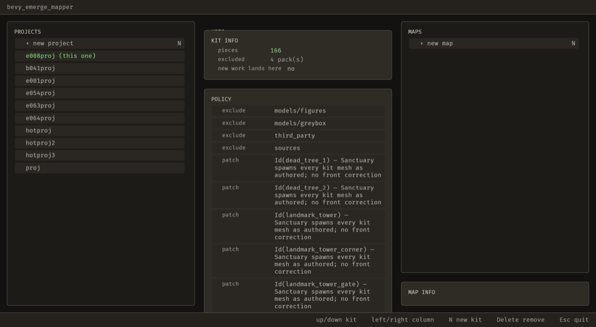
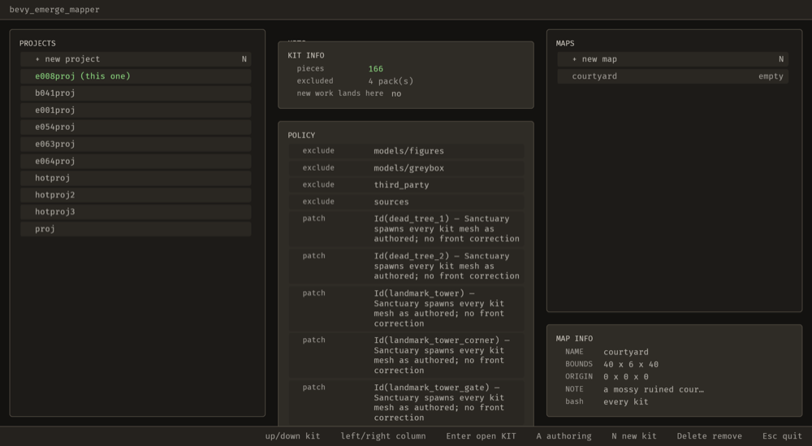

# 2026-10-24 agent-map: an agent can make a map (E-008)

Focus: E-008 · Commits: `dadb7ef` · Outcome: shipped

## Summary

The brief's first two steps are "the developer describes" and "the agent turns that into typed
editor operations". *"Make me a 40 metre courtyard with a note"* is the simplest request in that
loop, and **there was no tool that could do it**: `chooser::create_map` wrote a map's file directly,
outside the registry, so the only way to make a map was a person at the keyboard on the menu screen.

`map_create` is that operation now. It dispatches the same `create_map` the dialog calls, so the
naming rule, the refusal for a name in use, and the validate-then-atomic write are one
implementation with two front ends.

## Baseline

Gate green before the edit; the workspace's 126 test binaries `ok` after, clippy clean.

## Enhancement: `map_create`, one operation with two front ends

Plan: register a `map_create` operation that calls `chooser::create_map`, and make the chooser's
new-map dialog dispatch it instead of calling `create_map` itself. · Files: `ops.rs` (the operation),
`chooser.rs` (`make_it` dispatches; the parity scan reads both screens), `ops_brp.rs` (`emerge/state`
and `emerge/project_root` answer on the menu), `editor.rs`, `tiles.rs`. · Goal: an agent holding a
project root and nothing else can make a map that the chooser, the editor and the game all accept. ·
Proof: `crates/bevy_emerge_mapper/tests/an_agent_can_make_a_map.rs` — 5 tests, all failing before the
operation existed.

Three things had to change for an agent to reach it, and each was a real gap:

- **`Ctx::root`.** The menu is the screen you are on *before* a door, so it holds a root directory
  and no loaded `Project` — and opening one would parse every kit and require `vocab.ron`. A change
  made from the menu needs the root: the log line goes in it, a map goes in its `maps/`.
- **`emerge/project_root` and the bridge's context report the menu's root**, so the server's own
  "are we pointed at the same project" guard passes there. Before this the whole agent surface
  refused on the one screen where a project is chosen.
- **The MAPS column follows the directory.** It rescanned only when the *menu* acted, so a map
  written by an agent left the list showing what was there before — measured: an MCP client made
  `courtyard`, the file was on disk with its note, and the menu still drew `+ new map` alone. A
  system now rescans when the maps directory's mtime changes, and the stills below show both states.

Also: the parity walk only read `editor.rs`, so the chooser's dialog could have kept writing the file
itself invisibly. It reads both screens now.

MCP: `map_create` added, `Undo::None` (see "Deferred / open" for why), preview behaviour: none — it
creates one file and refuses a name in use.

| Before | After |
| ------------------------------------------------------- | ------------------------------------------------------ |
|  |  |

**Left (before):** an MCP client has made `courtyard` and the file is on disk with its note, while
the MAPS column still draws `+ new map` alone — the screen says nothing was made.
**Right (after):** the same catalogue after the directory follower landed: the `courtyard` row, and
its MAP INFO below.

## Performance

Not measured this iteration. The change is one operation plus one directory `stat` per frame on the
menu; no claim is made about frame time or latency.

## Review

Not run. No fresh-context review this iteration, so it is reported as absent rather than implied.

## Test diffs

None to existing tests or assertions beyond the parity-walk scan widening (it reads `chooser.rs` as
well as `editor.rs`, which is the point of the change rather than a loosened check).

## Release

Version: unchanged · semver-checks: not run · Channel: **not published** — E-006 is open, so no
published-crate code changed in the sense Phase 6 means. No tag.

## Deferred / open

- **E-066** — `map_create` is `Undo::None` because `take_back` applies an inverse by calling the
  *same* operation's commit with it, and the faithful inverse of a create is a removal that no
  operation carries. An agent can therefore make a map and not unmake it.
- **E-067** — no operation opens a map by name, so an agent that made a map cannot then work in it.
  Found by writing the acceptance script: `map_open` is the missing verb, and `door_open` takes a
  door and a tab but no map.

## Next focus

E-065, the sequencer tests' real-time deadline, because until the gate means green no evidence in any
report is worth much. Then the generation series, which is where the describe → set up loop actually
stops today: an agent can make a map and has nothing to fill it with.
