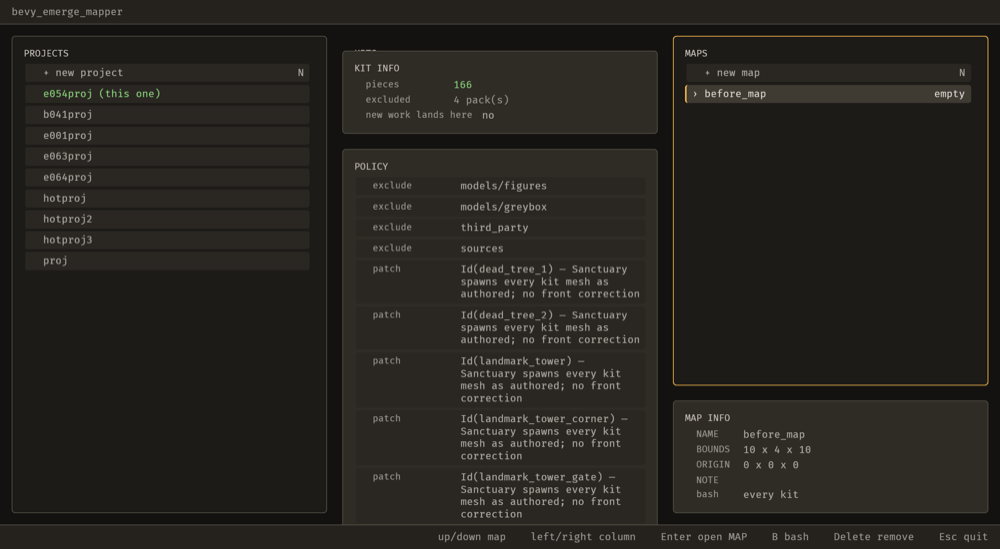
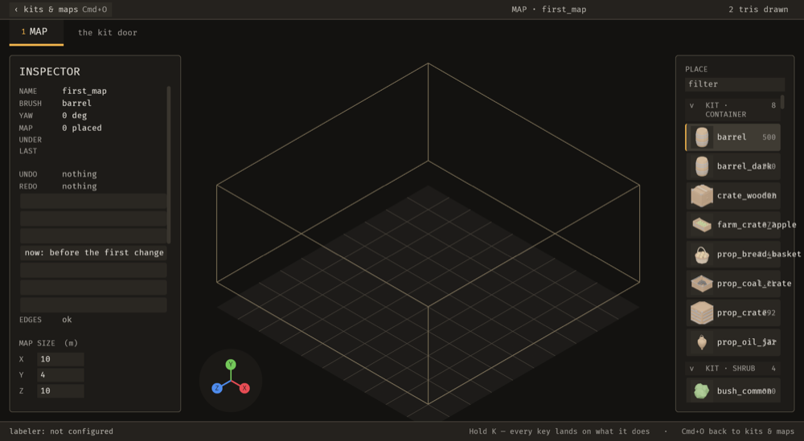

# 2026-10-24 chooser: making a map opens it in the same press (E-054)

Focus: E-054 · Commits: `b8952b5` · Outcome: shipped

## Summary

`Enter` on a new map committed the name and left you on the chooser, so the guide taught a ceremony
— *"the map is made… It is not open yet. Press Enter again."* The two presses were structural:
`type_into_field` consumes the `Enter` that commits a name and sets `Chooser::swallowed`, so
`drive_chooser` returned before its `Enter` arm and opening could not happen that frame. The map is
now left in hand and opened in the same press, through the path a second `Enter` used. One keypress
now goes from naming a map to working in it.

## Baseline

Gate: build, `cargo clippy --all-targets -- -D warnings` and `cargo test --workspace` green before any
edit; **126 test binaries `ok`, zero failures** after (see "Gate reliability" for what that took to
establish honestly).

## Enhancement: making a map opens it

Plan: `make_it` leaves the written map path in a new `Chooser::made`; `drive_chooser` opens it above
the `swallowed` early-return, reusing `open_the_selection` → `launch_args` → `args::open`. · Files:
`bevy_emerge_mapper/src/chooser.rs`, `docs/guide/getting-started.md` · Goal: naming a map and working
in it is one keypress, for a person and for an agent. · Proof:
`chooser::tests::making_a_map_opens_it_in_the_same_press` — fails without the change, passes with it.

Candidates considered:
- **E-054, the two-press map** — hit every time anyone makes a map, and it is the first thing the
  guide teaches; risk is that opening could pre-empt a refusal, handled by keeping the same open path
  so a refusal still lands on screen. Chosen.
- **E-056, `emerge_capture_sequence` annotated `destructiveHint: true`** — a one-line truthfulness fix
  on a tool hint; real but small; deferred.
- **E-008, the new-map dialog writes name/bounds/origin/note outside the registry** — the deeper
  issue behind this area, but it is a registry migration, not one iteration's remaining budget;
  deferred, and E-054 does not make it worse (the open path is unchanged).

**Why the two presses were structural, which the item did not say.** `type_into_field` runs before
`drive_chooser` (text takes the keyboard first, mirroring `keys::Phase::Text` before `Act` in the
editor) and sets `Chooser::swallowed` for the press it used. `drive_chooser` returns on that flag, so
its `KeyCode::Enter` arm — and therefore `open_the_selection` — never ran on the frame the name was
committed. The press could commit the name and nothing else. That is why the fix belongs where the
name is kept, not in the key handler.

MCP: no operation added or changed. `map_create` still does not exist as an operation (that is E-008),
so the chooser remains a screen outside the registry; this iteration changes what one keypress does
on it, not how it is driven.

| Before | After |
| ---------------------------------------------------------- | --------------------------------------------------------- |
|  |  |

**Measured on the real editor**, scratch project copy, maps directory emptied first so the chooser is
the only place to start, keys injected through `bevy_debugger/input` (the sanctioned path, not clicks):

| | one Enter, then `emerge/state` |
|---|---|
| **pre-fix binary** (built from the commit before, saved to `/tmp/emerge_live/mapper-before-e054`) | `map: none` — the chooser stays up, with `before_map.map.ron` written and the status band reading **`Enter open MAP`** |
| **this build** | `map: first_map`, bounds `[10, 4, 10]` — the MAP door is open |

The before still is the evidence that the ceremony was real: the map row exists, and the band is
asking for the second press. The after still is the MAP door on `first_map`.

## Gate reliability — a failure that was not mine, and how I know

Three consecutive `cargo test --workspace` runs each failed a **different** test:
`a_sequence_takes_the_agents_checks`, `an_agents_undo_of_a_removal_waits…`,
`an_agent_turn_in_a_sequence_stands_on_the_screen`, then `a_sequence_turn_is_on_the_receipt`. Each
passes alone (the piece one, 3/3). **Clean `main` at `4b15d06` fails the same way**, so this is
pre-existing rather than this change:

- The common shape is a **20 s real-time deadline** in a loop that calls `app.update()` — and
  `a_sequence_turn_is_on_the_receipt.rs:49` never sleeps, while its siblings do.
- The machine was at **load average 30–37 on 10 cores** (other work), so those loops never gave the
  sequencer the time it was waiting for.
- With the load down, the same tree runs **126 binaries, zero failures**.

Logged as **E-059** rather than worked around: the fix is a sleep in the tight loop, which is a
test-infrastructure change and not part of this iteration's one enhancement.

## Performance

No frame-path change: one `Option` check at the top of `drive_chooser`, true on one frame per map
creation. Frame time, latency and edit-to-visible were **not** measured this iteration; reporting that
as not-done rather than claiming a number. The opened map was readable through `emerge/state` within
the 2 s settle used in the drive script.

## Review

Not run. No fresh-context review this iteration, so it is reported as absent rather than implied.

## Test diffs

None to existing tests or assertions. One test added: `chooser::tests::making_a_map_opens_it_in_the_same_press`.
It asserts on the map left in hand and on the `launch_args` the screen would use, because
`open_the_selection` needs `Commands` and `NextState<Screen>` and cannot run headless — the real
keypress behaviour is proved by the two stills and the two `emerge/state` readings above.

## Release

Version: unchanged · semver-checks: not run · Channel: **not published** — `E-006` is open ("No crate
in this workspace is published to crates.io"), so no published-crate code changed in the sense Phase 6
means. No tag.

## Deferred / open

- **E-056** (`emerge_capture_sequence` says `destructiveHint: true`) — one-line annotation fix.
- **E-008** — the new-map dialog still writes its four fields outside the registry. This is the real
  work in this area: it is why `map_create` is not an operation and why the chooser cannot be driven
  by an agent at all.
- **E-059** — the sequencer tests' real-time deadlines; the gate cannot be trusted on a loaded
  machine until it is fixed.
- `B-018`, `B-021`, `B-030` remain the only open bugs; none is must-fix.

## Next focus

**E-008**, because it is the largest remaining gap in the brief's own first two steps: with no
`map_create` operation, an agent asked to "make me a map" has no tool that does it, and the chooser can
only be driven by synthesised keys. E-054 removed the ceremony for a person; E-008 is what removes it
for an agent.
