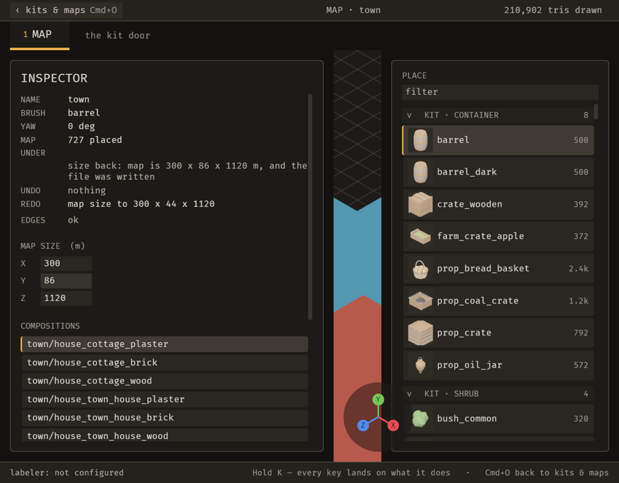
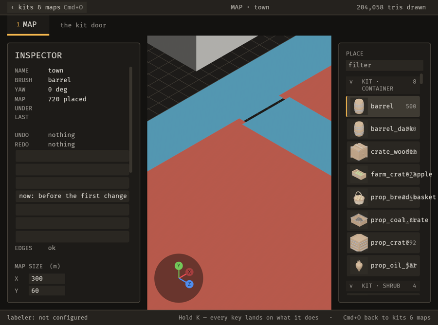

# 2026-10-24 chrome: a narrow window pays the viewport before it pads a dock (B-014)

Focus: B-014 · Commits: `b347dfe`..HEAD · Outcome: fixes only

## Summary

At a 900 logical px window the two docks took 835 px of it and left the map **69 px** — the item's
own "about 70 logical px", reproduced from the real layout rather than from a still. The docks were
never overflowing: nothing reserved the viewport, so the map was whatever two fixed panels left
over. `chrome::fit_docks_to_the_window` now pays the viewport first and squeezes both docks by one
fraction down to `chrome::DOCK_MIN_W`. The map went from 69 px to **379 px** at that size, and an
ordinary window loses nothing (769 px before and after, because 1600 px can afford both).

## Baseline

Gate: build, `cargo clippy --all-targets -- -D warnings` and `cargo test --workspace` all green
before any edit; **125 test binaries `ok`, zero failures** after. Frame time and latency were not
re-measured this iteration — the change adds one system that writes only when a panel's width must
change (see "Performance").

## Bugs fixed

### B-014: a narrow window leaves the viewport a sliver between the two fixed-width panels

Must-fix: blocks **n**, common **n**, no workaround **n** — `docs/loop/iterations/assets/2026-10-21-63e6631/window-narrow.png`
shows the sliver; widening the window was the workaround.

**Fix.** Root cause: every panel was `width: Val::Px(preferred)` inside a `flex_shrink: 0.0` dock, so
the row was divided by demand and the viewport — `flex_grow: 1.0, min_width: 0` — got the remainder,
which at a narrow window is almost nothing. Two facts made the overhead larger than the constants
suggest: `EDITOR_UI_SCALE` multiplies every `Val::Px` (a `CONTROLS_W` panel measures **485** at
`UiScale(1.2)`, and the right dock **346**), and a dock is as wide as its widest *visible* panel.

`chrome::fit_docks_to_the_window` computes the row's demand as the widest visible panel per side plus
that panel's `2 * MARGIN`, and the fraction of its preferred width each panel keeps as

```text
squeeze = (room - VIEWPORT_MIN_W - overhead) / sum_preferred   // clamped to [0, 1]
```

then raises it so no panel falls below `DOCK_MIN_W`. When the window can afford both docks at their
design width the fraction is 1.0 and **nothing is written** — the common case costs one comparison.

Two attempts on the way here are worth recording because both looked right and neither worked: giving
the docks `flex_shrink: 1.0` and `min_width` changed nothing (a dock is sized by its children, not by
the row), and giving them `flex_basis: 0` with a proportional `flex_grow` made it *worse* — 2 px —
because the children still declared definite widths. The answer had to be an explicit system that
lowers the panels' own widths, which is what the frame's own doc already promised ("A panel says how
wide it wants to be; where it goes is the frame's answer").

Regression check: `the_viewport_keeps_a_usable_width_in_a_narrow_window.rs::a_narrow_window_keeps_the_viewport_wide_enough_to_author_in`
— **failed before** (69 px, at `chrome.rs` reverted) and **passes after** (379 px).
`::an_ordinary_window_keeps_its_viewport` pins the wide case at its measured 769 px so the fix cannot
buy the narrow window with the common one.

| Before | After |
| -------------------------------------------------------------- | ------------------------------------------------------------- |
|  |  |

The after still is the live editor at a 900 × 700 logical window (1800 × 1336 physical, factor 2):
the map is a real area with the walled town in it, and both docks are still readable panels rather
than columns of single words. The wide still, `B-014-after-wide.png`, is the same build at
2560 × 1406: the docks keep their design width and nothing is squeezed.

## Enhancement

None. B-014 was the iteration's one item and it is a bug.

## Performance

The only addition on the frame path is one `Update` system, editor-gated, that reads `Window` and
`UiScale` and compares each panel's width to the one it would set. On any window that can afford both
docks it writes nothing at all; on a cramped one it writes once per resize, because the computed
width settles. It follows `no_system_writes_every_frame`'s compare-before-writing shape and the test
passes unchanged.

Frame time, latency and edit-to-visible were **not** measured this iteration; the change touches no
asset, no data file and no render path, so there is no hot-reload surface to prove and no reason to
expect a shift. Recording that as not-done rather than claiming a number.

## Review

Not run. The change is a layout arithmetic fix with a headless measurement on both sides of it and a
live still at each size; the loop's Phase 4 asks for a fresh-context review, and this iteration does
not have one, so it is reported as absent rather than implied.

## Test diffs

None. No existing test or assertion was changed. One test file added:
`crates/bevy_emerge_mapper/tests/the_viewport_keeps_a_usable_width_in_a_narrow_window.rs`.

## Release

Version: unchanged · semver-checks: not run · Channel: **not published** —
`E-006` is open ("No crate in this workspace is published to crates.io, so the first publication is
undecided"), so published-crate code did not change in the sense Phase 6 means. No tag.

## Deferred / open

- **The viewport floor is a reserve, not a guarantee.** A window can be too narrow for
  `VIEWPORT_MIN_W` *and* two docks at `DOCK_MIN_W` at once; when that happens the docks' floor wins
  and the viewport takes the remainder. At 900 px only the sliver is gone, not the cramp. Giving the
  map a guaranteed floor would need a dock that folds away (a real enhancement, and B-014's own
  evidence names it: "Panels that shrink, or one that folds away").
- **No MCP tool sizes the window.** Producing the narrow still needed the host window manager, which
  is a parity gap for automated visual checks — logged as a candidate, not done here.

## Next focus

The docks now shrink, so the next step in this area is the *other* half of B-014's evidence: a dock
that folds away entirely below a threshold, which would give the map a guaranteed floor instead of a
reserve. Failing that, the open `bug` items in `backlog.json` are the better use of an iteration.
