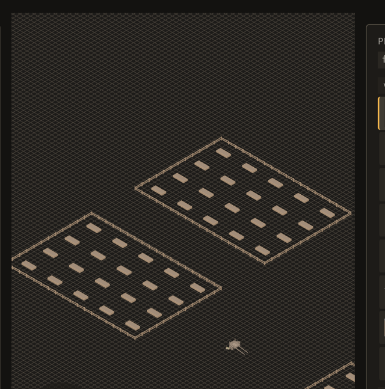
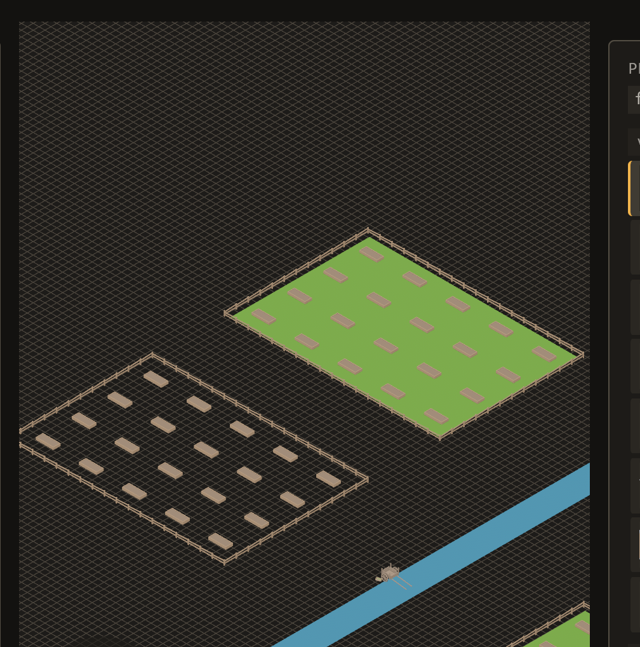

# 2026-10-24 editor: a redraw leaves the standing pieces standing (B-048), and the README catches up

Focus: bug sweep (all GitHub issues closed) · Commits: `c72d724`..`HEAD` · Outcome: fixes shipped

## Summary

B-048 had sat `unconfirmed` since cycle 5: *"undoing a removal blanks the ground patches for one
frame"*. It reproduces, and the cause is a full map redraw that despawned every standing piece and
spawned them all again. It now despawns only what the map no longer holds, and leaves a piece alone
only when the entity is drawn where its row says — position **and** facing. The README is also
brought up to date with everything shipped since it was last touched, as asked.

## Baseline

Gate: green before and after (clippy clean; `cargo test --workspace` green). Frame time, latency and
edit-to-visible were not re-measured: the sweep is narrower than it was, so the only path whose cost
changed got cheaper.

## Bugs fixed

### B-048: undoing a removal blanks the ground patches for one frame

Must-fix: blocks **n**, common **y**, no workaround **n** — every logged undo and every agent undo;
the workaround is to accept a visible flash. One yes: not must-fix by the rule, so it was taken as the
iteration's bounded bug work.

**Reproduced, measured.** Town map, fields framed, `emerge/capture_sequence_start` at 15 fps, then
a removal and its undo. Counting green field pixels per frame:

| | frames with 0 green | min | max |
|---|---|---|---|
| before | **`f009` (t=0.60 s)** | **0** | 143,694 |
| after | none | 73,190 | 143,694 |

`f009` is the undo frame. Both patches are gone from it — outlines and crops remain, the fill does
not — and they are back at `f010`.

**The person's `Cmd+Z` never blanked.** The same sequence driven by the key chord holds 143,694 green
pixels across all 45 frames. That is the finding that located the cause: the key path restores the
rows and spawns them itself (`Undo::RemovedMany`), while the logged undo and the agent's undo ask for
`Due::map_replaced`, which runs `draw_every_placement` — and that swept **every** entity before
spawning the map again.

**Fix** (`editor.rs::draw_every_placement`): despawn only entities the map no longer holds, and skip a
row whose entity is already drawn where that row says. Spawning at the right state gives the next
frame nothing to correct, so nothing is despawned and nothing blanks.

**Two wrong versions, caught by tests rather than by argument.** Skipping on the entity id alone broke
`a_map_edited_on_disk_reaches_the_screen` — a piece moved on disk kept its entity and stayed at the old
place. Comparing translation alone broke `an_agent_turn_stands_on_the_screen` — a turn moves neither
the row's `at` nor the translation, it only spins the piece. The rule is now *position and facing*,
and both of those tests pass.

**A related omission fixed on the way.** `Undo::RemovedMany` spawned restored rows with `Placement`
and no `bevy_emerge::Paint`, while every other spawner attaches it — so a restored piece drew at level
0 whatever the map said, and `relevel_placements` then corrected it by despawning it. It now spawns at
the map's paint.

## README

The README (`## Why`, `## Status`, `## What you can do`) now covers what shipped since `df7fe7d`:

- **G draws the layout before you keep it** (B-046) — translucent proposed pieces, and Enter keeps
  exactly what was on screen.
- **A piece can rest on a support surface or on the floor** (issue #1) — one library entry, the
  placement records which it took, and the `UNDER` readout names it (E-059).
- **A label change says what it did, in the door you are on** (E-048), including the effects a `kind`
  write re-derived from the vocabulary (E-063).
- **A still's answer carries a fingerprint of its bytes** (E-062), so two captures compare as
  pictures.

## Test diffs

- `crates/bevy_emerge_mapper/tests/a_full_redraw_leaves_the_standing_pieces_standing.rs` — **new**, 2
  tests: a redraw keeps the entities the map still holds, and still takes away a piece the map no
  longer holds. The first **fails before the fix**; the second passes either way, which is what keeps
  the pair from being a blanket "the sweep may do nothing".
- `crates/bevy_emerge_mapper/src/editor.rs` — the `redraw_all_for_test` hook, beside the other
  `*_for_test` helpers, calling the production `draw_every_placement`.
- **No existing test or assertion was changed.** Two of them (`a_map_edited_on_disk_reaches_the_screen`,
  `an_agent_turn_stands_on_the_screen`) failed against intermediate versions of this fix and pass
  against the final one; their assertions were untouched.

## Gate

- `cargo clippy --all-targets -- -D warnings` — clean.
- `cargo test --workspace` — green.

## Release

Version: no change · Channel: **not published**. E-006 stands: no crate here has a published baseline.

## Deferred / open

- **B-025** (file edit-to-visible rose 132 → 245 ms on a path the change did not touch) and **B-041**
  (a translucent house after a removal) remain `unconfirmed`. B-041's likely cause is recorded in its
  own evidence and would need a capture that reproduces the armed-brush state.
- **B-014** open; **E-064** open (an `effects` write can be overridden by the vocabulary, unsaid).
- The scratch project `/tmp/emerge_live/e001proj` has its map restored from the backup taken before
  the sequences.

## Next focus

**B-041**, the last `unconfirmed` bug with a plausible cause already written down: its evidence
suspects the gate house was the armed brush's ghost under the cursor, and a sequence that arms the
house *and* removes the block would settle it either way. That is the same method this iteration used
to settle B-048 — reproduce with a sequence, then decide.
