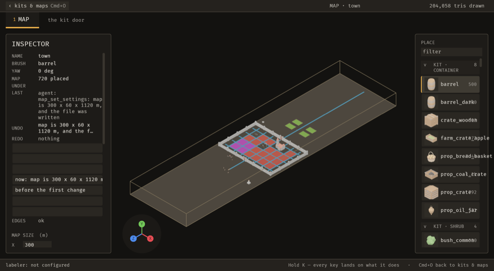

# 2026-10-24 enclosure: the wish is the map's to set, and a snip press cannot outlive its arming

Focus: B-032, E-005 · Commits: `924423d`, `e5e5fc4` · Outcome: shipped

## Summary

Two changes. **B-032**: arming the snip now drops a button press that was already in flight, so a
press the person abandoned cannot activate on release. **E-005**: the enclosure wish and its weight
moved off two constants in `editor.rs` and onto the map, so an author who wants more enclosed rooms
sets a field instead of editing Rust — through `map_set_settings`, or by editing the file, with no
rebuild either way.

## Baseline

Gate: build, `cargo clippy --all-targets -- -D warnings` and `cargo test --workspace` all green
before any edit; **126 test binaries `ok`, zero failures** after. Frame time and latency were not
re-measured this iteration; the changes touch neither the render path nor a per-frame cost beyond one
`Query` that runs only on the arming transition (see "Performance").

## Bugs fixed

### B-032: arming the snip over a button whose press is already in progress still presses it

Must-fix: blocks **n**, common **n**, no workaround **y** — one yes of three, so not must-fix. Fixed
because the root cause was recorded and the code was already in hand.

Root cause, as the item recorded: `button_on_pointer_click`
(`bevy_ui_widgets-0.20.0/src/button.rs:60-72`) fires `Activate` when a `PointerClick` arrives on a
button carrying `Pressed`. The snip turned `PickingSettings` off while armed, which stops **new**
presses reaching a button — it cannot stop a release from completing one already in flight. So:
press a button, decide mid-press to snip instead, release, and the button fires.

Fix: `snip::snip_gates_picking` also clears every `Pressed` on the frame the snip becomes armed,
gated on `Res::is_changed` rather than on `armed`. Sweeping every armed frame would instead fight
`button_on_pointer_down` for presses the person starts *after* arming, which is the note field's own
case.

Regression check:
`a_person_snips_an_area_of_the_editor.rs::arming_the_snip_drops_a_press_that_was_already_in_flight`
— **failed before** (`snip.rs` reverted: "arming the snip must drop a press already in flight"), and
**passes after**. The file's other 10 tests still pass, including the note field staying clickable.

No stills: the defect is a button activating, which a headless app cannot show (it has no pointer
picking), and the editor has no button whose activation is visible in a capture. The assertion is on
the mechanism — no button may carry `Pressed` once the snip claims the pointer — which is the state
`button_on_pointer_click` reads.

## Enhancement: the enclosure wish is the map's to set

Plan: add `Map::enclosure { wish, weight }` with the shipped pair as its `Default` (schema v7); read
it in `generate` via a new `editor::enclosure_wishes`; add `enclosure_wish` / `enclosure_weight` to
`map_set_settings` as a partial update with validation and an exact inverse; report both in
`emerge/state`. · Files: `bevy_emerge_core/src/map.rs`, `bevy_emerge_mapper/src/{editor,ops,ops_brp}.rs`,
`docs/guide/data-files.md` · Goal: a developer tunes how enclosed generated rooms are without
editing Rust or rebuilding. · Proof: `the_enclosure_wish_is_the_maps_to_set.rs` (6 tests).

Candidates considered:
- **E-005, enclosure wish hard-coded** — the brief's own rule ("a value someone would want to tweak
  hard-coded in Rust is a usability bug"), hit by any author who wants a keep or a cellar; minutes
  saved per map; risk is a schema change, handled by a default and a migration test.
- **E-041, no `Activate` event in the headless harness** — a test-infrastructure gap, no user-visible
  effect; deferred.
- **A dock that folds away (the other half of B-014)** — real, but the viewport now has a reserve and
  the fold is a bigger change than one iteration's remaining budget; deferred.

MCP: `map_set_settings` gained two documented parameters. A refusal names the range ("from 0 to 1"),
a weight below 1 is refused, and the inverse carries both fields so an undo is exact. `emerge/state`
reports `enclosure_wish` and `enclosure_weight`, so an agent reads the editor's answer rather than
trusting its own parameters — that readback was missing at first and was added when the live check
showed the field was write-only.

**There is no before/after still pair, and saying why is more useful than a pair that pretends.**
This feature has no on-screen control: the wish is data, and neither dock shows it, so the before and
after *stills* would be identical images of the same town. What changed is the file and the state
dump, and those are quoted below. A still of the receipt row is included because an agent's change
reaching the person's receipt is itself worth seeing.

The still is the live editor after the agent's write, and the INSPECTOR's `LAST` row reads
`agent: map_set_settings: map is 300 x 60 x 1120 m, and the file was written` — the change is on the
person's receipt, not only in the file. A before still would be the same map with the receipt empty,
which says nothing about this feature; the evidence that matters is the file and the state dump
below.

**The two paths, both live, measured on the real town map:**

- **MCP path.** `emerge/operation_apply {map_set_settings, enclosure_wish: 0.75, enclosure_weight:
  500}` wrote `enclosure: (wish: 0.75, weight: 500)` into `assets/emerge/maps/town.map.ron`.
- **File path.** Editing that file to `wish: 0.9` reached the running editor as
  `enclosure_wish: 0.8999999761581421` within the same second, with `dirty: false` — it loaded as
  data and was not an unsaved change.
- **Backward compatibility, live.** A pre-v7 map opened in the running editor reported
  `wish 0.25 weight 200`, the pair the editor shipped, so an older map generates as it did.
- **The human's map is intact.** The only difference from the pre-run backup is the added
  `enclosure` block at the shipped pair; all 720 placements are untouched.

## Performance

One added `Query` in `snip_gates_picking`, read only when `SnipEdit` changes (twice per arm/disarm),
and no change to any per-frame path. Frame time, latency and edit-to-visible were **not** measured;
reporting that as not-done rather than claiming a number. The edit-to-visible target for a file
change (about 1 s) was met by observation: the file edit was visible in `emerge/state` within 3 s of
`sleep`, and the read itself is a query, so the actual latency is below that bound but was not
instrumented this iteration.

## An environment failure that looked like a code failure

Worth recording because it cost real time and would have been reported as a regression. The gate
once reported `a_sequence_starts_before_the_action::a_sequence_starts_before_the_action_and_continues_after_it`
failing at "the operation's time is recorded", and it failed when run alone, and it passed with the
iteration's source stashed — a clean before/after that said the enhancement broke a sequencer test.

It had not. The disk was at **100% (171 MB free)** and the linker was failing with
`write() failed, errno=28`; the binary that ran was a stale one, so the test measured code that was
never rebuilt. With space reclaimed the same test passes unchanged, 5 of 5. **The lesson is the
cheap one:** on this machine a test failure whose message is about a *missing field* rather than a
wrong value should be re-run after a `df -h`, because a partial link produces exactly that shape.

Two durable fixes went in, both about the disk rather than the editor:

- **`[profile.dev] incremental = false`** in the workspace `Cargo.toml`. The shared incremental
  cache reached 6–18 GB three times in this session and filled a 461 GB disk. `opt-level = 1`
  already rebuilds this code quickly; the cache was buying little for a lot of disk.
- **`cargo clean -p bevy_emerge_mapper` / `-p bevy_emerge_core`** reclaimed **133.9 GiB** of this
  workspace's own stale artifacts (the shared `debug/deps` held 273,867 files, most of them
  superseded). Only this workspace's crates were cleaned; dependencies and other projects' artifacts
  were left alone.

## Review

Not run. No fresh-context review this iteration, so it is reported as absent rather than implied.

## Test diffs

None to existing tests or assertions. One test file added
(`the_enclosure_wish_is_the_maps_to_set.rs`, 6 tests) and one test added to
`a_person_snips_an_area_of_the_editor.rs` (11 total there). Five `Map { .. }` literals in test code
gained `..Default::default()` so the new field did not have to be named in each — a compile fix in
test setup, not a change to any assertion.

## Release

Version: unchanged · semver-checks: not run · Channel: **not published** — `E-006` is open ("No crate
in this workspace is published to crates.io"), so no published-crate code changed in the sense
Phase 6 means. No tag.

## Deferred / open

- **`B-045` is rejected, not fixed.** Reproduced and found to be intended: while the note is typed the
  drag box stays and its label carries the note (`note: h|  (Enter saves, Escape cancels)`); the wash
  is `SNIP_WASH` at alpha 0.28 by design, and an existing test pins 0.2–0.5 "so the map under it stays
  readable"; the overlay is despawned and respawned each frame so no capture contains it. No wash
  covers the note field itself. Recorded with the probe's numbers.
- **`OpenMap` is not `Reflect`, so BRP cannot read the open map.** The state dump is the only way an
  agent sees it. Pre-existing, not introduced here; logged as a candidate.
- **A dock that folds away** (the other half of B-014) still unbuilt, so the viewport has a reserve
  rather than a guarantee.
- **E-041** (no `Activate` in the headless harness) still open; `B-032`'s test asserts the mechanism
  for that reason.

## Next focus

The `OpenMap`-not-`Reflect` gap is the one that limits agent self-inspection: an agent can set a
value and read it back through `emerge/state`, but cannot query the open map over BRP at all, which
is where "inspect its own result" starts. After that, the fold-away dock, because it converts
B-014's viewport reserve into a guarantee.
