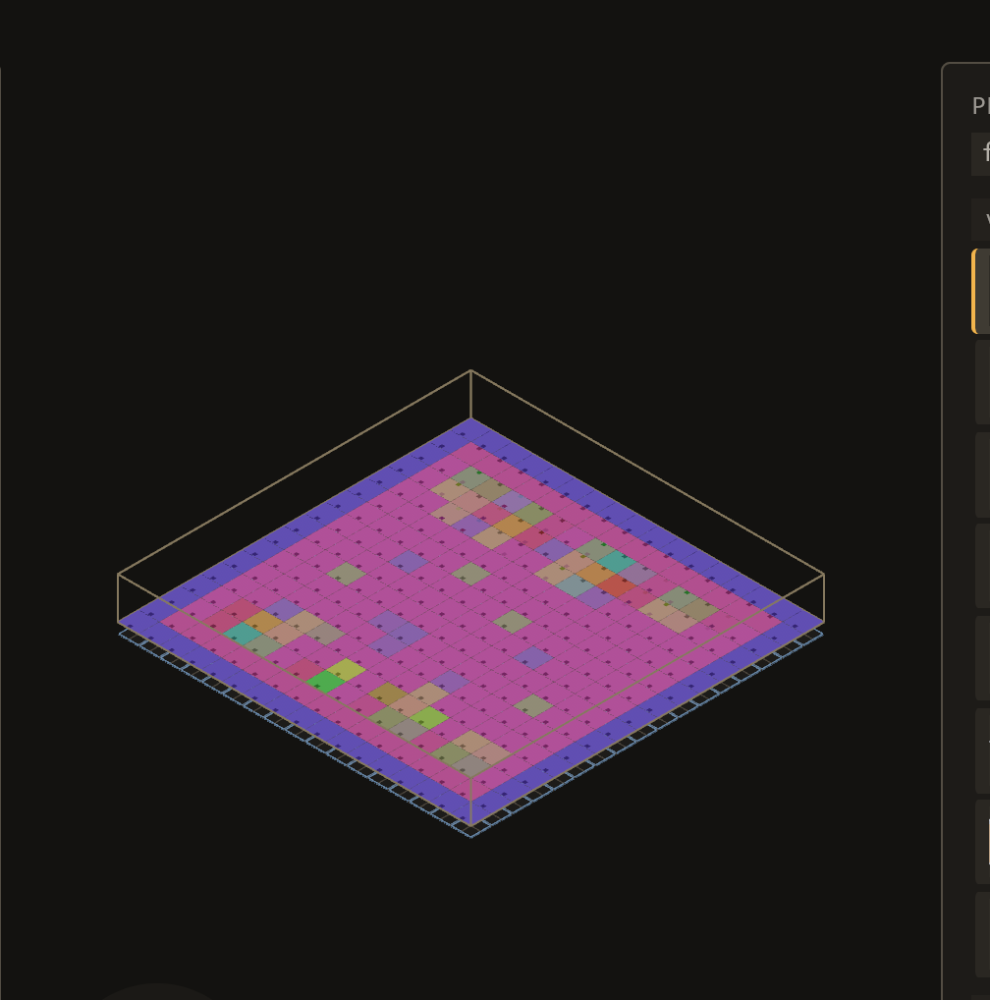
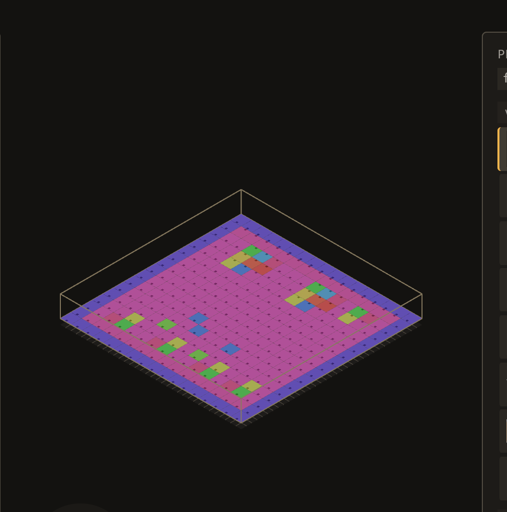

# 2026-10-24 fill: `G` draws the layout it is about to ask you to keep (B-046)

Focus: bugs (all GitHub issues closed) · Commits: `a0d25df`..`HEAD` · Outcome: fixes only

## Summary

`G` generates a whole layout and then asks a yes/no question — *"289 piece(s) … Enter keeps it, Esc
throws it away"* — and **the pieces were not drawn**. Only a 1-px cell outline went down, and on the
map the bug was filed against, pressing `G` changed **0.00% of the viewport's pixels**. The author
was asked to keep or discard a layout they could not see, which is the brief's rule about previewing
wide operations broken by the operation it names. Proposed pieces are now drawn as translucent
ghosts, through the same `spawn_piece` the commit uses, so the preview is the layout.

## Baseline

Gate: green before and after. Frame time, latency and edit-to-visible were not re-measured: the
change adds one system that rebuilds only when a proposal changes (`Local`-keyed), so no per-frame
cost on any measured path. Prior baseline stands: frame 16.66 ms median, MCP edit-to-visible 150 ms,
file edit-to-visible 452 ms on the town map.

## Bugs fixed

### B-046: A generator's proposal is not drawn before Enter

Must-fix: blocks **n**, common **y**, no workaround **y** — every learned/declared/composed
generate; the only workaround is keep-then-undo.

**Reproduction.** `town_block`, 289 placements, pre-fix binary, map framed to `[-40,-40]..[40,40]`:

| | viewport pixels changed by `G` |
|---|---|
| pre-fix | **0 of 1,014,944 (0.00%)** |
| after | 37,651 (3.67%) |

The status line confirmed the proposal was made in both cases (`proposed: 289 piece(s) replacing 289
… from 24 prototype(s)`), so the pre-fix result is a proposal whose picture is the unchanged map.

**Fix** (root cause: `draw_proposal` drew cell outlines, and nothing ever spawned the proposed
pieces). A new `sync_proposal_ghosts` system spawns one ghost per proposed placement through
`spawn_piece` — the same function `redraw_placements` uses — with heights from `resolve_y` over a
scratch map of *open map + proposed rows*, so a proposed piece that rests on something is drawn at
the height the commit will give it. Entities carry `Ghost` (the existing translucent look, via
`fade_ghost`) and the new `ProposalGhost` (bookkeeping, so a discard cannot take an armed brush's
ghost with it).

Rejected alternatives: a translucent full-map overlay (does not show *which* pieces, which is the
question being asked); drawing only the changed cells (the proposal replaces every unpinned row, so
there is no smaller set).

| Before                                              | After                                             |
| --------------------------------------------------- | ------------------------------------------------- |
|  |  |

Same frame, same map, same key: left is the moment after `G` on the pre-fix binary, right is the
moment after `G` on the fixed one. Enter then produced exactly the right-hand layout, now solid:

## Review

A fresh-context reviewer was given the diff and the two tests and asked for correctness gaps. It
confirmed the Esc / Enter / second-`G` / map-change paths and the scratch-map index offset, and
found one real gap:

1. **A ghost could go stale when the map moves under a standing proposal.** The sync keyed on the
   proposal's generation alone, and the ghosts capture the map's origin at spawn. An agent's
   `map_set_settings`, a `Cmd+Z` of one, or a file edit the watcher adopts would move every real
   piece and every `draw_proposal` outline while the ghosts stayed put — and `Enter` would then lay
   the pieces where the preview never showed. **Fixed**: the key is now
   `(generation, origin.x, origin.z)`. The regression test
   `moving_the_map_under_a_proposal_moves_its_ghosts` fails without it (`was at x 2.5, now x 2.5`)
   and passes with it.
2. **`generation: state.seed` was not monotonic.** `EditorState` is rebuilt on every door crossing
   (`seed: 1`) while the sync's `Local` is not, and `generate_region_blocks` never advanced the seed
   at all. A proposal could then be mistaken for the one already drawn. **Fixed**: a `ProposalClock`
   resource that never resets, ticked once per generate, added to the `keys` parameter tuple (the
   system is at Bevy's sixteen-parameter cap).
3. **`apply_proposal` and the sync had no order between them**, so on a frame where the sync ran
   first it kept a key for a proposal already gone. **Fixed**: `.after(apply_proposal)`.

Skeptic pass: the reviewer's remaining notes (region previews reusing a seed; a door crossing
delivering two keys on one frame) are both closed by the clock resource, and neither is reachable
now that the counter is process-lived.

**One break the gate caught.** The new `ProposalClock` resource failed
`every_resource_says_what_a_door_does_to_it` — the census that refuses an unclassified resource.
Classified `Ownership::Session`, which is the reason it exists: `EditorState` is rebuilt on a door
crossing and the sync's `Local` is not, so a `Door` counter could report a proposal as already
drawn. This is the ratchet doing its job, not a test loosened.

## Test diffs

One file added, no existing test or assertion changed:

- `crates/bevy_emerge_mapper/tests/a_proposal_is_drawn_before_it_is_kept.rs` — three tests. A
  proposal spawns one ghost per proposed piece and changes no map row; `Esc` clears them; a map
  origin change under a standing proposal moves them. The first and third fail on the pre-fix code
  (`19 proposed, 0 drawn`; `was at x 2.5, now x 2.5`), the second failed before because nothing was
  drawn to clear.

`crates/bevy_emerge_mapper/src/screen.rs` gained one `OWNERSHIP` row for `ProposalClock`
(`Session`). That is the production table the census reads, not a test file.

## Performance

Not re-measured, and deliberately: the new system returns immediately unless `Proposal` changed
(one `Local` key comparison per frame), and it runs only on the Map door. The ghost meshes are
spawned once per generate, not per frame. No measured path changed.

## Release

Version: no change · Channel: **not published**. E-006 stands: no crate in this workspace has a
published baseline.

## Deferred / open

- **E-061**: a `composes` proposal lays *stamps*, and `sync_proposal_ghosts` draws placements only —
  its member rows come from `composition::expand` against the landing map, which the preview does not
  run. The cell outline and the count in the status line still cover them. Stated in the system's own
  comment rather than left silent.
- **B-047 and B-048** remain `unconfirmed` and were not reproduced this iteration.
- The scratch project `/tmp/emerge_live/e001proj` is restored to its 289-row `town_block`.

## Next focus

The remaining open bugs are all `blocks: false` with a workaround, so the next iteration should take
the highest-commonality one: **B-014** (in a ~900 px window the viewport is a sliver between two
fixed-width panels) — a layout bug that any author on a laptop hits — or, if the queue is preferred
over bugs, **E-059** (a two-way piece's palette row does not say which layer each placement took),
which is the open half of last iteration's feature.
