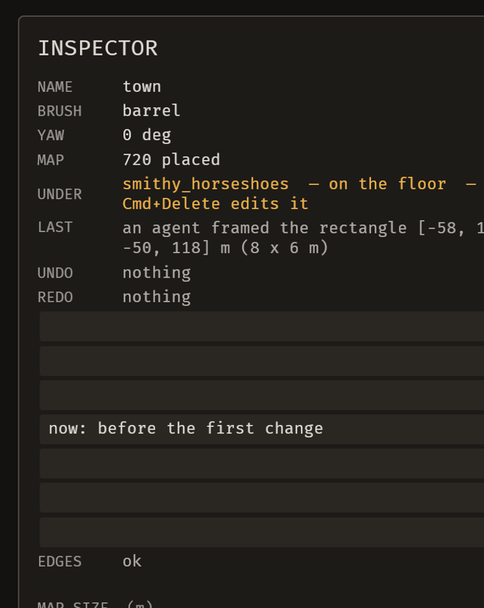

# 2026-10-24 kits: the readout names which layer a two-way piece took (E-059)

Focus: bug sweep (all GitHub issues closed) · Commits: `e89b2d8`..`HEAD` · Outcome: fixes only

## Summary

E-059 asked that a two-way piece's *palette row* say which layer a placement took. Investigating it
found the item's own evidence was wrong about where the answer lived — and the answer was missing from
the one place it belongs. The `UNDER` readout names a specific placement, and it printed only the id
and the chord. It now says which layer that placement took, and the library row was left alone
because a library entry has no placement to report.

## Baseline

Gate green before and after (clippy clean; `cargo test --workspace` green). Frame time, latency and
edit-to-visible were not re-measured: `layer_of` is two `matches!` and a `format!` on a string that is
already recomputed once per frame, and `descriptor_of` is the resolver the cursor pick already used.

## The item, corrected

E-059's evidence said the per-placement answer was *"only in the INSPECTOR's UNDER row"*. It was not:

```rust
Some(p) => format!("{}  — {} edits it", p.id, keys::chord_text(...)),
```

That is id and chord, nothing else. And the surface the item named — the kit door's mount row — shows
`mount_label`, which is the **declaration** (`on support or floor`). A library entry has no placement,
so that row is *right* to say what it says.

So the gap was real but narrower and in a different place: the readout that names a piece did not say
which of its two layers this one took.

## Enhancement: the readout names the layer

Plan: give `editor::under_readout` the descriptor and print the layer between the id and the chord.
Files: `crates/bevy_emerge_mapper/src/editor.rs` (`under_readout`, `layer_of`, `sense_under_cursor`).
Goal: hovering a two-way piece says whether this placement is on a host or on the floor, naming the
host when there is one.
Proof: `headless.rs::the_under_readout_says_which_layer_a_two_way_piece_took` — fails before the
change with `pile@1  — Cmd+Delete edits it`, passes after.

| Mount | Readout |
|---|---|
| `OnSurfaceOrFloor`, `on: Some("smithy_workbench")` | `pile@1  — on \`smithy_workbench\`  — Cmd+Delete edits it` |
| `OnSurfaceOrFloor`, `on: None` | `pile@2  — on the floor  — Cmd+Delete edits it` |
| `OnFloor` (or any other mount) | unchanged — `crate@7  — Cmd+Delete edits it` |
| descriptor not in the library | unchanged — no claim either way |

**Why the third line matters.** Every other mount is settled by the descriptor, so the kit row already
answers it; announcing "on the floor" on every ordinary crate would be the always-non-blank row the
readout's own doc refuses (*"the eye stops reading a line that always has something in it"*).

**Why the host is named, not just counted.** The first version printed `on a host  — ` and the test
rejected it — the map records *which* piece in `Placed::on`, and a line that says only that one exists
leaves the author to hover the furniture to find out. That is the same argument the readout makes for
naming the piece at all.



Hovering `smithy_horseshoes` — a `dress_horseshoe_pile` authored
`mount: Some(OnSurfaceOrFloor(class: "support"))` — on the running editor.

**The seated case is proven by the unit test, not by a still.** Hovering the seated copy on the
running editor kept picking the bench underneath it, which is correct behaviour (the bench is larger
and nearer the cursor) and not a bug; the report says so rather than implying a picture exists. The
unit test asks `under_readout` directly, which is the same pure function the system calls — the
pattern this file's existing readout test established after a driven test proved to assert nothing.

## Bugs fixed

None confirmed this iteration; no open bug met the must-fix rule.

## Review

A fresh-context reviewer found **no correctness bugs**, and confirmed the five questions with cites:
the `matches!` admits only `OnSurfaceOrFloor` (a seated `OnSurface` lamp has the same `Placed::on` but
gets no layer word because the mount is read first); the `Cow`/`as_deref()` borrow is sound and the
lookup is one linear `Library::get` per frame against the `resolve_y` the cursor pick already runs;
the `on_ui` early return still wins; the new test is load-bearing (deleting `layer_of`, swapping its
two answers, or removing the mount check each fail it); and nothing else in the workspace calls
`under_readout`.

Two gaps it named, both closed:

1. **The test could not catch a widened mount check.** Every existing case would still pass if the
   check became `OnSurface | OnSurfaceOrFloor`, because a seated `OnSurface` piece also has
   `Placed::on: Some(..)`. Added that case — and **mutation-tested it**: widening the check now fails
   with `` lamp@1  — on `desk`  — Cmd+Delete edits it ``. The code was right; the test now guards it.
2. **A doc comment named the wrong chord** (`Cmd+E` where `EditTile` is `Cmd+Delete`). Corrected.

## Test diffs

- `crates/bevy_emerge_mapper/tests/headless.rs` — **new** `the_under_readout_says_which_layer_a_two_way_piece_took`
  (four cases: seated names the host, floored says floor, `OnFloor` stays silent, no descriptor stays
  silent). Fails before the change.
- The same file's `the_under_readout_is_blank_while_the_pointer_is_on_a_panel` had its **three call
  sites** updated mechanically to the new three-argument arity, passing `None` as the descriptor. **No
  assertion was changed**; that test still asserts the panel gate and the chord.

## Gate

- `cargo clippy --all-targets -- -D warnings` — clean.
- `cargo test --workspace` — green.

## Release

Version: no change · Channel: **not published**. E-006 stands: no crate here has a published baseline.

## Deferred / open

- **The seated case has no live still** (see above). The unit test is the evidence; a hover-precision
  fix for small pieces standing on large ones is not this iteration's scope and is not a bug.
- **E-063** — a `kind` change re-settles implied effects without naming them. Open, `common: false`.
- **B-014** — the viewport is a sliver at ~900 px. Open, `common: false`, workaround exists.
- B-047, B-048, B-025, B-041 remain `unconfirmed`.
- The scratch project `/tmp/emerge_live/e001proj` has its map restored from the backup taken before the
  seated row was authored; the library still carries the two-way `dress_horseshoe_pile` row from the
  issue-#1 iteration, which is the state that iteration left.

## Next focus

**E-063** — a label receipt names the axis it set but not the effects a `kind` change re-settled. It is
the same shape as the receipt work already shipped twice (B-046's preview, E-048's transition text): a
write that changes more than the field it names, and the author is not told. After that the remaining
open items are all narrow (`B-014`'s layout, the `unconfirmed` set), so the next iteration should
reproduce or retire the four `unconfirmed` bugs rather than carry them again.
