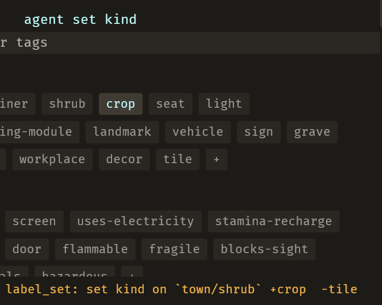
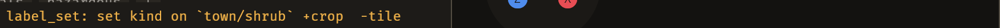

# 2026-10-24 labels: an agent's kit edit says what it changed, in the door you are looking at (E-048)

Focus: bug sweep (all GitHub issues closed) · Commits: `a741f06`..`HEAD` · Outcome: fixes only

## Summary

E-048: an agent's kit-label edit gave the person almost no visible feedback. Two defects, both
real and both fixed: **the receipt named the axis and never the values** (`set kind on town/shrub`),
and **it was written to the Map door's receipt only** — with the kit door open the person saw the
labels row change and nothing saying what changed. With a piece selected on the kit door, an agent's
`label_set` now reads in that door's own receipt row:
`label_set: set kind on `town/shrub` +crop  -tile`.

**This iteration also contains a correction**: my first diagnosis was wrong and the evidence is
below.

## Baseline

Gate green before and after (clippy clean; `cargo test --workspace` green). Frame time, latency and
edit-to-visible were not re-measured: the change adds no per-frame work — the receipt is written once
per operation, and the chips already repainted before it.

## Bugs fixed

### E-048: an agent's kit edit gives the person almost no visible feedback

Must-fix: blocks **n**, common **y**, no workaround **n** — every agent label edit on the kit door;
the workaround is to read `emerge_list_pieces`. Not must-fix by the three checks, so it was taken as
the iteration's one enhancement rather than a bug fix. (Log entry below.)

**Defect 1 — the receipt omits the change.** `label_set`'s summary was
`format!("set {axis} on `{id}`")`. The screen showed `agent set kind` on the labels row and a chip
repaint; the values it moved to were nowhere. Fixed by capturing the axis before the write and
naming the transition: `+crop  -tile`, `-worn` for an emptied axis, and
`— same tokens, claim restated` for a re-assertion.

**Defect 2 — the receipt goes to the other door.** `ops_brp::receipt_agent_change` writes
`EditorState::status`, which is the Map door's receipt. The kit door shows `ImportState::status`,
and the agent path wrote only the first. Fixed by writing both, from one `says` value, so the two
cannot report different things.

| Before (no receipt on the kit door) | After |
| --- | --- |
|  |  |

The right-hand image is the kit door's own receipt row after an agent's `label_set`; before the fix
that row was empty and the change was only visible as the chip moving.

## The correction, stated plainly

My first diagnosis was that the kit pane never repainted, because `label_set` bumped neither
`ImportState` nor `LabelGeneration`. I measured "0 of 2,560 x 1,406 pixels changed", added a
`LabelGeneration` bump, and saw 7,974 px change — so I believed it.

**Both readings were wrong.** The two "before/after" captures had **identical MD5 hashes**
(`9702f3bd311ea207d07719077bf74572`) — a screenshot that had not been rewritten, not a screen that
had not changed. An independent reviewer caught the contradiction: `rebuild_detail` already runs on
`resource_exists_and_changed::<Project>`, and `adopt_library` writes through `as_deref_mut`, so the
pane was repainting all along.

I settled it by experiment rather than argument: with the bump **disabled**, the same interaction
still repainted the chip block (9,521 px). The bump was therefore removed, along with the two tests
that asserted it — they pinned behaviour that should not exist. `changed_from`'s `unchanged` wording
was also corrected, because a re-asserted axis moves provenance and repaints the chip `UNCHECKED`,
so "unchanged" was a word the screen contradicted.

What remains is only what the evidence supports: the transition text, and the receipt reaching the
door the author is on.

## Test diffs

`crates/bevy_emerge_mapper/tests/label_set_is_an_operation.rs` gained 4 tests:

- `the_receipt_says_what_the_axis_changed_from_and_to` — `+worn`, `-plain`, and `-worn` when the axis
  is emptied.
- `a_receipt_for_a_restated_axis_says_the_claim_was_restated` — and asserts the word `unchanged` is
  *not* present, because the chip repaints.
- `the_kit_doors_receipt_names_the_agents_label_change` — `ImportState::status` carries the agent's
  summary and the values. **Fails before the fix** with an empty receipt (`""`).
- `the_kit_doors_refusal_is_a_problem` — a refusal lands in `status.problem`, not the receipt slot.
  **Fails before the fix.**

Two tests written earlier in this iteration were **deleted**, not loosened: they asserted that a
label write bumps `LabelGeneration`, which the experiment above showed is unnecessary. Deleting a
test that pins a wrong belief is the correction; keeping it would have been a ratchet on a mistake.

No existing test or assertion was changed.

## Gate

- `cargo clippy --all-targets -- -D warnings` — clean.
- `cargo test --workspace` — green.
- Live: kit door open on `meshes`, `town/shrub` selected, agent `label_set`; the chip block repaints
  and the receipt reads `label_set: set kind on `town/shrub` +crop  -tile`.

## Performance

Not re-measured, and deliberately: the receipt is a string written once per operation and nothing in
the change runs per frame. No measured path changed.

## Release

Version: no change · Channel: **not published**. E-006 stands: no crate here has a published
baseline.

## Deferred / open

- **E-062** (filed): a screenshot read back over BRP can be a stale file — `bevy_debugger/screenshot`
  returns before the write lands, and two reads can hand back the same bytes. It cost this iteration
  a wrong diagnosis. The check is a hash of the requested path before/after, and an MCP capture tool
  that awaits the write.
- **E-063** (filed): `changed_from` names the tokens a `kind` write moved but not the *effects* that
  `set_axis` re-settled with them. A `light` → `decor` change drops an implied `electricity` and the
  receipt does not say so.
- **B-047, B-048, B-025, B-041** remain `unconfirmed`; none was reproduced.
- The scratch project `/tmp/emerge_live/e001proj` has its library restored from Sanctuary's assets.

## Next focus

No open issue, no must-fix bug, and the remaining open bugs are all `blocks: false` with a
workaround. **E-062 is the one worth doing next**, and not because it is a feature: this iteration
lost its diagnosis to it, and the loop's own Phase 0 and Phase 4 both depend on captures being the
frame they claim. After that, **E-059** (a two-way piece's palette row does not say which layer each
placement took) is the open half of the multi-mount feature.
