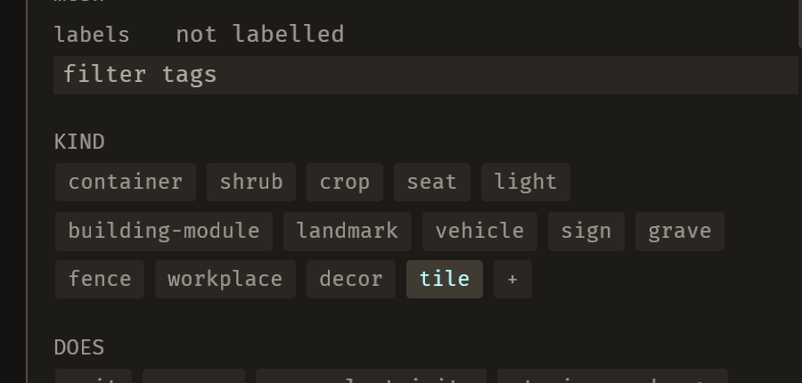
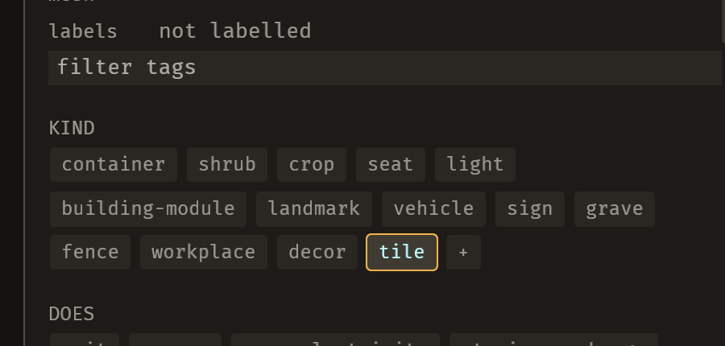
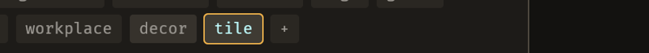

# 2026-10-24 labels: B-047 settled — the pane was right, the picture was unreadable

Focus: bug sweep (all GitHub issues closed) · Commits: `57cbc6c`..`d93340e` · Outcome: fixes only

## Summary

B-047 had sat `unconfirmed` since cycle 5: *"clicking an unlit KIND chip stamps the kind, but the
clicked chip does not appear lit."* It could never be settled because **nothing in the suite fired a
chip's `Activate`** — E-041 records that gap. This iteration built the hook, drove the real click, and
got a two-part answer: the pane is correct, and **the measurement was the defect**. Chips were told
apart by fill alone, and hovered is 60% of the way to held — 1.14:1 contrast. They now carry the shape
the palette's own rule requires.

## Baseline

Gate green before and after (clippy clean; `cargo test --workspace` green). Frame time, latency and
edit-to-visible were not re-measured: the change is one border colour on a node that is already
spawned, and the new test hooks are `pub fn`s no system calls.

## Bugs fixed

### B-047: a clicked chip did not appear lit

Must-fix: blocks **n**, common **n**, no workaround **n** — its stated symptom does not reproduce, so
the three checks were never answered. What is fixed is the thing that made it unanswerable.

**Part 1 — the stated symptom does not reproduce.** With a hook that fires the same `Activate` a
person's press sends, the click writes the token to `project.measured` **and** the clicked chip's fill
is `ROW_SELECTED`:

```
left: ["decor", "prop"]   right: ["decor", "prop"]      // lit_kind_chips, after the click
```

So the pane agrees with the file. The cycle-5 observation was something else.

**Part 2 — the photograph could not have shown the difference, and that is a real defect.** Sampled
on the running editor, kit door, `town/shrub` selected:

| state | fill (sRGB 0–255) | border |
|---|---|---|
| rest (`workplace`) | `(42, 39, 34)` | 1 px dark |
| **hovered** (`decor`) | `(54, 50, 44)` — **60% of the way to held** | 1 px dark |
| held (`tile`) | `(63, 59, 51)` | 1 px dark |

Contrast hover-vs-held is **1.14:1**; the WCAG non-text minimum is 3:1.

`chrome.rs`'s palette note already states the design: selection *"steps only ΔL\* 3.89 over
`ROW_HOVER` and does not need more, **because selection also carries a shape**"* — `SELECT_RAIL_W` of
`ACCENT`. **`chrome::chip` never passed a border for a held chip**, so chips got the fill without the
shape. That is the defect: the design's compensating cue was never wired, and B-047's own evidence
says *"the cursor ring sat over it"*.

**Fix** (`tiles.rs`, the tag-chip call site): a held chip's border is `ACCENT` instead of
`Color::NONE`; a `ghost`/proposal still wins the border, because a proposal is a question and a held
token is an answer; an unheld chip keeps `Color::NONE`.

| Before | After |
| --- | --- |
|  |  |

The held `tile` chip is lit by fill alone on the left; on the right it carries the accent edge.

**And a hover cannot fake it.** With the pointer resting on the unheld `decor` chip, its fill
lightens and it gains **no edge**, so it cannot be read as chosen:



## Review

A fresh-context reviewer found **no correctness bugs** and confirmed all five questions with cites: the
accent cannot be confused with a proposal's `SUGGEST` border (a chip is never both held and a ghost)
nor stolen from another writer (only list rows get a border, and no ratchet constrains chip borders);
the token index the test clicks is the same table the pane builds from; and the negative-result test
cannot pass without `on_tag_chip` running, because `decor` reaches `measured` only through
`toggle_tag` → `set_label` → `adopt_library`.

Two things it named, both closed:

1. **My helpers were inserted inside an existing doc block**, so three doc comments collapsed onto
   `click_tag_chip_for_test` and `library_ids_for_test` was left with none. The block was already
   untidy, but the patch made it worse. Moved the helpers above it; each doc now attaches to its own
   function.
2. **`lit_kind_chips` read the painted `BackgroundColor`**, which `style_list_rows` rewrites every
   frame — so a held chip under a pressed mouse (`ROW_PRESSED`) would read as unheld. Now reads
   `RowRest`, which is what the chip was spawned as and nothing mutates. That is the question the
   test actually asks.

## Test diffs

- `crates/bevy_emerge_mapper/tests/headless.rs` gained 2 tests:
  - `clicking_a_tag_chip_writes_the_kind_and_lights_the_clicked_chip` — **the negative result, kept
    as a guard**: it is the first thing in the suite to click a tag chip, so a future change that
    made the pane read a different value than the click wrote would fail here.
  - `a_held_tag_chip_carries_an_accent_edge_and_an_unheld_one_does_not` — **fails before the fix**
    (the held edge was `Color::NONE`), passes after.
- `crates/bevy_emerge_mapper/tests/fixtures/mod.rs` gained `kind_tokens`, so a test can watch the
  light move between two chips (the fixture shipped one kind token).

**No existing test or assertion was changed.** The three read-only `for_test` hooks
(`click_tag_chip_for_test`, `lit_kind_chips`, `kind_chip_edges_for_test`) are production `pub fn`s
beside `library_ids_for_test`, following `size_field_for_test`'s precedent of firing the real
`Activate` rather than reimplementing an observer.

## Gate

- `cargo clippy --all-targets -- -D warnings` — clean.
- `cargo test --workspace` — green.

## Release

Version: no change · Channel: **not published**. E-006 stands: no crate here has a published baseline.

## Deferred / open

- **B-047** is closed as `fixed` for its actionable half, with the negative result recorded in its
  evidence: the pane was never wrong, and the chip now carries the shape that makes the state
  readable. If the real cycle-5 cause was something else, that is no longer observable and the guard
  test stands in its place.
- **E-041** (the `Activate` gap) is now **partly closed**: `on_tag_chip` is reachable and tested. The
  palette row click (`on_row_click`) still is not — that needs its own hook, and is left logged.
- **E-063** (a `kind` change re-settles implied effects without naming them) is still open; it was
  this iteration's other candidate and was not taken.
- **B-025, B-041, B-048** remain `unconfirmed`. **B-014** open.
- The scratch project `/tmp/emerge_live/e001proj` is unchanged from the state the E-059 iteration
  left it in.

## Next focus

**E-063**, unchanged from last iteration's recommendation and now the only open enhancement of real
size: a label receipt names the axis but not the effects a `kind` change re-settled. After that, the
remaining `unconfirmed` bugs each need a hook or a capture before they can be judged — the pattern this
iteration proved works is *build the hook, then ask*, and **B-048** (undo blanks the ground patches for
one frame) is the next one that pattern would settle.
