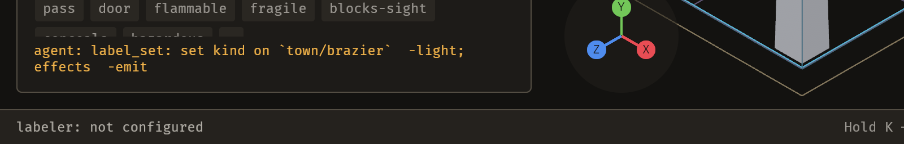

# 2026-10-24 labels: a `kind` write says which effects it re-settled (E-063)

Focus: bug sweep (all GitHub issues closed) · Commits: `6d8d779`..`f58b388` · Outcome: fixes shipped

## Summary

A `kind` write re-derives the piece's `effects` from the vocabulary — a `light` emits, a `bed`
recharges stamina — and the receipt named only the axis the author typed. The write was right and the
sentence was not: four tokens could change under a person who asked for one. The receipt now names
them after a semicolon, and says nothing when the vocabulary moved nothing.

## Baseline

Gate: green before and after (clippy clean; `cargo test --workspace` green). Frame time, latency and
edit-to-visible were not re-measured: the change adds one `Vec` compare and a `format!` per label
write, on a path that already writes a file.

## Enhancement: the derived effects are reported

Plan: capture `effects` before `set_axis`, compare after, and append `; effects: ±tokens` when the
vocabulary moved them. Files: `crates/bevy_emerge_mapper/src/ops.rs` (`label_set`'s `edit`).
Goal: a person who changes a piece's kind is told which effects the vocabulary added or removed.
Proof: `label_set_is_an_operation.rs::a_kind_change_names_the_effects_the_vocabulary_resettled` —
fails before with `set kind on site/wall  -prop`, passes after.

| Case | Receipt |
|---|---|
| `kind` write that moves an effect | `set kind on \`town/brazier\`  -light; effects  -emit` |
| `kind` write that moves none | unchanged — the axis phrase alone |
| `effects` write | unchanged — the axis phrase already names them, and saying it twice would read as two changes |
| `look`/`surfaces` write | unchanged — those axes settle nothing |

`agent: label_set: set kind on \`town/brazier\`  -light; effects  -emit` — from the running editor
on a scratch project whose vocabulary gives `light` an implication, so the derivation is real rather
than contrived in a test. The effects on that piece went from `["emit"]` to `[]`.

**Two design decisions worth stating.**

- **The two clauses are reported separately** because they are two decisions: one a person made, one
  the vocabulary made from it — and only the second is the one nobody expected.
- **"Moved" is compared as lists, not by parsing the phrase.** The first version tested
  `changed_from`'s output for a prefix, which is a second rule that can drift from the first; the
  guard is now `effects_were == d.effects`. When the axis did not move but the effects did, the
  `same tokens, claim restated` clause is dropped, because the effects are the news and a restated
  claim in front of them buries it.

## Bugs fixed

None confirmed this iteration; no open bug met the must-fix rule.

## Review

A fresh-context reviewer confirmed all five questions and found **one real gap**, which it pinned on
this change's own test:

**G1 — a stale row made the receipt claim a change it had not made.** A library written before an
`implies` rule was added stores effects the rule now contradicts, and `Project::open` settles only the
in-memory `library`, never `measured` — the copy this write edits (`project.rs:255`). Comparing the raw
stored list therefore told the author the vocabulary had *just* added an effect the editor had been
showing since open. On this test's own fixture the kind was `prop` before and after, and the receipt
still said `+electricity`.

**Fixed by comparing settled to settled**: `effects_were` is now
`labels::settled_effects(&d.kind, &d.effects, &project.vocab)`, so only what *this* write moved is
reported. That also removed an ordering-only false positive the reviewer noted (a row stored out of
vocabulary order).

Its remaining note is real and out of scope, logged as **E-064**: on an `effects` write the vocabulary
can override what the author typed and nothing says so — the same class of problem on the other axis.

## Test diffs

`crates/bevy_emerge_mapper/tests/label_set_is_an_operation.rs` gained 2 tests:

- `a_kind_change_names_the_effects_the_vocabulary_resettled` — fails before, passes after.
- `the_derived_effects_phrase_is_separated_and_only_appears_when_they_moved` — the separator and the
  silence: a `look` write must not mention `effects` at all.

**No existing test or assertion was changed.** The 11 tests already in that file still pass.

**Two false starts, recorded.** (1) The first test asserted an *arriving* effect on a piece the
fixture gives `effects: ["inert"]` — which passed for the wrong reason, because the editor's settled
view already carried `electricity` and only the disk copy was behind. The reviewer's G1 fix exposed it.
(2) The test then asserted the arriving direction again and failed: with both sides settled, a `kind`
write that does not change the derivation moves nothing. The test now uses the direction that
genuinely derives — `kind = []`, which drops the implied effect — and the probe that found the first
problem is not in the tree.

## Gate

- `cargo clippy --all-targets -- -D warnings` — clean.
- `cargo test --workspace` — green.

## Release

Version: no change · Channel: **not published**. E-006 stands: no crate here has a published baseline.

## Deferred / open

- **Live proof needs a project that declares an `implies`.** The shipped `town` and `kit` vocabularies
  declare none, so the screenshot above comes from a scratch copy with one added. That is stated
  rather than glossed: the feature is exercised by the fixture test and by a real editor, and the
  vocabulary that would show it by default does not exist in this project.
- **B-048** (undo blanks the ground patches for one frame) is the next `unconfirmed` bug, and the
  pattern that would settle it is the one used twice now: build the hook, then ask.
- **B-025, B-041** remain `unconfirmed`. **B-014** open.

## Next focus

**B-048**, as last iteration recommended: a one-frame blank on undo is exactly the kind of thing a
frame sequence settles and a still cannot, and `emerge_capture_sequence` at 4 fps with a frame-0
before-state is the tool the brief already provides. If it does not reproduce, that is worth knowing
and the item retires instead of ageing.
