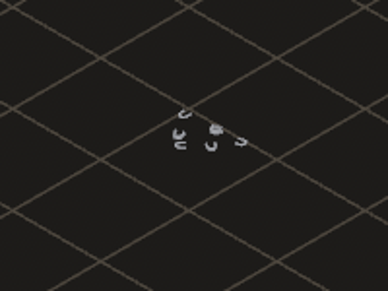
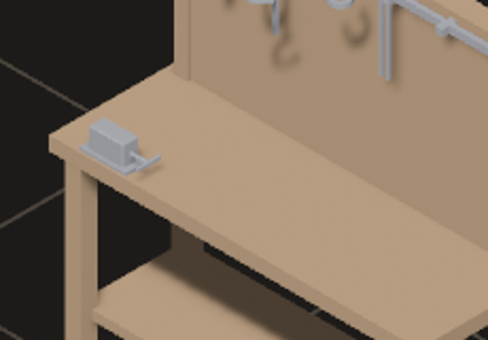

# 2026-10-24 mount: a piece may rest on a support surface or on the floor (issue #1)

Focus: issue #1 · Commits: `38a058a`..`HEAD` · Outcome: shipped

## Summary

Open issue #1 asked for a library piece that may be placed **either on a support surface or on the
floor**, chosen per placement — Sanctuary's dressing sets (smith's tools, ingot stacks, a horseshoe
pile) are the motivating case, and a single `Option<Mount>` could not say it. Added
`Mount::OnSurfaceOrFloor { class }`; `Placed::on` is the record of which of the two a placement
took, so both seatings save and reload without a second field. Existing single-`mount:` libraries
are untouched.

## Baseline

Gate: green before and after. Frame time, latency and edit-to-visible were **not** re-measured this
iteration: the change adds one enum variant and no per-frame work on any measured path (`same_layer`,
`resolve_y` and `datum` run on edits and loads, not per frame). The prior baseline stands: frame
16.66 ms median, MCP edit-to-visible 150 ms, file edit-to-visible 452 ms on the town map.

## Enhancement: issue #1 — `Mount::OnSurfaceOrFloor`

Plan: add one `Mount` variant naming a surface class, and let the **placement** record which of the
two layers it took. Files: `bevy_emerge_core/src/{descriptor,stack,vocab,convert,composition,map}.rs`,
`bevy_emerge_mapper/src/{editor,vlm}.rs`, `docs/guide/kits-and-labels.md`.
Goal: a library entry can say *"on a `support` top, or on the floor"*, and a click decides which —
dropped on a bench it seats on it and records the host; dropped on bare floor it stands at floor
height with no host; both survive a save and a reload.
Proof: `bevy_emerge_core/tests/a_piece_may_rest_on_a_surface_or_on_the_floor.rs` (9 tests) and
`bevy_emerge_mapper/tests/a_two_way_mount_seats_on_either.rs` (4 tests, through
`editor::place_for_test` — the release path of the place tool).

Candidates considered: (1) this issue — the only open GitHub issue, and the focus names issues
first; (2) E-057, saving the town map roughly triples its file — real but not blocking; (3) E-054,
Enter on "+ new map" does not open the map — a one-key annoyance with a workaround. (1) won on the
focus and on the fact that it is a schema hole Sanctuary is actively working around.

MCP: no new tool. The variant is data, so it reaches an agent through the existing
`emerge_apply_operation` / `brush_arm` and `emerge_list_pieces` path; the VLM prompt gained a
`surface_or_floor` token so a model can propose it.

### The design, and why this shape

- **`Placed::on` is the per-placement record**, not a new field. It already answers "what does this
  rest on", `resolve_y` already derives height from it, and `None` already means floor. A second
  field would be a second answer to one question, and the two would disagree after the first reload.
- **Two predicates, not one with a flag.** `needs_surface` is the strict question every "may this
  piece go here" guard asks; `may_take_surface` is the permissive one a host lookup asks. A `bool`
  at either call site reads as the other question — `fill::flood`'s 4,089 invisible lamps were
  exactly that mistake, one mount kind ago.
- **A variant, not a list** (the issue offered both). The codebase's own rule, from `DecalHost`'s
  doc: *"encoding it in the variant means the unanswerable state is not constructible"*. A
  `Vec<Mount>` would make `[OnWall, Decal, OnFloor]` writable and would need a rule for what the
  first one means when the second wins. The issue explicitly allows restricting to floor-plus-a-
  surface-class.
- **`editor::mount_class` still asks the strict mount.** A fill with a two-way piece is legal — it
  may stand on open floor — and that is documented at the function.

| Before (floor only) | After (seated on the bench) |
| --- | --- |
|  |  |

Both stills are the same descriptor (`dress_horseshoe_pile`, authored
`mount: Some(OnSurfaceOrFloor(class: "support"))`) in one project: right, seated on
`smithy_workbench` with `on: Some("smithy_workbench")`; left, standing on the floor with `on: None`.
Captured from the running editor on `/tmp/emerge_live/e001proj` (a copy of Sanctuary's assets).

## Bugs fixed

None. No must-fix bug was found in this iteration's sweep; the focus named issues first.

## Test diffs

Two files added, no existing test or assertion changed:

- `crates/bevy_emerge_core/tests/a_piece_may_rest_on_a_surface_or_on_the_floor.rs` — new. Nine
  tests over the acceptance criteria: the RON round-trip, seating on a bench, standing on the floor,
  `resolve_y` agreeing with `placement_at`, save/reload reproducing both seatings, the strict sibling
  still refusing bare floor, a vanished host still refused, the class needed from both sides, and a
  single-`mount:` library unchanged.
- `crates/bevy_emerge_mapper/tests/a_two_way_mount_seats_on_either.rs` — new. Four tests through
  the real click path: on the desk, on bare floor, a fill may lay it, and the strict piece still
  refused.
- `crates/bevy_emerge_mapper/tests/fixtures/mod.rs` — added `two_way_descriptor`, one helper beside
  the existing `mounted_descriptor` / `surface_descriptor` pair.
- `crates/bevy_emerge_mapper/tests/a_two_way_mount_is_seated_by_every_door.rs` — new, from the
  review. Six tests over the two doors the diff missed: the Build tab's `host_for` (seats on a
  touching sibling, leaves it on the floor, still refuses a strict piece, and `rebind_hosts` keeps a
  recorded seating) and the paste's floor/bench answers. Two fail on the pre-fix code; see Review.

**Failing-before evidence.** With only my source edits stashed and the new tests kept:

```
crates/bevy_emerge_core: error[E0599]: no variant named `OnSurfaceOrFloor` found for enum
  `bevy_emerge_core::descriptor::Mount`
crates/bevy_emerge_mapper: 0 passed; 4 failed —
  library: 25:25-25:41: Unexpected variant named `OnSurfaceOrFloor` in enum `Mount`, expected one of
  `OnFloor`, `OnWall`, `OnCeiling`, `InOpening`, `OnSurface`, `OnFace`, `Decal`, or `Tiled`
```

Both pass after (`9 passed`, `4 passed`).

## Gate

- `cargo clippy --all-targets -- -D warnings` — clean.
- `cargo test --workspace` — green.
- `cargo run -p bevy_emerge_mapper --example boot_headless -- /tmp/emerge_live/e001proj` — the
  project with the new variant opens and steps 12 frames, 4096 entities.
- The live editor loaded the project (211 descriptors, 727 placements) with the variant in a library
  row, and hot-reloaded a map edit that used it.

## Review

An independent reviewer was given the diff, the two new test files and the acceptance criteria, and
asked only for correctness gaps. It confirmed the core is sound: heights, host choice on a click, the
overlap table, undo, reloading a plain map, and `validate_library` all handle the variant, and
fingerprint tag 9 leaves every recorded fingerprint unchanged. It found **two real gaps**, both in
doors outside the diff that decide a host their own way, and both breaking acceptance criterion 2:

1. **`build::host_for` asked `editor::mount_class`** — the *strict* mount — so a two-way member
   dropped against a bench in the Build tab saved `on: None`, and `rebind_hosts` reset a
   hand-authored `on: Some(sibling)` on the next edit. Stamped, the piece landed at floor height
   inside the bench. **Fixed**: `host_for` now asks `stack::may_take_surface` and only refuses when
   `mount_class` also says the piece needs a host (`build.rs`).
2. **`stamp_set` refused a paste** when `host_under` found nothing. Right for a strict `OnSurface`;
   wrong for a two-way piece, which is legal on open floor — a click at the same spot accepted it.
   **Fixed**: the refusal is now armed only when `needs_surface` is `Some` (`editor.rs`).

Both are covered by `crates/bevy_emerge_mapper/tests/a_two_way_mount_is_seated_by_every_door.rs`
(6 tests). Two of them fail on the pre-fix code — `the_build_tab_seats_a_two_way_piece_on_the_sibling_it_touches`
and `a_recorded_sibling_seating_survives_a_rebind`, both `left: None, right: Some("b1")`. The four
paste/floor tests pass either way because they exercise the shared `stack` functions rather than
`stamp_set`'s branch; they are recorded here as **characterisation, not failing-before evidence**.

Skeptic pass: the reviewer's other noted edge — an `OnFloor` placement carrying a stale
`on: Some(..)` reading as a different layer — needs data the editor cannot produce (no code writes
`on` for a floor mount), so it does not block.

**One self-inflicted break, caught by the gate.** The first `host_for` fix asked `may_take_surface`
alone, which is `None` for a face mount, so seven existing `build::tests` wall-fixture tests lost
their host (`left: None, right: Some("wall")`). The final version asks `mount_class` (what a host is
*required* for, surfaces and faces) and falls back to `may_take_surface` (what a host may be *taken*
from). All 21 `build::tests` and all 10 two-way tests pass. **No test code was changed to fix it.**

## Release

Version: no change · Channel: **not published**. E-006 stands: no crate in this workspace has a
published baseline, so there is no version to bump and no crates.io entry to verify against. This is
unchanged from every prior iteration.

## Deferred / open

- **`mount_options` offers the two-way entry for the first surface class only.** The `M` cycle is a
  fixed-length list an author taps through; one entry per class would double it. Authoring another
  class is a file edit. Logged as a candidate, not a bug.
- **A two-way piece's *other* layer is not shown in the panel.** The mount label reads
  `on support or floor`; the per-placement answer is visible as `UNDER:` in the INSPECTOR and in the
  map file, but the palette row does not say which one this placement took. A candidate for a later
  iteration.
- The scratch project `/tmp/emerge_live/e001proj` remains for the next iteration; its map is back at
  727 placements and the only difference from Sanctuary's assets is the one authored library row.

## Next focus

Close issue #1 and take the next open issue. If none is open, the next candidate from the backlog
with the best ratio of user-visible relief to risk is **E-057** (saving the town map triples its
file — every placement is written in full-pretty RON), because it grows with every map and Sanctuary
saves that map constantly.
