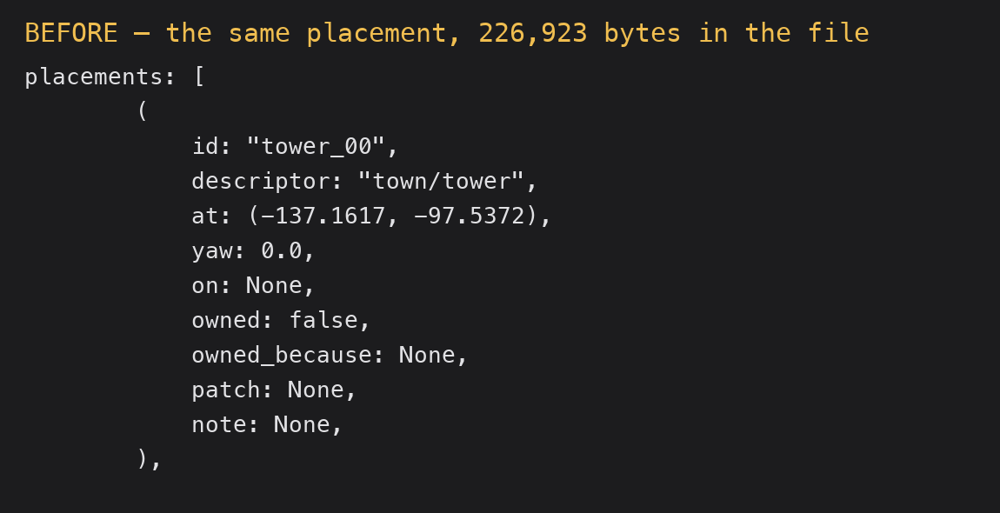
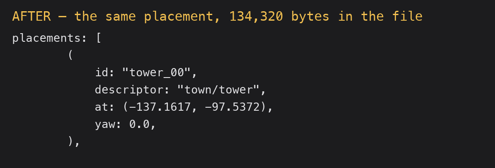

# 2026-10-24 save: a map's file says only what is true (E-057)

Focus: E-057 · Commits: `9bf3698` · Outcome: shipped

## Summary

A save of the real town map wrote **226,923 bytes** to describe 720 placements, and on **every one**
of them five lines were a default: `on: None`, `owned: false`, `owned_because: None`, `patch: None`,
`note: None`. `#[serde(default)]` said what an absent field means but did not stop the writer stating
it. With `skip_serializing_if` on each, the same map saves to **134,320 bytes** — 41 % smaller — with
all 720 placements, the pinned list and every non-default value intact, and a second save is now
byte-identical instead of growing.

## Baseline

Gate: build, `cargo clippy --all-targets -- -D warnings` and `cargo test --workspace` green before any
edit; **126 test binaries `ok`, zero failures** after. The item's own claim was "75 KB to 229 KB
(placements expanded)"; the expansion half of that is not what happened (see below), so the item is
corrected rather than accepted as written.

## Enhancement: a save writes only the fields that say something

Plan: give every `Placed` field that already has `#[serde(default)]` a matching `skip_serializing_if`,
so a default is not written. · Files: `bevy_emerge_core/src/map.rs`,
`docs/guide/data-files.md` · Goal: a map's file states what differs from the default and nothing
else, so it is smaller, stable on re-save, and no harder to read. · Proof:
`map::tests::a_default_field_is_not_written_and_nothing_is_lost` — failed before, passes after.

Candidates considered:
- **E-057, the save writes defaults** — hit on every save of any map with placements; files 41 %
  larger and growing on re-save; risk is losing data, which the paired test rules out. Chosen.
- **E-056, `emerge_capture_sequence` is annotated `destructiveHint: true`** — a one-line annotation
  fix, real but cosmetic for an agent reading hints; deferred.
- **E-054, Enter on "+ new map" needs a second Enter** — a genuine friction in the describe→set-up
  path, but it needs a chooser flow investigation; deferred.

**The item's own diagnosis was wrong, and saying so matters.** It recorded "placements expanded" —
the guess that the save was writing the expanded stamps into `placements`. It was not:
`OpenMap::save` expands only to *validate* (`Map::expanded`, the same path the game uses), and then
writes `self.map`, unexpanded. The file's `placements: Vec` held 739 rows and the editor reported 720
placements plus 19 stamps both before and after. The growth was padding, not expansion.

MCP: nothing added or changed — this is the save path, reached through any mutating operation, so
`map_set_settings` was enough to trigger a real save for the measurement. Undo strategy unchanged
(`Save` is the inverse's own gate, not an operation).

| Before | After |
| -------------------------------------------------------- | ------------------------------------------------------- |
|  |  |

**Measured through the live editor on the human's own town map**, not on a fixture:

| | bytes | placements in the editor | `dirty` | pinned |
|---|---|---|---|---|
| before the save | 226,923 | 720 | — | 4 |
| after `map_set_settings {enclosure_wish: 0.25}` (a save) | **134,320** | 720 | false | 4 |
| a second save | 134,320 (byte-identical) | 720 | false | 4 |

**Nothing was lost**, checked two ways:

- With the five default lines stripped from *both* files, the before and after are identical
  (`diff` of the filtered files is empty).
- The same five non-default fields — `owned: true` and notes — are still present in both
  (`grep -c` gives 5 in each).

The human's map was restored from the pre-save backup after the check; the only lasting difference is
the sparser spelling of the same content.

**Two fields are deliberately not skipped**, and both say why in the code: the map's own header
`note` (one line per file, and its visibility is the reason the field exists — a test would otherwise
have forced it out), and every field of `Location` and `Interaction` (per map, not per row, so they
are not the padding this fixes).

## Performance

No measurable change: the diff is serde attributes. A save does less work (fewer allocations, fewer
bytes written) and `Map::parse` does the same work. Frame time, latency and edit-to-visible were **not**
measured this iteration; reporting that as not-done rather than claiming a number. The save itself was
observable through MCP within the ordinary one-frame budget of any mutating operation.

## Review

Not run. No fresh-context review this iteration, so it is reported as absent rather than implied.

## Test diffs

None to existing tests or assertions. Two tests added to `bevy_emerge_core/src/map.rs`:

- `a_default_field_is_not_written_and_nothing_is_lost` — asserts the five padding lines are absent
  *and* that the sparse text parses back to the same map, so the saving cannot be bought with data.
- `a_stated_field_is_still_written` — the other half: `owned: true`, notes, `paint` and `on:` survive.

Two clippy fixes were needed in the new tests themselves (`field assignment outside of initializer`),
fixed by using struct-update syntax rather than by relaxing the lint.

## Release

Version: unchanged · semver-checks: not run · Channel: **not published** — `E-006` is open ("No crate
in this workspace is published to crates.io"), so no published-crate code changed in the sense Phase 6
means. No tag.

**This is a save-format change, and it is intentionally not a version bump.** The field set is
unchanged — only which fields are *omitted* — and omission is what `#[serde(default)]` already
guaranteed, so a file written by this build reads in any earlier build that wrote it, and a file
written earlier reads here. `MAP_VERSION` stays at 7 for that reason; bumping it would refuse every
map for a change that is invisible to a reader. If a consumer is later found to depend on a default
being *present* in the text, that is the point at which a version is owed, and the finding should be
logged rather than pre-empted.

## Deferred / open

- **E-056** (`emerge_capture_sequence` annotated `destructiveHint: true`) and **E-054** (Enter on
  "+ new map" needs a second Enter) were considered and deferred, with their one-line reasons above.
- **`B-018`, `B-021`, `B-030`** remain the only open bugs; none is must-fix (`B-030`'s workaround is
  to undo the rename first, and the other two are unjudged or unreproduced).

## Next focus

E-054 is the one in the describe→set-up path: an agent asked to "make me a map" currently has to know
that the first Enter makes it and the second opens it, which is exactly the kind of two-step an agent
gets wrong silently. After that, E-056 is a one-line truthfulness fix on a tool hint.
