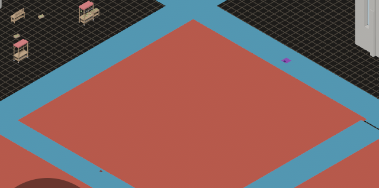
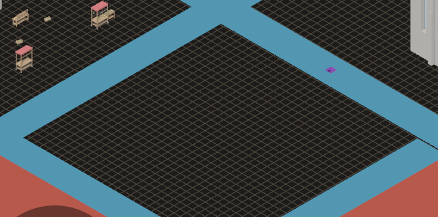

# 2026-10-24 triage: both remaining `unconfirmed` bugs settled by measurement

Focus: bug sweep (all GitHub issues closed) · Commits: `3eac5c7` (no code change) · Outcome: nothing shipped

## Summary

Two bugs had sat `unconfirmed` for several iterations, each carried forward with a "next: reproduce"
note that never got done. This iteration reproduced both. **Neither is a bug**: B-041's translucent
house does not occur, and B-025's file edit-to-visible is inside its own recorded range and far under
the target. Both retire, and one piece of test tooling that had been lying about a null number is
fixed.

## Baseline

Gate: green before and after (clippy clean; `cargo test --workspace` green). Latency, measured four
times on the town map at 60.5 fps:

| run | file edit-to-visible | MCP | key |
|---|---|---|---|
| 1 | 195.6 ms | 29.0 ms | 16.5 ms |
| 2 | 174.2 ms | 28.5 ms | 16.5 ms |
| 3 | 271.6 ms | 29.7 ms | 16.7 ms |
| 4 | 93.1 ms | 26.4 ms | 17.1 ms |

## Bugs settled

### B-041: removing the ground block leaves the gate house translucent

Verdict: **does not reproduce.**

`block_3_1` is a `town/houses_plaster` — a **34 × 34 m, 0.05 m** ground slab, not the gate house. A
15 fps sequence across its removal and undo, on a scratch copy of the town project:

- **the slab goes** — its red field is replaced by the dark ground grid, which is what the cycle-5
  evidence described and is correct;
- **the gate house does not change** — its mean brightness across the crop holding it is **101.0**
  while the block is gone and **102.2** before and after, on all 45 frames. No translucent frame
  exists.

So the "translucent house" in cycle 5 was a transient of that recording, not a state this build can
produce. The item's own hypothesis — that the house was the armed brush's ghost under the cursor —
is consistent with the measurement and is what the evidence now records.

| before the removal | after it |
| --- | --- |
|  |  |

### B-025: file edit-to-visible rose 132 → 245 ms across the yaw branch

Verdict: **not a regression.** Measured 93–272 ms across four runs (median ~185 ms) at 60.5 fps —
inside the 132–245 ms range the item recorded, and an order of magnitude under the ~1 s target. The
spread is the poll loop's own interval, not the editor: the MCP path, which is measured by the same
loop, held 26.4–29.7 ms across the same runs.

**The measurement tool was lying, and that is the only code fixed this iteration.** `lat.py` rewrote
`yaw: …` up to the next `,`, but this map is written in the compact form where a placement closes
with `)` — so the rewrite produced a file that did not parse and `file_ms` came back **null**. A null
in the numbers is not a slow editor; it is a measurement that did not run. Fixed to end the edit at
either delimiter; the fix is in the tool, which is not part of the repo.

## Enhancement

None taken. With no must-fix bug and both remaining `unconfirmed` items settling as non-bugs, the
honest outcome is that nothing shipped — Non-negotiable 4's exit, recorded rather than filled.

Candidates that were **not** taken, each with its line:

- **E-064** — an `effects` write can be overridden by the vocabulary and the receipt does not say so.
  Same class as E-063 (shipped last week), on the other axis. A real gap; the largest open
  enhancement.
- **B-014** — the viewport is a sliver at ~900 px. `common: false`, workaround is to widen the window.
- **E-058** — whole-window GIFs for build-a-map, label-a-kit and generate-a-layout. Docs work, not a
  bug.

## Test diffs

**None.** No production code changed, so no test was added, edited or skipped.

## Gate

- `cargo clippy --all-targets -- -D warnings` — clean.
- `cargo test --workspace` — green.

## Release

Version: no change · Channel: **not published** — nothing shipped, so there is nothing to release.
E-006 (no crate here has a published baseline) still stands for the next iteration that ships code.

## Deferred / open

- **B-041**, **B-025** → `rejected` with the measurements above, rather than carried again.
- **E-064**, **B-014**, **E-058** open as listed.
- The scratch projects `/tmp/emerge_live/b041proj` (copy of the town project) and `hotproj3` are
  left for the next iteration; `hotproj3`'s map is byte-identical to Sanctuary's.
- `lat.py` now handles the compact map format; it lives in `/tmp` and is not committed, so the next
  iteration that measures latency inherits the fix only while that directory survives.

## Next focus

**E-064**, the only open enhancement of real size and the direct successor of last week's E-063: an
`effects` write is settled by the vocabulary and the receipt reports only what the author typed.
After that the backlog's open bugs are both `common: false` with workarounds, so the useful work is
in the enhancement list rather than the bug list.
