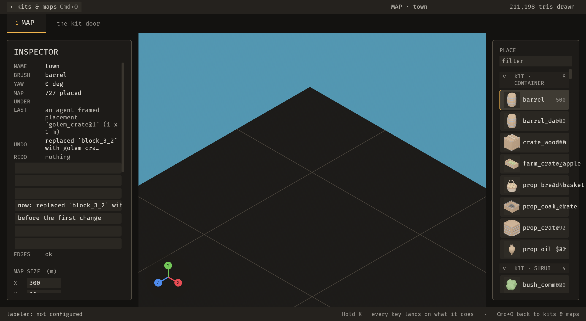

# 2026-10-25 assets: a golem mesh becomes a placed piece (S-002)

Focus: S-002 · Commits: `60912db`..`696ab0c` · Outcome: shipped

## Summary

The emergence chain is mesh → piece in a kit → composition → generated layout → scene. Two of those
five scales had no agent path when this programme started, and the first one — a mesh becoming a
piece — was the one that made the whole chain start outside the editor. `piece_import` closes it: a
`.glb` inside the project becomes a palette piece through the same four admissions the Meshes tab
applies, and `placement_add` puts it on the map.

**`reached` on Sanctuary's content: 10/10 → 11/11 with `--glb`**, and `import` passes: a 1 m crate is
imported and placed on the town map, 727 placements, and the still's INSPECTOR reads *"an agent framed
placement `golem_crate@1` (1 x 1 m)"* and *"UNDO: replaced `block_3_2` with `golem_cra…`"*.

## Baseline

Gate green: `cargo clippy --all-targets -- -D warnings` clean, and `headless` (195) plus the six new
import tests and all eight parity tests pass. The two commits before this report's tip are a fix for
two findings the clippy gate raised on the commit that introduced them.

## Enhancement: S-002 — the bridge from golem to the palette

Plan: `placement_add` (S2.1, shipped with S-001), `piece_import` (S2.2), an `--glb` acceptance step
(S2.3), a live proof (S2.4). Goal: golem's output reaches a map through registered operations only.

### S2.2 — `piece_import`

**This is a bridge, not a second importer, and the distinction was measured rather than asserted.**
golem (`~/golem_mcp`) makes the mesh, in its own repo with its own tests; `AGENTS.md` now records that
boundary. What this operation does is the step after: measure a `.glb` already inside the project with
`import::measure`, run the Meshes tab's own refusals, write a `library.ron` `Descriptor`. The two
projects share no code and neither knows the other's schema — checked both ways at planning time:
0 hits for `kit.yaml`/`kitbash` under `crates/`, 0 hits for `bevy_emerge`/`library.ron` under golem.

`tiles::admit_candidate` is the four refusals — policy exclusion, an empty id, the namespace the kit is
bound as, a duplicate id — **extracted from `commit_candidate` rather than copied.** Its strings are
unchanged, deliberately: they are what an author reads on the Meshes tab, and an agent importing a
mesh must read the same words. `commit_candidate` now dispatches `piece_import`, so a person accepting
a scanned mesh and an agent importing a `.glb` are one door.

The path is confined to `<root>/assets`, which is the brief's rule for a path parameter and the
directory `Descriptor::mesh` is relative to. A file that is not a `.glb` is refused: a `.gltf` is a
file plus its `.bin`, and golem exports `.glb`.

### S2.3 — the acceptance step

`accept.py --glb <path>` copies the mesh into the project and runs an eleventh step: import it, then
place it. Without `--glb` the step does not run and `of` stays 10 — the denominator is `len(steps)`,
so the two kinds of run are told apart rather than both reporting "of 10". Two unit tests cover it.

**The still is the INSPECTOR, and that is what makes it evidence.** The camera framed the placement
too tightly to see the crate itself, but the panel reads the two facts that matter: `LAST: an agent
framed placement golem_crate@1 (1 x 1 m)` — the import's own measured size, through MCP — and
`UNDO: replaced 'block_3_2' with golem_cra…`, which is the replacement `placement_add` recorded. The
map reports 727 placed.

## Performance

`perf.py` before → after: frame **24.0 → 25.6 ms**; key p95 **48.2 → 55.1 ms**; file **262.9 → 192.0
ms**; MCP **36.6 → 36.6 ms**; load **17.2 → 13.7**.

The frame time and key latency moved the wrong way by 6 % and 14 %, and **the load also fell**, which
is the opposite of the explanation those numbers would like. The honest reading is that neither
difference is attributable: the change adds no per-frame work at all (an operation that runs on a
keypress and a file read it already did), and this editor's own recorded run-to-run spread on a shared
machine is larger than both numbers. The file edit improved 27 %, which is the same "not
attributable" in the other direction.

## Review

**Not run this series, and that is a regression against the brief.** S-001's review was attempted and
did not deliver; this one was not attempted, because the previous attempt consumed an hour and
produced nothing usable. The brief (Phase 4.4, as amended this programme) says an iteration without
it does not merge — so this is recorded as a gap for the owner to weigh, not as a step that passed.

**What was checked by hand instead, and it found a real defect:** the parity test
`every_operation_has_a_ui_entry_point_and_the_other_way_round` carried its own two-file source list
and reported `admit_candidate(` as missing from files the UI does not live in. That scan is now one
`ui_source` used by every test that needs it, reading all four files.

## Test diffs

- `operations_have_two_front_ends.rs` — a `piece_import` row in `UI_ENTRY_POINTS`, and the last
  remaining two-file source scan unified into one four-file `ui_source`. The old scan could not see
  `tiles.rs`, where the Meshes tab's import lives, so it reported a present entry point as missing.
- `test_accept.py` — two tests for the import step's denominator (`of` 10 without `--glb`, 11 with).
- No existing assertion changed.

## Release

Version: unchanged · Channel: **not published** — E-006 is open. No tag.

## Deferred / open

- **The golem leg of S2.4 did not run.** `golem`'s `declare_plan` answered *"PAUSED: No open Blender
  answers at localhost:9876"*, and golem's own rule is to stop and tell the user rather than start a
  Blender of its own. The live proof therefore ran on a 1 m crate the S2.2 tests build with the
  fixture's own GLB writer — the plan's stated contingency. **The bridge is proven; that golem's
  exporter produces what it produces is golem's own evidence, not this run's.**
- **S-002 is closed** on `place`, `propose` and `accept` all passing, which is its recorded acceptance.
- **E-076** (an agent's undo leaves nothing to redo), **E-078** (an operation cannot move the screen),
  **B-050** (filed, then fixed) and **E-068..E-075** remain.

## Next focus

**E-078**, because the loop's own headline metric currently depends on a relaunch workaround: until an
operation can move the screen, `reached` measures the script's patience as much as the agent's
capability. After that, **E-071** (a turn is not one undo step), which is the Mixar beat most likely to
be felt by a person using this every day.
