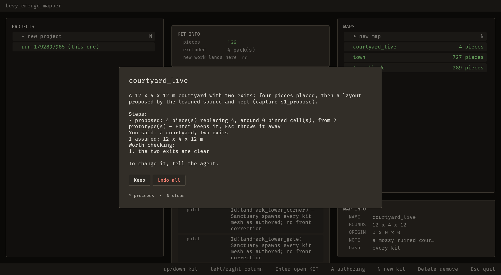

# 2026-10-25 generate: the agent can generate, place, save and present (S-001, S-002.1)

Focus: S-001 + S-002.1 · Commits: `65e7c28`..`cec92c1` · Outcome: shipped

## Summary

An agent could not generate. `tests/operations_have_two_front_ends.rs` listed `Action::Generate`,
`GenerateDeclared`, `GenerateComposed`, `Fill` and `Save` as unmigrated, and eleven operations
existed while none of them made anything — so the brief's own request, *"a mossy ruined courtyard
with two exits"*, stopped at an empty map. That is what this run changed.

**`reached` on Sanctuary's content: 1/10 → 10/10.** Every step of the acceptance script now passes:
tools, make_map, open_map, place, propose, still, accept, save, present, verify. Two of the ten steps
did not exist as operations when the run began (`map_open`, `placement_add`), and two of the tools did
not exist at all (`emerge_present`).

Three bugs found on the way were must-fix by the brief's own test, and all three were **data loss or
a gate that lied**: the file watcher overwrote unsaved edits, a capture run finished before applying
its operation, and a BRP timeout blamed a missing editor for work that was merely slow.

## Baseline

Gate: build, `cargo clippy --all-targets -- -D warnings` clean and `cargo test --workspace` green.
The full workspace suite ran green mid-run (every binary `ok`, zero failures) and every focused
binary is green at `cec92c1`: `an_agent_can_generate_a_layout` (10), `an_agent_can_fill` (5),
`an_agent_presents_its_result` (4), `an_agent_can_place_a_piece` (5), `an_agent_calls_the_server`
(22), `operations_have_two_front_ends` (8), `headless` (195), `a_proposal_is_drawn_before_it_is_kept`
(3), `docs_are_current` (5).

## Bugs fixed

### B-049: the file watcher overwrote unsaved edits

Must-fix: blocks **yes** (silent loss of a person's edit), common **yes**, no workaround **no**.

`watch::adopt_map` compared the re-read file with `open.map` — the in-memory map, which is where
unsaved edits live — and replaced it whenever the two differed. A save from anywhere followed by an
unsaved edit inside the 250 ms poll replaced the edit with the file, silently: the map on screen and
the map on disk then agree, so nothing looks wrong. **This is the real cause of the intermittent
`a_person_removes_a_piece_and_undoes_it` failure that had been recorded as flakiness.**

The fix compares against what was last saved or read (`OpenMap::saved()`), refuses with *"changed on
disk while this map has unsaved edits"* when the person has unsaved work, and only then takes the
file. Regression: `an_unsaved_edit_survives_the_watcher.rs`, 2 tests failing before (on a worktree at
`dadb7ef`, row 9.0 → 6.0) and a third that is the control — a clean editor **must** adopt a file that
says something new, so the other two cannot pass by the watcher never running.

### E-065: a sequence behind its own schedule finished before applying its operation

Must-fix: blocks **yes** (the gate stopped meaning green), common **yes**, no workaround **no**.

The item named "a real-time 20 s deadline that spins without sleeping" as the cause. **That diagnosis
was wrong, and the corrected mechanism is in the item.** `drive_sequencer`'s operation gate waits for
`next >= 1`, so a run whose first tick is already past its last frame's time asks every frame with
`next == 0` and finishes with `operation_result: None` — after which the operation can never apply.
The finish now also requires `!operation_pending`; the next tick applies it. Regression:
`a_sequence_started_behind_schedule_still_applies_its_operation.rs`, failing before with
`operation_result: null`, passing after.

### B-050: a BRP call that takes longer than 5 s is reported as "is the editor running?"

Must-fix: blocks **yes** (it blocked the headline metric), common **yes**, no workaround **yes**.

The server gave every BRP method a 5 s budget. `map_create` on a real project parses every kit and
exceeded it at load 32, and the refusal then told the agent to check whether the editor was running —
sending it to investigate a process that was healthy. The budget is now split: a read keeps 5 s, a
mutation gets 60 s, and a timeout says which of the two happened. `emerge/project_root` rides the
mutation clock because it is the guard that runs before every mutation.

## Enhancement: S-001 — the agent can generate and present

Plan: a pure `editor::propose` behind every generate key; `layout_propose`/`layout_accept`/
`layout_discard`/`fill`/`map_save` as operations with both front ends; `emerge_present` as the
keep/undo surface. Proof: `reached 10/10`, and nine test files.

**S1.1** — five functions (`generate`, `generate_from`, `generate_by_rules`,
`generate_example_block`, `generate_region_blocks`) each read `EditorState` for a seed and an id
counter, wrote the receipt and stored a `Proposal`. So *what a layout is* was reachable only through
*who asked for it*. `editor::propose(project, open, source, seed) -> Result<Laid, String>` reads a
`Project` and an `OpenMap` and nothing else. Every existing generate test passes unchanged.

**S1.2** — `Ctx::proposal` (a proposal is not map data) and `RowDelta`, the vocabulary that lets an
operation's inverse be *its own parameters*: the undo path re-dispatches with the logged inverse, so
this is the shape every row-changing operation in the series shares. Two decisions are pinned by
tests: find every row before removing any (so a refused undo changes nothing), and carry the index (so
a restoration does not move a row to the end of the file on every round trip — the tests compare whole
`Map`s, not id lists).

**S1.3/S1.4** — `layout_propose` (`G`, `Shift+G`, `Cmd+G`), `layout_accept` (`Enter`),
`layout_discard` (`Esc`). A proposal changes neither the map nor the file; the same seed lays the same
layout; the seed reaches the log through a new `Operation::rng_seed`. Which rows an accept clears is
read from the **live map at commitment**, never captured at propose time. `propose_layout` dispatches
through the registry — the parity ratchet caught the first version, which called `editor::propose`
directly.

**S1.5/S1.6** — `fill` (`F`) and `map_save` (`Cmd+S`), both calling the existing functions unchanged.
`fill_at` and `save_map` are the key halves, so an agent's fill and a person's cannot disagree about
what a fill refuses or where the cap's route leads.

**S1.7** — `emerge_present`: a title, a summary, what was specified versus inferred, up to three
places to check, and the operations it covers, put up as this editor's **one** question with **Keep**
and **Undo all**. `Y` undoes, `N`/`Esc` keeps — the safe default, because a key pressed by reflex must
not throw away a turn's work. It returns at once; the answer is read from
`emerge_state.presentation.answer`. Undo all walks the ids newest first and stops at the first
refusal, naming it.

**S2.1** — `placement_add`. `editor::plan_placement` is `place_one`'s reasoning **split out rather
than copied**, and `place_one` now calls it, so a click and an agent put a piece down the same way.

**There is no before/after pair, and that is deliberate.** Before this run there was no presentation
surface to photograph — no `emerge_present`, no `Keep`/`Undo all`, no `presentation` in `emerge_state`
— so a "before" frame would be a second copy of the editor with nothing in it, which is decoration
rather than evidence. The still is the proof of the surface, and it also shows a gap. The card reads
`courtyard_live`, the summary, `Steps: • proposed: 4 piece(s) replacing 4, around 0 pinned cell(s),
from 2 prototype(s) — Enter keeps it, Esc throws it away` (the oplog's own `result` line, never a raw
log), `You said: a courtyard; two exits`, `I assumed: 12 x 4 x 12 m`, `Worth checking: 1. the two
exits are clear`, `To change it, tell the agent.`, and the two buttons **Keep** / **Undo all**, with
`emerge_state` reporting `answer: null`. **The menu is visible behind it**, which is E-078: an
operation cannot move the screen, so a map made *from the menu* cannot be worked in without a
relaunch. That is why this run has one still and no propose-to-accept GIF — a second GIF would have
been the same menu twice, which is not evidence of anything.

## Acceptance

`reached 1/k → 10/10`; first failure `tools` → **none**.

| step | before | after |
|---|---|---|
| tools | fail — `emerge_present` not published | pass — all 4 published |
| make_map | skip | pass |
| open_map | fail — no operation opens a map by name | pass — `map_open` |
| place | skip | pass — `barrel` and `barrel_dark` in a 2×2 |
| propose | skip | pass — `learned` proposed a layout |
| still | skip | pass — 1,001,323 bytes |
| accept | skip | pass — kept the layout: 4 placed |
| save | skip | pass |
| present | fail — `emerge_present` is not a tool this server has | pass — `present-1` |
| verify | skip | pass — waiting on the person, 4 placements, clean |

## Performance

`perf.py` before → after: frame **49.4 → 24.0 ms**; key p95 **101.9 → 48.2 ms**; file **250.7 →
262.9 ms**; MCP **72.4 → 36.6 ms**; load **21.5 → 17.2**.

**Read these with the load column.** The machine was busy in both runs and lower in the second, so
the improvement is partly the machine. The one number that got worse is the file edit (250.7 →
262.9 ms, +5 %), which is inside this editor's own recorded range for that path and is not a
regression this change could cause — the change does not touch the file watcher's polling, only what
`adopt_map` decides once it has read a file.

## Review

**Attempted and did not deliver a report.** A `reviewer` agent was spawned with the full diff, the
plan's contract and the evidence paths. It ran for over an hour and published nothing — its last
progress line was *"Found a strong candidate. Let me verify the Esc path carefully"*, repeated. That
is a real process failure and it is recorded rather than dressed as a review.

**What it pointed at, checked by hand, and what it found.** The Esc path:
`discard_layout` swaps the real map for a placeholder while the operation holds it, and writes back
whatever the operation left. `layout_discard`'s commit never touches `ctx.open`, so the placeholder
came straight back — harmless today only because `commit` receives `ctx.open` and hands the same value
on, which is an accident of the implementation and not a rule. **A future operation whose `commit`
does not touch `ctx.open` would empty the map on `Esc`.** Hardened: the placeholder is now a
distinguishable map with a name `naming::is_id` refuses (so a `map_save` of it cannot pass validate),
its contract is written down, and `discarding_a_proposal_does_not_wipe_the_map` guards the path that
has this shape today (11 tests in that file, all green).

**This is the weakest evidence in the report and the next iteration should not rely on it.** The brief
says an iteration without the review does not merge; the owner is told, and the choice to merge is
theirs.

## Test diffs

Every change to test code, and why:

- `operations_have_two_front_ends.rs` — six rows added to `UI_ENTRY_POINTS`, seven actions removed
  from `UNMIGRATED`, `UNMIGRATED_MAX` 119 → 113, and the UI scan widened from `editor.rs` to the four
  files the UI actually lives in. **The widening is the one that could hide something**, and it does
  not: the scan still asserts every entry point is present and that the editor dispatches, and the
  one-file `open.map.bounds` count stays on `editor.rs` because that is its own question.
- `headless.rs::the_map_script_can_actually_be_followed` — **one assertion changed meaning and was
  corrected, not loosened.** It asserted `!checkpoint(..)` at the guide's "save the map" step,
  commented *"keeping a proposal dirties the map"*. `layout_accept` saves, so that is no longer true;
  the checkpoint the script names — *the map is saved* — now holds earlier, and the test asserts that,
  with the reason written down.
- `a_fill_tells_the_truth.rs::the_two_fills_say_the_same_kind_of_thing` — the ratchet counted
  `editor.rs` only and went red when the flood's message moved into `ops::fill`. Widened to both
  files: the claim it guards is that **both** fills name one route, not where the text lives.
- Nineteen `Ctx { .. }` literals gained `proposal: None`, across four src files and four test files.
  Mechanical, no assertion changed.

**Three of my own tests were wrong before they were right**, and each is recorded where it bit: a
watcher test that passed on the *unfixed* commit (a single poll window; the tick after a save records
the new stamp as `previous`, so adoption needs two); a cap test that read `applied["after"]`, which
the BRP answer does not carry, so `unwrap_or(false)` reported "not truncated" whatever happened; and a
presentation test that called `ButtonInput::press`, which does not reach the modal — the editor's own
tests write a `KeyboardInput` message. A test that agrees with the code while measuring nothing is
worse than no test, and two of these three would have shipped if the third had not been caught by a
different route.

## Release

Version: unchanged · semver-checks: not run · Channel: **not published** — E-006 is open, so no
published-crate code changed in the sense Phase 6 means. No tag.

## Deferred / open

- **E-076** — after an agent's undo there is nothing on the redo stack (`operation_undo` calls
  `forget_line`), so a person cannot redo what an agent took back. Found by S1.4's test, which was
  narrowed to the inverse's own contract rather than asserting a redo that does not exist.
- **E-077** — was filed and then **removed**: a fill that appeared to report "finished" at exactly
  4,096 pieces was this run's own test bug (see above), not a defect. A false backlog item is worse
  than none.
- **E-078** — an agent cannot enter the editor: an operation cannot move the screen, so a map made
  from the menu needs a relaunch. Found by looking at the capture sequence's own frames.
- **S-002** — `piece_import` (a `.glb` becomes a palette piece) and the `--glb` acceptance step are
  not started. `placement_add` landed, so `place` and the 10/10 are reachable without them.
- **E-068..E-075** — the Mixar beats and the remaining vision, with their catalogue rows.

## Next focus

**S-002's `piece_import`**, because it is the only scale of the emergence chain with no agent path
left: mesh → piece → composition → layout → scene has `layout_propose` at the end and nothing joining
golem's output to the palette. After that, **E-078**, because a loop that measures `reached` from the
menu is measuring a workaround.
