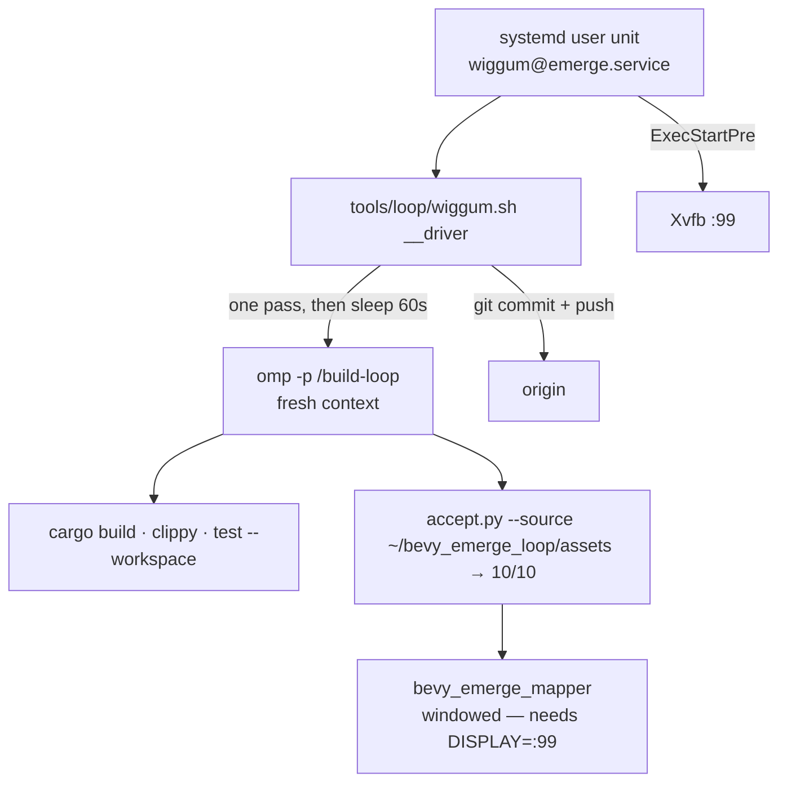

# The Wiggum loop on big

`build-loop` runs itself forever: one fresh `omp` process per pass, no session carried between them,
DeepSeek 4.1 Flash, and the repository as the only memory. This file is how to start it, stop it, and
read what it did.

## What runs what



**`WIGGUM_REPO` is `~/bevy_emerge_loop`,** a clean clone. It is deliberately **not** `~/bevy_emerge`,
which is the old 198-file rsync scratch tree — the driver refuses any tree with more than 40 modified
files, so pointing it at the scratch tree stops the loop instead of committing into it.

## Any repo, not just this one

The driver is repo-agnostic. `WIGGUM_REPO` is the clone, `WIGGUM_COMMAND` is the slash command a pass
runs, and both default sensibly:

```sh
WIGGUM_REPO=/path/to/bevy_elements WIGGUM_COMMAND=elements-loop ~/wiggum.sh start
WIGGUM_REPO=/path/to/bevy_debugger_mcp WIGGUM_COMMAND=bevy-debugger-loop ~/wiggum.sh start
WIGGUM_REPO=/path/to/anything WIGGUM_COMMAND=bevy-loop ~/wiggum.sh one   # foreground smoke test
```

**State is per repo and lives outside it**: `~/.local/state/wiggum/<repo-name>/`. A loop's own logs and
counters must never appear in a pass's `git status` — a dirty tree is the first thing a pass is told to
fix, and a driver writing bookkeeping into the tree would make every pass diagnose itself. One driver per
repo (the process marker carries the repo name), so two repos can run side by side.

`/bevy-loop` is the **generic** pass, installed at `~/.omp/agent/commands/bevy-loop.md`, for a repo that
has no loop command of its own: it discovers that repo's backlog/log/report convention first, creates the
smallest one that works if there is none, and never invents a second convention beside an existing one.
Prefer a repo's own command where it has one.

## Daily use

```sh
# on big
~/bevy_emerge_loop/tools/loop/wiggum.sh status   # running? how many passes? last lines
~/bevy_emerge_loop/tools/loop/wiggum.sh tail     # follow the driver's own log
~/bevy_emerge_loop/tools/loop/wiggum.sh stop     # finish the pass in flight, then exit

systemctl --user start wiggum@emerge          # the permanent way (enabled at boot)
systemctl --user stop wiggum@emerge           # finishes the pass first; see TimeoutStopSec
systemctl --user status wiggum@emerge
journalctl --user -u wiggum@emerge -f
```

**`stop` never kills a pass.** `systemctl --user stop` signals the whole cgroup, so the driver traps
SIGTERM and writes its stop file; the unit allows 50 minutes (`TimeoutStopSec=3000`) for the pass in
flight to finish. Otherwise a stop would kill an edit mid-write and the next pass would spend its budget
repairing the tree.

## Where the evidence is

| | |
|---|---|
| driver log | `~/target/emerge-loop/wiggum/driver.log` |
| each pass, full output | `~/target/emerge-loop/wiggum/passes/pass-NNNN-*.log` |
| systemd's view | `~/target/emerge-loop/wiggum/systemd.log` |
| what a pass did | `~/bevy_emerge_loop/docs/loop/iterations/`, `docs/loop/log.md` |
| what is still open | `~/bevy_emerge_loop/docs/loop/backlog.json` |

## Facts about big that shaped this

Measured, not assumed:

- **`accept.py` reaches 10/10** against the repo's own `assets/`, not the laptop's 11/11 — the `import`
  step needs a golem `.glb` fixture that is not on big.
- **The editor is windowed.** `main.rs` always builds a `Window`, so a display is mandatory and Xvfb
  `:99` is created by the unit. Without it the only acceptance gate fails every pass on a machine that
  otherwise builds perfectly — the worst kind of failure, because it looks like a code problem.
- **`perf.py` cannot run.** It times a live editor; there is no display to time.
- **Sanctuary is not on big.** Anything that needs `~/sanctuary` cannot happen here.
- **Its own `CARGO_TARGET_DIR` (`~/target/emerge-loop`).** The shared global target dir is a trap:
  workspace crates at one version share an artifact hash across checkouts, so a second tree on the
  shared dir makes cargo call the first tree's units Fresh and silently runs the wrong code.
- **`RUSTUP_TOOLCHAIN=1.98.1`.** big's `stable` is 1.99; the workspace is pinned.
- **It goes under the machine's other work** (`Nice=15`, `CARGO_BUILD_JOBS=8`). Measured: load average
  31 on 24 cores, 3 GB RAM free, while big served `hs-distill` and built `bevy_elements`.

## When the loop stops for good

The unit gives up after **5 failures inside an hour** (`StartLimitBurst`/`StartLimitIntervalSec`, both
`[Unit]` keys). Diagnose from the logs above, fix the cause, then:

```sh
systemctl --user reset-failed wiggum@emerge
systemctl --user start wiggum@emerge
```

Five stops worth checking first: a dirty tree (a killed pass), a full disk, git push failing, the `omp`
model name having changed, and a protected file that a pass thought it needed to edit. That last one is
by design: a pass may not edit `tools/loop/*.py`, the test files, or its own command, so a genuine need
there stops it with `status: "blocked"` for a human to run an evaluator pass.

## What it costs

One pass every ~30–60 minutes, 20–40 minutes of model time each. **There is no spend cap in the unit** —
`WIGGUM_MAX` bounds the pass count and defaults to 0 (forever). To bound it:

```sh
systemctl --user edit wiggum@emerge     # add Environment=WIGGUM_MAX=20
```
